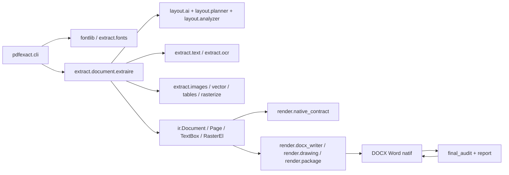

# Graphe d'architecture de pdfexact

Inventaire statique de **40 modules** et **639 fonctions/méthodes**.
Les relations d'appel sont résolues par AST ; les appels dynamiques peuvent ne pas être détectés.

## Pipeline principal

## Graphe complet

Le graphe détaillé fonction-par-fonction est fourni dans `architecture_graph.json` et `architecture_graph.dot`.
Le JSON contient les nœuds modules/fonctions et les arêtes `imports`/`calls`.

## Dépendances entre modules

```mermaid
flowchart TD
  pdfexact[pdfexact] --> pdfexact_cli[pdfexact.cli]
  pdfexact[pdfexact] --> pdfexact_report[pdfexact.report]
  pdfexact_cli[pdfexact.cli] --> pdfexact_extract_document[pdfexact.extract.document]
  pdfexact_cli[pdfexact.cli] --> pdfexact_extract_fonts[pdfexact.extract.fonts]
  pdfexact_cli[pdfexact.cli] --> pdfexact_extract_vector[pdfexact.extract.vector]
  pdfexact_cli[pdfexact.cli] --> pdfexact_final_audit[pdfexact.final_audit]
  pdfexact_cli[pdfexact.cli] --> pdfexact_font_fetcher[pdfexact.font_fetcher]
  pdfexact_cli[pdfexact.cli] --> pdfexact_fontlib[pdfexact.fontlib]
  pdfexact_cli[pdfexact.cli] --> pdfexact_ir[pdfexact.ir]
  pdfexact_cli[pdfexact.cli] --> pdfexact_layout_text_comprehension[pdfexact.layout.text_comprehension]
  pdfexact_cli[pdfexact.cli] --> pdfexact_layout_text_comprehension_ai[pdfexact.layout.text_comprehension_ai]
  pdfexact_cli[pdfexact.cli] --> pdfexact_render_native_contract[pdfexact.render.native_contract]
  pdfexact_cli[pdfexact.cli] --> pdfexact_render_package[pdfexact.render.package]
  pdfexact_cli[pdfexact.cli] --> pdfexact_report[pdfexact.report]
  pdfexact_extract_blocks[pdfexact.extract.blocks] --> pdfexact_geometry[pdfexact.geometry]
  pdfexact_extract_document[pdfexact.extract.document] --> pdfexact_extract_fonts[pdfexact.extract.fonts]
  pdfexact_extract_document[pdfexact.extract.document] --> pdfexact_extract_glyph_images[pdfexact.extract.glyph_images]
  pdfexact_extract_document[pdfexact.extract.document] --> pdfexact_extract_images[pdfexact.extract.images]
  pdfexact_extract_document[pdfexact.extract.document] --> pdfexact_extract_layout_map[pdfexact.extract.layout_map]
  pdfexact_extract_document[pdfexact.extract.document] --> pdfexact_extract_links[pdfexact.extract.links]
  pdfexact_extract_document[pdfexact.extract.document] --> pdfexact_extract_ocr[pdfexact.extract.ocr]
  pdfexact_extract_document[pdfexact.extract.document] --> pdfexact_extract_tables[pdfexact.extract.tables]
  pdfexact_extract_document[pdfexact.extract.document] --> pdfexact_extract_text[pdfexact.extract.text]
  pdfexact_extract_document[pdfexact.extract.document] --> pdfexact_extract_vector[pdfexact.extract.vector]
  pdfexact_extract_document[pdfexact.extract.document] --> pdfexact_fallback_rasterize[pdfexact.fallback.rasterize]
  pdfexact_extract_document[pdfexact.extract.document] --> pdfexact_geometry[pdfexact.geometry]
  pdfexact_extract_document[pdfexact.extract.document] --> pdfexact_ir[pdfexact.ir]
  pdfexact_extract_document[pdfexact.extract.document] --> pdfexact_layout[pdfexact.layout]
  pdfexact_extract_document[pdfexact.extract.document] --> pdfexact_report[pdfexact.report]
  pdfexact_extract_fonts[pdfexact.extract.fonts] --> pdfexact_fontlib[pdfexact.fontlib]
  pdfexact_extract_fonts[pdfexact.extract.fonts] --> pdfexact_ir[pdfexact.ir]
  pdfexact_extract_glyph_images[pdfexact.extract.glyph_images] --> pdfexact_fallback_rasterize[pdfexact.fallback.rasterize]
  pdfexact_extract_glyph_images[pdfexact.extract.glyph_images] --> pdfexact_geometry[pdfexact.geometry]
  pdfexact_extract_images[pdfexact.extract.images] --> pdfexact_fallback_rasterize[pdfexact.fallback.rasterize]
  pdfexact_extract_images[pdfexact.extract.images] --> pdfexact_geometry[pdfexact.geometry]
  pdfexact_extract_images[pdfexact.extract.images] --> pdfexact_ir[pdfexact.ir]
  pdfexact_extract_layout_map[pdfexact.extract.layout_map] --> pdfexact_geometry[pdfexact.geometry]
  pdfexact_extract_links[pdfexact.extract.links] --> pdfexact_geometry[pdfexact.geometry]
  pdfexact_extract_links[pdfexact.extract.links] --> pdfexact_ir[pdfexact.ir]
  pdfexact_extract_ocr[pdfexact.extract.ocr] --> pdfexact_extract_blocks[pdfexact.extract.blocks]
  pdfexact_extract_ocr[pdfexact.extract.ocr] --> pdfexact_extract_fonts[pdfexact.extract.fonts]
  pdfexact_extract_ocr[pdfexact.extract.ocr] --> pdfexact_extract_styles[pdfexact.extract.styles]
  pdfexact_extract_ocr[pdfexact.extract.ocr] --> pdfexact_extract_text[pdfexact.extract.text]
  pdfexact_extract_ocr[pdfexact.extract.ocr] --> pdfexact_fallback_rasterize[pdfexact.fallback.rasterize]
  pdfexact_extract_ocr[pdfexact.extract.ocr] --> pdfexact_geometry[pdfexact.geometry]
  pdfexact_extract_ocr[pdfexact.extract.ocr] --> pdfexact_ir[pdfexact.ir]
  pdfexact_extract_styles[pdfexact.extract.styles] --> pdfexact_extract_text[pdfexact.extract.text]
  pdfexact_extract_styles[pdfexact.extract.styles] --> pdfexact_geometry[pdfexact.geometry]
  pdfexact_extract_tables[pdfexact.extract.tables] --> pdfexact_extract_styles[pdfexact.extract.styles]
  pdfexact_extract_tables[pdfexact.extract.tables] --> pdfexact_extract_text[pdfexact.extract.text]
  pdfexact_extract_tables[pdfexact.extract.tables] --> pdfexact_geometry[pdfexact.geometry]
  pdfexact_extract_tables[pdfexact.extract.tables] --> pdfexact_ir[pdfexact.ir]
  pdfexact_extract_text[pdfexact.extract.text] --> pdfexact_extract_fonts[pdfexact.extract.fonts]
  pdfexact_extract_text[pdfexact.extract.text] --> pdfexact_fontlib[pdfexact.fontlib]
  pdfexact_extract_text[pdfexact.extract.text] --> pdfexact_geometry[pdfexact.geometry]
  pdfexact_extract_text[pdfexact.extract.text] --> pdfexact_ir[pdfexact.ir]
  pdfexact_extract_vector[pdfexact.extract.vector] --> pdfexact_geometry[pdfexact.geometry]
  pdfexact_extract_vector[pdfexact.extract.vector] --> pdfexact_ir[pdfexact.ir]
  pdfexact_fallback_rasterize[pdfexact.fallback.rasterize] --> pdfexact_geometry[pdfexact.geometry]
  pdfexact_fallback_rasterize[pdfexact.fallback.rasterize] --> pdfexact_ir[pdfexact.ir]
  pdfexact_final_audit[pdfexact.final_audit] --> pdfexact_fallback_rasterize[pdfexact.fallback.rasterize]
  pdfexact_final_audit[pdfexact.final_audit] --> pdfexact_geometry[pdfexact.geometry]
  pdfexact_final_audit[pdfexact.final_audit] --> pdfexact_ir[pdfexact.ir]
  pdfexact_final_audit[pdfexact.final_audit] --> pdfexact_layout_ai[pdfexact.layout.ai]
  pdfexact_final_audit[pdfexact.final_audit] --> pdfexact_layout_analyzer[pdfexact.layout.analyzer]
  pdfexact_final_audit[pdfexact.final_audit] --> pdfexact_render_package[pdfexact.render.package]
  pdfexact_final_audit[pdfexact.final_audit] --> pdfexact_report[pdfexact.report]
  pdfexact_font_fetcher[pdfexact.font_fetcher] --> pdfexact_fontlib[pdfexact.fontlib]
  pdfexact_fonts_cli[pdfexact.fonts_cli] --> pdfexact_font_fetcher[pdfexact.font_fetcher]
  pdfexact_fonts_cli[pdfexact.fonts_cli] --> pdfexact_fontlib[pdfexact.fontlib]
  pdfexact_ir[pdfexact.ir] --> pdfexact_geometry[pdfexact.geometry]
  pdfexact_layout[pdfexact.layout] --> pdfexact_layout_ai[pdfexact.layout.ai]
  pdfexact_layout[pdfexact.layout] --> pdfexact_layout_analyzer[pdfexact.layout.analyzer]
  pdfexact_layout[pdfexact.layout] --> pdfexact_layout_classifier[pdfexact.layout.classifier]
  pdfexact_layout[pdfexact.layout] --> pdfexact_layout_model[pdfexact.layout.model]
  pdfexact_layout[pdfexact.layout] --> pdfexact_layout_planner[pdfexact.layout.planner]
  pdfexact_layout[pdfexact.layout] --> pdfexact_layout_text_comprehension[pdfexact.layout.text_comprehension]
  pdfexact_layout[pdfexact.layout] --> pdfexact_layout_understanding[pdfexact.layout.understanding]
  pdfexact_layout_ai[pdfexact.layout.ai] --> pdfexact_geometry[pdfexact.geometry]
  pdfexact_layout_ai[pdfexact.layout.ai] --> pdfexact_layout_model[pdfexact.layout.model]
  pdfexact_layout_analyzer[pdfexact.layout.analyzer] --> pdfexact_geometry[pdfexact.geometry]
  pdfexact_layout_analyzer[pdfexact.layout.analyzer] --> pdfexact_layout_model[pdfexact.layout.model]
  pdfexact_layout_classifier[pdfexact.layout.classifier] --> pdfexact_geometry[pdfexact.geometry]
  pdfexact_layout_classifier[pdfexact.layout.classifier] --> pdfexact_layout_model[pdfexact.layout.model]
  pdfexact_layout_classifier[pdfexact.layout.classifier] --> pdfexact_layout_understanding[pdfexact.layout.understanding]
  pdfexact_layout_model[pdfexact.layout.model] --> pdfexact_geometry[pdfexact.geometry]
  pdfexact_layout_planner[pdfexact.layout.planner] --> pdfexact_geometry[pdfexact.geometry]
  pdfexact_layout_planner[pdfexact.layout.planner] --> pdfexact_ir[pdfexact.ir]
  pdfexact_layout_planner[pdfexact.layout.planner] --> pdfexact_layout_model[pdfexact.layout.model]
  pdfexact_layout_planner[pdfexact.layout.planner] --> pdfexact_layout_understanding[pdfexact.layout.understanding]
  pdfexact_layout_text_comprehension_ai[pdfexact.layout.text_comprehension_ai] --> pdfexact_layout_text_comprehension[pdfexact.layout.text_comprehension]
  pdfexact_layout_understanding[pdfexact.layout.understanding] --> pdfexact_geometry[pdfexact.geometry]
  pdfexact_layout_understanding[pdfexact.layout.understanding] --> pdfexact_ir[pdfexact.ir]
  pdfexact_layout_understanding[pdfexact.layout.understanding] --> pdfexact_layout_ai[pdfexact.layout.ai]
  pdfexact_layout_understanding[pdfexact.layout.understanding] --> pdfexact_layout_classifier[pdfexact.layout.classifier]
  pdfexact_render_docx_writer[pdfexact.render.docx_writer] --> pdfexact_extract_fonts[pdfexact.extract.fonts]
  pdfexact_render_docx_writer[pdfexact.render.docx_writer] --> pdfexact_geometry[pdfexact.geometry]
  pdfexact_render_docx_writer[pdfexact.render.docx_writer] --> pdfexact_ir[pdfexact.ir]
  pdfexact_render_docx_writer[pdfexact.render.docx_writer] --> pdfexact_layout_text_comprehension[pdfexact.layout.text_comprehension]
  pdfexact_render_docx_writer[pdfexact.render.docx_writer] --> pdfexact_render_drawing[pdfexact.render.drawing]
  pdfexact_render_drawing[pdfexact.render.drawing] --> pdfexact_extract_fonts[pdfexact.extract.fonts]
  pdfexact_render_drawing[pdfexact.render.drawing] --> pdfexact_geometry[pdfexact.geometry]
  pdfexact_render_drawing[pdfexact.render.drawing] --> pdfexact_ir[pdfexact.ir]
  pdfexact_render_native_contract[pdfexact.render.native_contract] --> pdfexact_geometry[pdfexact.geometry]
  pdfexact_render_native_contract[pdfexact.render.native_contract] --> pdfexact_ir[pdfexact.ir]
  pdfexact_render_native_contract[pdfexact.render.native_contract] --> pdfexact_layout_text_comprehension[pdfexact.layout.text_comprehension]
  pdfexact_render_package[pdfexact.render.package] --> pdfexact_ir[pdfexact.ir]
  pdfexact_render_package[pdfexact.render.package] --> pdfexact_render_docx_writer[pdfexact.render.docx_writer]
  pdfexact_render_package[pdfexact.render.package] --> pdfexact_render_fonts_embed[pdfexact.render.fonts_embed]
```

## Tableau exhaustif des fonctions

| Module | Fonction | Fichier:ligne | Description | Prend en entrée | Retourne | Reçoit de | Transmet à |
|---|---|---:|---|---|---|---|---|
| pdfexact.cli | analyser_pages | pdfexact/cli.py:21 | Traduit « 1-3,7 » en indices 0-based [0, 1, 2, 6]. | expression: str -> list[int] | list[int]; valeurs observées: indices | pdfexact.cli:main |  |
| pdfexact.cli | convertir | pdfexact/cli.py:42 | Convertit un PDF en docx. Retourne le rapport de conversion. | source, destination, pages=None, dpi: int=300, seuil_raster: int=SEUIL_CHEMINS_PAR_DEFAUT, strict: bool=False, dossiers_polices=None, rasteriser_pages: bool=False, text_mode: str='spans', ocr_layer: bool=False, ocr_lang: str='eng', ocr_visible: bool=False, ocr_granularity: str='word', ocr_layout: str='blocks', layout_ai: bool=False, layout_provider: str \| None=None, layout_model: str \| None=None, layout_model_root: str \| None=None, layout_device: str \| None=None, text_understanding_ai: bool=False, text_understanding_url: str \| None=None, text_understanding_timeout: float=3.0, fetch_missing_fonts: bool=False, font_cache_dir: str='fonts/local', final_audit: bool=False, final_audit_dpi: int=120, verbose: bool=False -> Rapport | Rapport; valeurs observées: rapport | pdfexact.cli:main | pdfexact.cli:_compter_textes_positionnes, pdfexact.extract.document:extraire, pdfexact.extract.fonts:collecter_polices, pdfexact.final_audit:certifier_et_reparer, pdfexact.font_fetcher:telecharger_polices_manquantes, pdfexact.fontlib:construire, pdfexact.fontlib:dossiers_par_defaut, pdfexact.layout.text_comprehension:configurer_fournisseur_comprehension_texte, pdfexact.layout.text_comprehension_ai:creer_fournisseur_comprehension_texte_ai, pdfexact.render.native_contract:corriger_document_word_native, pdfexact.render.native_contract:inspecter_docx_word_native, pdfexact.render.package:ecrire_docx |
| pdfexact.cli | _compter_textes_positionnes | pdfexact/cli.py:228 | Fonction _compter_textes_positionnes | document -> int | int; valeurs observées: total | pdfexact.cli:convertir |  |
| pdfexact.cli | _analyseur | pdfexact/cli.py:244 | Fonction _analyseur | -> argparse.ArgumentParser | argparse.ArgumentParser; valeurs observées: analyseur | pdfexact.cli:main |  |
| pdfexact.cli | main | pdfexact/cli.py:398 | Fonction main | argv=None -> int | int; valeurs observées: 0 \| 2 \| 1 |  | pdfexact.cli:_analyseur, pdfexact.cli:analyser_pages, pdfexact.cli:convertir |
| pdfexact.extract.blocks | _aire | pdfexact/extract/blocks.py:27 | Fonction _aire | boite: BBox -> int | int; valeurs observées: max(0, boite.largeur) * max(0, boite.hauteur) | pdfexact.extract.blocks:ratio_couverture |  |
| pdfexact.extract.blocks | ratio_couverture | pdfexact/extract/blocks.py:31 | Fonction ratio_couverture | boite: BBox, zone: BBox -> float | float; valeurs observées: intersection / aire if aire else 0.0 | pdfexact.extract.blocks:est_dans_zone | pdfexact.extract.blocks:_aire |
| pdfexact.extract.blocks | centre_dans | pdfexact/extract/blocks.py:41 | Fonction centre_dans | boite: BBox, zone: BBox -> bool | bool; valeurs observées: zone.x0 <= x <= zone.x1 and zone.y0 <= y <= zone.y1 | pdfexact.extract.ocr:extraire_rapidocr |  |
| pdfexact.extract.blocks | est_dans_zone | pdfexact/extract/blocks.py:47 | Fonction est_dans_zone | boite: BBox, zones: list[BBox], seuil: float=0.25 -> bool | bool; valeurs observées: any((ratio_couverture(boite, zone) > seuil for zone in zones)) | pdfexact.extract.blocks:detecter_blocs_texte, pdfexact.extract.ocr:_est_dans_zone_ignoree | pdfexact.extract.blocks:ratio_couverture |
| pdfexact.extract.blocks | _proche_verticalement | pdfexact/extract/blocks.py:51 | Fonction _proche_verticalement | precedente: BBox, courante: BBox -> bool | bool; valeurs observées: ecart <= hauteur * 1.9 | pdfexact.extract.blocks:detecter_blocs_texte |  |
| pdfexact.extract.blocks | _compatible_horizontalement | pdfexact/extract/blocks.py:57 | Fonction _compatible_horizontalement | a: BBox, b: BBox -> bool | bool; valeurs observées: chevauchement / largeur_min > 0.2 or proches | pdfexact.extract.blocks:detecter_blocs_texte |  |
| pdfexact.extract.blocks | detecter_blocs_texte | pdfexact/extract/blocks.py:64 | Groupe les lignes OCR en blocs texte, hors figures/formules. | lignes: list[OcrLine], zones_non_texte: list[BBox] -> list[PageBlock] | list[PageBlock]; valeurs observées: blocs | pdfexact.extract.blocks:detecter_blocs_page | pdfexact.extract.blocks:_compatible_horizontalement, pdfexact.extract.blocks:_proche_verticalement, pdfexact.extract.blocks:est_dans_zone, pdfexact.geometry:union |
| pdfexact.extract.blocks | detecter_blocs_page | pdfexact/extract/blocks.py:107 | Fonction detecter_blocs_page | lignes: list[OcrLine], zones_non_texte: list[BBox] -> list[PageBlock] | list[PageBlock]; valeurs observées: blocs | pdfexact.extract.ocr:extraire_rapidocr | pdfexact.extract.blocks:detecter_blocs_texte |
| pdfexact.extract.document | _aire | pdfexact/extract/document.py:74 | Fonction _aire | bbox: BBox -> int | int; valeurs observées: max(0, bbox.largeur) * max(0, bbox.hauteur) | pdfexact.extract.document:_bbox_texte_intersecte_zone, pdfexact.extract.document:_element_texte_intersecte_zone, pdfexact.extract.document:_fond_vectoriel_significatif, pdfexact.extract.document:_page_image_pleine_sans_texte_natif, pdfexact.extract.document:_page_pdf_natif_dominant, pdfexact.extract.document:_recouvrement_min, pdfexact.extract.document:_recouvrement_source, pdfexact.extract.document:_tableau_confirme_par_layout_ia, pdfexact.extract.document:_tableau_ressemble_bandeau_entete, pdfexact.extract.document:_zone_visuelle_garde_texte_original, pdfexact.extract.document:_zones_images_lisibles_ocr, pdfexact.extract.document:_zones_visuelles_ia_a_rasteriser |  |
| pdfexact.extract.document | _intersection | pdfexact/extract/document.py:78 | Fonction _intersection | a: BBox, b: BBox -> int | int; valeurs observées: max(0, x1 - x0) * max(0, y1 - y0) | pdfexact.extract.document:_bbox_texte_intersecte_zone, pdfexact.extract.document:_element_texte_intersecte_zone, pdfexact.extract.document:_recouvrement_min, pdfexact.extract.document:_recouvrement_source, pdfexact.extract.document:_tableau_ressemble_bandeau_entete, pdfexact.extract.document:_zone_contient_lignes_natives, pdfexact.extract.document:_zone_touche_tableau |  |
| pdfexact.extract.document | _recouvrement_min | pdfexact/extract/document.py:86 | Fonction _recouvrement_min | a: BBox, b: BBox -> float | float; valeurs observées: _intersection(a, b) / max(min(_aire(a), _aire(b)), 1) | pdfexact.extract.document:_dedoublonner_cadres_lecture, pdfexact.extract.document:_filtrer_zones_images_avec_texte_natif, pdfexact.extract.document:_lignes_dupliquees, pdfexact.extract.document:_remplir_page, pdfexact.extract.document:_tableau_confirme_par_layout_ia, pdfexact.extract.document:_zone_deja_couverte, pdfexact.extract.document:_zone_touche_tableau | pdfexact.extract.document:_aire, pdfexact.extract.document:_intersection |
| pdfexact.extract.document | _recouvrement_source | pdfexact/extract/document.py:90 | Fonction _recouvrement_source | a: BBox, b: BBox -> float | float; valeurs observées: _intersection(a, b) / max(_aire(a), 1) | pdfexact.extract.document:_cadres_hors_couverture, pdfexact.extract.document:_element_texte_couvert_par_zone, pdfexact.extract.document:_element_visuel_couvert_par_zone, pdfexact.extract.document:_forme_couverte_par_zone, pdfexact.extract.document:_tableau_confirme_par_layout_ia, pdfexact.extract.document:_zone_contient_lignes_natives, pdfexact.extract.document:_zone_source_deja_couverte | pdfexact.extract.document:_aire, pdfexact.extract.document:_intersection |
| pdfexact.extract.document | _zone_deja_couverte | pdfexact/extract/document.py:94 | Fonction _zone_deja_couverte | zone: BBox, zones: list[BBox], seuil: float=0.7 -> bool | bool; valeurs observées: any((_recouvrement_min(zone, existante) >= seuil for existante in zones)) | pdfexact.extract.document:_filtrer_zones_lisibles_ocr, pdfexact.extract.document:_remplir_page | pdfexact.extract.document:_recouvrement_min |
| pdfexact.extract.document | _bbox_intersecte_page | pdfexact/extract/document.py:98 | Fonction _bbox_intersecte_page | bbox: BBox, page: Page -> bool | bool; valeurs observées: min(bbox.x1, page.largeur_emu) > max(bbox.x0, 0) and min(bbox.y1, page.hauteur_emu) > max(bbox.y0, 0 | pdfexact.extract.document:_remplir_page |  |
| pdfexact.extract.document | _zone_source_deja_couverte | pdfexact/extract/document.py:105 | Fonction _zone_source_deja_couverte | zone: BBox, zones: list[BBox], seuil: float=0.75 -> bool | bool; valeurs observées: any((_recouvrement_source(zone, existante) >= seuil for existante in zones)) | pdfexact.extract.document:_zones_formules_a_rasteriser, pdfexact.extract.document:_zones_visuelles_ia_a_rasteriser | pdfexact.extract.document:_recouvrement_source |
| pdfexact.extract.document | _zone_rasterisable | pdfexact/extract/document.py:109 | Fonction _zone_rasterisable | zone: BBox, page: Page -> bool | bool; valeurs observées: largeur * hauteur >= pt_vers_emu(2.0) * pt_vers_emu(2.0) \| False | pdfexact.extract.document:_remplir_page | pdfexact.geometry:pt_vers_emu |
| pdfexact.extract.document | _page_image_pleine_sans_texte_natif | pdfexact/extract/document.py:117 | Fonction _page_image_pleine_sans_texte_natif | zones_images_source: list[BBox], lignes_natives: list[BBox], page: Page -> bool | bool; valeurs observées: any((_aire(zone) / aire_page >= 0.82 and zone.largeur >= page.largeur_emu * 0.8 and (zone.hauteur >= \| False | pdfexact.extract.document:_remplir_page | pdfexact.extract.document:_aire |
| pdfexact.extract.document | _page_pdf_natif_dominant | pdfexact/extract/document.py:133 | Vrai pour les pages texte PDF natives où l'OCR massif est risqué. | lignes_natives: list[BBox], zones_images_source: list[BBox], page: Page -> bool | bool; valeurs observées: len(lignes_utiles) >= 12 \| False | pdfexact.extract.document:_remplir_page | pdfexact.extract.document:_aire, pdfexact.geometry:pt_vers_emu |
| pdfexact.extract.document | _extraire_texte_pdf_natif_word_native | pdfexact/extract/document.py:158 | Fonction _extraire_texte_pdf_natif_word_native | page_pdf, polices: dict, plan_layout, zones_images: list[BBox], zones_textes_visuelles_natives: list[BBox], page_ir: Page, document: Document -> list[TextBox] | list[TextBox]; valeurs observées: elements_natifs | pdfexact.extract.document:_remplir_page | pdfexact.extract.document:_attacher_frames_texte, pdfexact.extract.document:_filtrer_textes_intersectant_zones, pdfexact.extract.document:_zones_formules_du_plan, pdfexact.extract.text:extraire_texte, pdfexact.fallback.rasterize:nettoyer_images_fond_texte_positionne, pdfexact.layout.planner:filtrer_elements_selon_plan |
| pdfexact.extract.document | _zones_formules_du_plan | pdfexact/extract/document.py:184 | Fonction _zones_formules_du_plan | plan, lignes_natives: list[BBox] \| None=None, page: Page \| None=None -> list[BBox] | list[BBox]; valeurs observées: [item.bbox for item in plan if item.kind in {'formula', 'formula-or-complex-vector'} and item.strate \| [] | pdfexact.extract.document:_extraire_texte_pdf_natif_word_native, pdfexact.extract.document:_zones_formules_a_rasteriser | pdfexact.extract.document:_zone_formule_inline_dans_texte |
| pdfexact.extract.document | _zone_formule_inline_dans_texte | pdfexact/extract/document.py:200 | Fonction _zone_formule_inline_dans_texte | zone: BBox, lignes_natives: list[BBox], page: Page \| None -> bool | bool; valeurs observées: False \| True | pdfexact.extract.document:_zones_formules_du_plan | pdfexact.geometry:pt_vers_emu |
| pdfexact.extract.document | _preparer_ocr_visible_page_image | pdfexact/extract/document.py:223 | Fonction _preparer_ocr_visible_page_image | elements: list -> int | int; valeurs observées: lignes | pdfexact.extract.document:_remplir_page |  |
| pdfexact.extract.document | _styliser_ocr_depuis_image_scanee | pdfexact/extract/document.py:238 | Fonction _styliser_ocr_depuis_image_scanee | page_pdf, elements: list, geometrie: PageGeometry -> None | None | pdfexact.extract.document:_remplir_page | pdfexact.extract.document:_couleur_texte_depuis_rendu |
| pdfexact.extract.document | _couleur_texte_depuis_rendu | pdfexact/extract/document.py:250 | Fonction _couleur_texte_depuis_rendu | page_pdf, bbox: BBox, geometrie: PageGeometry -> str | str; valeurs observées: '000000' \| 'FFFFFF' | pdfexact.extract.document:_styliser_ocr_depuis_image_scanee | pdfexact.extract.document:_mediane, pdfexact.geometry:emu_vers_pt |
| pdfexact.extract.document | _mediane | pdfexact/extract/document.py:293 | Fonction _mediane | valeurs: list[float] -> float | float; valeurs observées: valeurs[len(valeurs) // 2] | pdfexact.extract.document:_couleur_texte_depuis_rendu |  |
| pdfexact.extract.document | _zone_touche_tableau | pdfexact/extract/document.py:298 | Fonction _zone_touche_tableau | zone: BBox, tableaux: list[TableEl], seuil: float=0.04 -> bool | bool; valeurs observées: False \| True | pdfexact.extract.document:_remplir_page | pdfexact.extract.document:_intersection, pdfexact.extract.document:_recouvrement_min |
| pdfexact.extract.document | _tableau_ressemble_graphe | pdfexact/extract/document.py:307 | Fonction _tableau_ressemble_graphe | tableau: TableEl -> bool | bool; valeurs observées: marqueurs_graphe >= 1 and (vides_ratio >= 0.25 or ratio_axes >= 0.35 or len(tableau.rows) <= 3 or (l \| False \| True | pdfexact.extract.document:_remplir_page |  |
| pdfexact.extract.document | _tableau_ressemble_bandeau_entete | pdfexact/extract/document.py:374 | Fonction _tableau_ressemble_bandeau_entete | tableau: TableEl, lignes_natives: list[BBox], hauteur_page_emu: int -> bool | bool; valeurs observées: 1 <= len(lignes) <= 8 \| False | pdfexact.extract.document:_remplir_page | pdfexact.extract.document:_aire, pdfexact.extract.document:_intersection, pdfexact.geometry:pt_vers_emu |
| pdfexact.extract.document | _filtrer_tableaux_contredits_par_ia | pdfexact/extract/document.py:391 | Fonction _filtrer_tableaux_contredits_par_ia | tableaux: list[TableEl], zones_ia, largeur_page_emu: int, hauteur_page_emu: int, *, actif: bool -> list[TableEl] | list[TableEl]; valeurs observées: [tableau for tableau in tableaux if _tableau_confirme_par_layout_ia(tableau, zones_ia, largeur_page_ \| tableaux | pdfexact.extract.document:_remplir_page | pdfexact.extract.document:_tableau_confirme_par_layout_ia |
| pdfexact.extract.document | _tableau_confirme_par_layout_ia | pdfexact/extract/document.py:408 | Fonction _tableau_confirme_par_layout_ia | tableau: TableEl, zones_ia, largeur_page_emu: int, hauteur_page_emu: int -> bool | bool; valeurs observées: True \| False | pdfexact.extract.document:_filtrer_tableaux_contredits_par_ia | pdfexact.extract.document:_aire, pdfexact.extract.document:_recouvrement_min, pdfexact.extract.document:_recouvrement_source |
| pdfexact.extract.document | _forme_couverte_par_zone | pdfexact/extract/document.py:443 | Fonction _forme_couverte_par_zone | forme: ShapeEl, zones: list[BBox], seuil: float=0.55 -> bool | bool; valeurs observées: any((_recouvrement_source(forme.bbox, zone) >= seuil for zone in zones)) | pdfexact.extract.document:_filtrer_formes_couvertes, pdfexact.extract.document:_remplir_page | pdfexact.extract.document:_recouvrement_source |
| pdfexact.extract.document | _filtrer_formes_couvertes | pdfexact/extract/document.py:447 | Fonction _filtrer_formes_couvertes | elements: list, zones: list[BBox] -> list | list; valeurs observées: [element for element in elements if not (isinstance(element, ShapeEl) and _forme_couverte_par_zone(e \| elements | pdfexact.extract.document:_remplir_page | pdfexact.extract.document:_forme_couverte_par_zone |
| pdfexact.extract.document | _element_visuel_couvert_par_zone | pdfexact/extract/document.py:457 | Fonction _element_visuel_couvert_par_zone | element, zones: list[BBox], seuil: float=0.7 -> bool | bool; valeurs observées: any((_recouvrement_source(element.bbox, zone) >= seuil for zone in zones)) \| False | pdfexact.extract.document:_filtrer_elements_visuels_couverts, pdfexact.extract.document:_remplir_page | pdfexact.extract.document:_recouvrement_source |
| pdfexact.extract.document | _filtrer_elements_visuels_couverts | pdfexact/extract/document.py:463 | Fonction _filtrer_elements_visuels_couverts | elements: list, zones: list[BBox] -> list | list; valeurs observées: [element for element in elements if not _element_visuel_couvert_par_zone(element, zones)] \| elements | pdfexact.extract.document:_remplir_page | pdfexact.extract.document:_element_visuel_couvert_par_zone |
| pdfexact.extract.document | _element_texte_couvert_par_zone | pdfexact/extract/document.py:473 | Fonction _element_texte_couvert_par_zone | element, zones: list[BBox], seuil: float=0.22 -> bool | bool; valeurs observées: False \| True | pdfexact.extract.document:_filtrer_textes_couverts | pdfexact.extract.document:_recouvrement_source |
| pdfexact.extract.document | _filtrer_textes_couverts | pdfexact/extract/document.py:489 | Fonction _filtrer_textes_couverts | elements: list, zones: list[BBox] -> list | list; valeurs observées: [element for element in elements if not _element_texte_couvert_par_zone(element, zones)] \| elements |  | pdfexact.extract.document:_element_texte_couvert_par_zone |
| pdfexact.extract.document | _bbox_texte_elementaires | pdfexact/extract/document.py:499 | Fonction _bbox_texte_elementaires | element -> list[BBox] | list[BBox]; valeurs observées: bboxes | pdfexact.extract.document:_element_texte_intersecte_zone |  |
| pdfexact.extract.document | _element_texte_intersecte_zone | pdfexact/extract/document.py:513 | Fonction _element_texte_intersecte_zone | element, zones: list[BBox] -> bool | bool; valeurs observées: False \| True | pdfexact.extract.document:_filtrer_textes_intersectant_zones | pdfexact.extract.document:_aire, pdfexact.extract.document:_bbox_texte_elementaires, pdfexact.extract.document:_intersection |
| pdfexact.extract.document | _filtrer_textes_intersectant_zones | pdfexact/extract/document.py:527 | Fonction _filtrer_textes_intersectant_zones | elements: list, zones: list[BBox] -> list | list; valeurs observées: filtres \| elements | pdfexact.extract.document:_extraire_texte_pdf_natif_word_native, pdfexact.extract.document:_remplir_page | pdfexact.extract.document:_element_texte_intersecte_zone, pdfexact.extract.document:_ligne_sans_spans_intersectant_zones, pdfexact.geometry:union |
| pdfexact.extract.document | _ligne_sans_spans_intersectant_zones | pdfexact/extract/document.py:558 | Fonction _ligne_sans_spans_intersectant_zones | ligne: Line, zones: list[BBox] -> Line \| None | Line \| None; valeurs observées: Line(bbox=bbox, spans=spans, hauteur_ligne_emu=ligne.hauteur_ligne_emu, largeur_cible_emu=max(bbox.l \| None if _bbox_texte_intersecte_zone(ligne.bbox, ligne.spans, zones) else ligne \| None | pdfexact.extract.document:_filtrer_textes_intersectant_zones | pdfexact.extract.document:_bbox_texte_intersecte_zone, pdfexact.geometry:union |
| pdfexact.extract.document | _bbox_texte_intersecte_zone | pdfexact/extract/document.py:586 | Fonction _bbox_texte_intersecte_zone | bbox: BBox, spans: list[Span], zones: list[BBox] -> bool | bool; valeurs observées: aire_couverte / max(aire_totale, 1) >= 0.35 | pdfexact.extract.document:_ligne_sans_spans_intersectant_zones | pdfexact.extract.document:_aire, pdfexact.extract.document:_intersection |
| pdfexact.extract.document | _zone_contient_lignes_natives | pdfexact/extract/document.py:604 | Fonction _zone_contient_lignes_natives | zone: BBox, lignes_natives: list[BBox], minimum: int=2 -> bool | bool; valeurs observées: False \| True | pdfexact.extract.document:_filtrer_zones_images_avec_texte_natif | pdfexact.extract.document:_intersection, pdfexact.extract.document:_recouvrement_source |
| pdfexact.extract.document | _filtrer_zones_images_avec_texte_natif | pdfexact/extract/document.py:620 | Fonction _filtrer_zones_images_avec_texte_natif | zones_ignorees: list[BBox], zones_images_source: list[BBox], lignes_natives: list[BBox] -> list[BBox] | list[BBox]; valeurs observées: zones_filtrees \| zones_ignorees | pdfexact.extract.document:_remplir_page | pdfexact.extract.document:_recouvrement_min, pdfexact.extract.document:_zone_contient_lignes_natives |
| pdfexact.extract.document | _zones_images_lisibles_ocr | pdfexact/extract/document.py:636 | Grandes images de page pouvant contenir du texte à reconstruire en Word natif. | zones_images_source: list[BBox], page: Page -> list[BBox] | list[BBox]; valeurs observées: _dedoublonner_cadres_lecture(lisibles) \| [] | pdfexact.extract.document:_remplir_page | pdfexact.extract.document:_aire, pdfexact.extract.document:_dedoublonner_cadres_lecture |
| pdfexact.extract.document | _filtrer_zones_lisibles_ocr | pdfexact/extract/document.py:651 | Fonction _filtrer_zones_lisibles_ocr | zones_ignorees: list[BBox], zones_lisibles: list[BBox] -> list[BBox] | list[BBox]; valeurs observées: [zone for zone in zones_ignorees if not _zone_deja_couverte(zone, zones_lisibles, seuil=0.82)] \| zones_ignorees | pdfexact.extract.document:_remplir_page | pdfexact.extract.document:_zone_deja_couverte |
| pdfexact.extract.document | _zones_visuelles_ia_a_rasteriser | pdfexact/extract/document.py:661 | Fonction _zones_visuelles_ia_a_rasteriser | plan, zones_existantes: list[BBox], page: Page -> list[BBox] | list[BBox]; valeurs observées: zones | pdfexact.extract.document:_remplir_page | pdfexact.extract.document:_aire, pdfexact.extract.document:_zone_source_deja_couverte |
| pdfexact.extract.document | _zones_formules_a_rasteriser | pdfexact/extract/document.py:680 | Fonction _zones_formules_a_rasteriser | plan, zones_existantes: list[BBox], lignes_natives: list[BBox] \| None=None, page: Page \| None=None -> list[BBox] | list[BBox]; valeurs observées: zones | pdfexact.extract.document:_remplir_page | pdfexact.extract.document:_zone_source_deja_couverte, pdfexact.extract.document:_zones_formules_du_plan |
| pdfexact.extract.document | _texte_blanc_sur_fond | pdfexact/extract/document.py:694 | Fonction _texte_blanc_sur_fond | paragraphe: FlowParagraph -> bool | bool; valeurs observées: emu_vers_pt(paragraphe.bbox.largeur) >= 80 and emu_vers_pt(paragraphe.bbox.hauteur) <= 42 \| False | pdfexact.extract.document:_fonds_synthetiques_texte_inverse | pdfexact.geometry:emu_vers_pt |
| pdfexact.extract.document | _couleur_int_vers_rgb | pdfexact/extract/document.py:700 | Fonction _couleur_int_vers_rgb | couleur: int \| None -> tuple[int, int, int] | tuple[int, int, int]; valeurs observées: (valeur >> 16 & 255, valeur >> 8 & 255, valeur & 255) | pdfexact.extract.document:_couleur_presque_blanche |  |
| pdfexact.extract.document | _couleur_presque_blanche | pdfexact/extract/document.py:705 | Fonction _couleur_presque_blanche | couleur: int \| None -> bool | bool; valeurs observées: r >= 244 and g >= 244 and (b >= 244) | pdfexact.extract.document:_zone_contient_texte_blanc_natif | pdfexact.extract.document:_couleur_int_vers_rgb |
| pdfexact.extract.document | _zone_contient_texte_blanc_natif | pdfexact/extract/document.py:710 | Fonction _zone_contient_texte_blanc_natif | page_pdf, zone: BBox, geometrie: PageGeometry -> tuple[int, float] | tuple[int, float]; valeurs observées: (caracteres, taille_max) | pdfexact.extract.document:_zone_visuelle_garde_texte_original | pdfexact.extract.document:_couleur_presque_blanche, pdfexact.geometry:emu_vers_pt |
| pdfexact.extract.document | _ratio_fond_colore_sombre | pdfexact/extract/document.py:746 | Fonction _ratio_fond_colore_sombre | page_pdf, zone: BBox, geometrie: PageGeometry -> float | float; valeurs observées: actifs / max(total, 1) \| 0.0 | pdfexact.extract.document:_zone_visuelle_garde_texte_original | pdfexact.geometry:emu_vers_pt |
| pdfexact.extract.document | _zone_visuelle_garde_texte_original | pdfexact/extract/document.py:775 | Fonction _zone_visuelle_garde_texte_original | page_pdf, zone: BBox, page: Page, geometrie: PageGeometry -> bool | bool; valeurs observées: _ratio_fond_colore_sombre(page_pdf, zone, geometrie) >= 0.28 \| False | pdfexact.extract.document:_remplir_page | pdfexact.extract.document:_aire, pdfexact.extract.document:_ratio_fond_colore_sombre, pdfexact.extract.document:_zone_contient_texte_blanc_natif |
| pdfexact.extract.document | _bande_fond_depuis_rendu | pdfexact/extract/document.py:790 | Fonction _bande_fond_depuis_rendu | page_pdf, bbox: BBox, geometrie: PageGeometry -> tuple[BBox, str] \| None | tuple[BBox, str] \| None; valeurs observées: (bande, f'{r:02X}{g:02X}{b:02X}') \| None | pdfexact.extract.document:_fonds_synthetiques_texte_inverse | pdfexact.geometry:emu_vers_pt, pdfexact.geometry:pt_vers_emu |
| pdfexact.extract.document | _fonds_synthetiques_texte_inverse | pdfexact/extract/document.py:851 | Fonction _fonds_synthetiques_texte_inverse | page_pdf, elements_ocr: list, page_ir: Page, geometrie: PageGeometry -> list[ShapeEl] | list[ShapeEl]; valeurs observées: fonds | pdfexact.extract.document:_remplir_page | pdfexact.extract.document:_bande_fond_depuis_rendu, pdfexact.extract.document:_texte_blanc_sur_fond, pdfexact.geometry:se_chevauchent |
| pdfexact.extract.document | _limiter_bbox_page | pdfexact/extract/document.py:878 | Fonction _limiter_bbox_page | bbox: BBox, page: Page -> BBox | BBox; valeurs observées: BBox(x0, y0, x1, y1) | pdfexact.extract.document:_qbbox |  |
| pdfexact.extract.document | _qbbox | pdfexact/extract/document.py:886 | Fonction _qbbox | bbox: BBox, page: Page -> BBox | BBox; valeurs observées: _limiter_bbox_page(quantifier_bbox(bbox), page) | pdfexact.extract.document:_quantifier_element, pdfexact.extract.document:_quantifier_ligne, pdfexact.extract.document:_quantifier_span | pdfexact.extract.document:_limiter_bbox_page, pdfexact.geometry:quantifier_bbox |
| pdfexact.extract.document | _quantifier_span | pdfexact/extract/document.py:890 | Fonction _quantifier_span | span: Span, page: Page -> None | None | pdfexact.extract.document:_quantifier_element, pdfexact.extract.document:_quantifier_ligne | pdfexact.extract.document:_qbbox |
| pdfexact.extract.document | _quantifier_ligne | pdfexact/extract/document.py:895 | Fonction _quantifier_ligne | ligne: Line, page: Page -> None | None | pdfexact.extract.document:_quantifier_element | pdfexact.extract.document:_qbbox, pdfexact.extract.document:_quantifier_span, pdfexact.geometry:quantifier_coord |
| pdfexact.extract.document | _quantifier_element | pdfexact/extract/document.py:903 | Fonction _quantifier_element | element, page: Page -> None | None | pdfexact.extract.document:_quantifier_page | pdfexact.extract.document:_qbbox, pdfexact.extract.document:_quantifier_ligne, pdfexact.extract.document:_quantifier_span, pdfexact.geometry:quantifier_coord |
| pdfexact.extract.document | _quantifier_page | pdfexact/extract/document.py:945 | Fonction _quantifier_page | page: Page -> None | None | pdfexact.extract.document:extraire | pdfexact.extract.document:_quantifier_element |
| pdfexact.extract.document | _cadres_lecture_depuis_comprehension | pdfexact/extract/document.py:950 | Fonction _cadres_lecture_depuis_comprehension | comprehension -> list[BBox] | list[BBox]; valeurs observées: [element.bbox for element in comprehension.elements if element.strategy == 'word-text' and element.r \| [] | pdfexact.extract.document:_remplir_page |  |
| pdfexact.extract.document | _cadres_lecture_depuis_plan | pdfexact/extract/document.py:961 | Fonction _cadres_lecture_depuis_plan | plan -> list[BBox] | list[BBox]; valeurs observées: _dedoublonner_cadres_lecture(cadres) | pdfexact.extract.document:_remplir_page | pdfexact.extract.document:_cadres_hors_couverture, pdfexact.extract.document:_dedoublonner_cadres_lecture, pdfexact.extract.document:_fusionner_cadres_lecture |
| pdfexact.extract.document | _fusionner_cadres_lecture | pdfexact/extract/document.py:1002 | Fonction _fusionner_cadres_lecture | cadres: list[BBox] -> list[BBox] | list[BBox]; valeurs observées: sorted(clusters, key=lambda bbox: (bbox.x0, bbox.y0)) \| [] | pdfexact.extract.document:_cadres_lecture_depuis_plan | pdfexact.extract.document:_score_meme_cadre_lecture, pdfexact.geometry:pt_vers_emu, pdfexact.geometry:union |
| pdfexact.extract.document | _score_meme_cadre_lecture | pdfexact/extract/document.py:1025 | Fonction _score_meme_cadre_lecture | a: BBox, b: BBox -> float | float; valeurs observées: 0.0 \| 2.0 + ratio_x \| 1.5 + ratio_x | pdfexact.extract.document:_fusionner_cadres_lecture | pdfexact.geometry:pt_vers_emu |
| pdfexact.extract.document | _cadres_hors_couverture | pdfexact/extract/document.py:1047 | Fonction _cadres_hors_couverture | cadres: list[BBox], reference: list[BBox] -> list[BBox] | list[BBox]; valeurs observées: [cadre for cadre in cadres if not any((_recouvrement_source(cadre, ref) >= 0.8 for ref in reference) \| cadres | pdfexact.extract.document:_cadres_lecture_depuis_plan | pdfexact.extract.document:_recouvrement_source |
| pdfexact.extract.document | _dedoublonner_cadres_lecture | pdfexact/extract/document.py:1053 | Fonction _dedoublonner_cadres_lecture | cadres: list[BBox] -> list[BBox] | list[BBox]; valeurs observées: sorted(resultat, key=lambda bbox: (bbox.x0, bbox.y0)) | pdfexact.extract.document:_cadres_lecture_depuis_plan, pdfexact.extract.document:_remplir_page, pdfexact.extract.document:_zones_images_lisibles_ocr | pdfexact.extract.document:_recouvrement_min |
| pdfexact.extract.document | _attacher_frames_texte | pdfexact/extract/document.py:1062 | Associe chaque ligne native au frame de compréhension qui la contient. | elements: list, plan -> list | list; valeurs observées: elements | pdfexact.extract.document:_extraire_texte_pdf_natif_word_native, pdfexact.extract.document:_remplir_page | pdfexact.extract.document:_meilleur_frame_ligne |
| pdfexact.extract.document | _meilleur_frame_ligne | pdfexact/extract/document.py:1102 | Fonction _meilleur_frame_ligne | bbox: BBox, frames -> tuple[int, object] \| None | tuple[int, object] \| None; valeurs observées: meilleur | pdfexact.extract.document:_attacher_frames_texte | pdfexact.geometry:se_chevauchent |
| pdfexact.extract.document | _dedoublonner_textes_positionnes | pdfexact/extract/document.py:1131 | Fonction _dedoublonner_textes_positionnes | page: Page -> None | None | pdfexact.extract.document:_remplir_page | pdfexact.extract.document:_compact_textbox_line, pdfexact.extract.document:_lignes_dupliquees, pdfexact.extract.document:_meilleur_texte_duplique |
| pdfexact.extract.document | _compact_textbox_line | pdfexact/extract/document.py:1160 | Fonction _compact_textbox_line | ligne: Line -> str | str; valeurs observées: re.sub('\\s+', ' ', texte) | pdfexact.extract.document:_dedoublonner_textes_positionnes |  |
| pdfexact.extract.document | _lignes_dupliquees | pdfexact/extract/document.py:1165 | Fonction _lignes_dupliquees | a: BBox, b: BBox -> bool | bool; valeurs observées: dx <= pt_vers_emu(3) and dy <= pt_vers_emu(3) \| True | pdfexact.extract.document:_dedoublonner_textes_positionnes | pdfexact.extract.document:_recouvrement_min, pdfexact.geometry:pt_vers_emu, pdfexact.geometry:se_chevauchent |
| pdfexact.extract.document | _meilleur_texte_duplique | pdfexact/extract/document.py:1173 | Fonction _meilleur_texte_duplique | a: TextBox, ligne_a: Line, b: TextBox, ligne_b: Line -> TextBox | TextBox; valeurs observées: a if _score_texte_positionne(a, ligne_a) >= _score_texte_positionne(b, ligne_b) else b | pdfexact.extract.document:_dedoublonner_textes_positionnes | pdfexact.extract.document:_score_texte_positionne |
| pdfexact.extract.document | _score_texte_positionne | pdfexact/extract/document.py:1177 | Fonction _score_texte_positionne | element: TextBox, ligne: Line -> float | float; valeurs observées: score | pdfexact.extract.document:_meilleur_texte_duplique | pdfexact.geometry:pt_vers_emu |
| pdfexact.extract.document | _diagnostic_layout | pdfexact/extract/document.py:1189 | Fonction _diagnostic_layout | index: int, resume_analyse: str, comprehension, plan, layout_ai=None -> DiagnosticLayout | DiagnosticLayout; valeurs observées: DiagnosticLayout(index=index, resume=f'{resume_analyse}; {comprehension.resume()}', profiles=sorted( | pdfexact.extract.document:_remplir_page | pdfexact.extract.document:_inventaire_layout, pdfexact.layout.planner:zones_layout_du_plan, pdfexact.layout.planner:zones_ocr_du_plan |
| pdfexact.extract.document | _bbox_report | pdfexact/extract/document.py:1210 | Fonction _bbox_report | bbox: BBox -> dict[str, int] | dict[str, int]; valeurs observées: {'x0': bbox.x0, 'y0': bbox.y0, 'x1': bbox.x1, 'y1': bbox.y1} | pdfexact.extract.document:_inventaire_layout, pdfexact.extract.document:_inventaire_layout.ajouter |  |
| pdfexact.extract.document | _inventaire_layout | pdfexact/extract/document.py:1214 | Fonction _inventaire_layout | comprehension, plan -> list[DiagnosticElement] | list[DiagnosticElement]; valeurs observées: sorted(inventaire, key=lambda item: (item.bbox['y0'], item.bbox['x0'], item.kind, item.role)) | pdfexact.extract.document:_diagnostic_layout | pdfexact.extract.document:_bbox_report |
| pdfexact.extract.document | _inventaire_layout.ajouter | pdfexact/extract/document.py:1218 | Fonction _inventaire_layout.ajouter | kind, role, source, strategy, bbox, editable, confidence, reasons | non annoté |  | pdfexact.extract.document:_bbox_report |
| pdfexact.extract.document | _fond_vectoriel_significatif | pdfexact/extract/document.py:1264 | Garde les grands aplats utiles au layout, pas les artefacts de glyphes/traits. | cluster: list[ShapeEl], aire_page: int, flux_word: bool=False -> bool | bool; valeurs observées: False \| True | pdfexact.extract.document:_remplir_page | pdfexact.extract.document:_aire, pdfexact.geometry:pt_vers_emu |
| pdfexact.extract.document | _vectoriel_structurel_significatif | pdfexact/extract/document.py:1283 | Garde traits, cadres et courbes utiles sans reprendre les micro-glyphes. | cluster: list[ShapeEl], page: Page -> bool | bool; valeurs observées: False \| True | pdfexact.extract.document:_remplir_page | pdfexact.geometry:pt_vers_emu |
| pdfexact.extract.document | _forme_bordure_page_clusterisante | pdfexact/extract/document.py:1302 | Fonction _forme_bordure_page_clusterisante | forme: ShapeEl, page: Page -> bool | bool; valeurs observées: forme.epaisseur_emu <= pt_vers_emu(2) \| False | pdfexact.extract.document:_remplir_page | pdfexact.geometry:pt_vers_emu |
| pdfexact.extract.document | _remplir_page | pdfexact/extract/document.py:1312 | Construit les éléments d'une page, dans l'ordre de superposition. | page_ir, page_pdf, doc, document, polices, dpi, seuil_raster, rapport, text_mode, ocr_granularity, ocr_layout, layout_ai, layout_provider, layout_model, layout_model_root, layout_device, verbose | non annoté | pdfexact.extract.document:extraire | pdfexact.extract.document:_attacher_frames_texte, pdfexact.extract.document:_bbox_intersecte_page, pdfexact.extract.document:_cadres_lecture_depuis_comprehension, pdfexact.extract.document:_cadres_lecture_depuis_plan, pdfexact.extract.document:_dedoublonner_cadres_lecture, pdfexact.extract.document:_dedoublonner_textes_positionnes, pdfexact.extract.document:_diagnostic_layout, pdfexact.extract.document:_element_visuel_couvert_par_zone, pdfexact.extract.document:_extraire_texte_pdf_natif_word_native, pdfexact.extract.document:_filtrer_elements_visuels_couverts, pdfexact.extract.document:_filtrer_formes_couvertes, pdfexact.extract.document:_filtrer_tableaux_contredits_par_ia, pdfexact.extract.document:_filtrer_textes_intersectant_zones, pdfexact.extract.document:_filtrer_zones_images_avec_texte_natif, pdfexact.extract.document:_filtrer_zones_lisibles_ocr, pdfexact.extract.document:_fond_vectoriel_significatif, pdfexact.extract.document:_fonds_synthetiques_texte_inverse, pdfexact.extract.document:_forme_bordure_page_clusterisante, pdfexact.extract.document:_forme_couverte_par_zone, pdfexact.extract.document:_page_image_pleine_sans_texte_natif, pdfexact.extract.document:_page_pdf_natif_dominant, pdfexact.extract.document:_preparer_ocr_visible_page_image, pdfexact.extract.document:_recouvrement_min, pdfexact.extract.document:_styliser_ocr_depuis_image_scanee, pdfexact.extract.document:_tableau_ressemble_bandeau_entete, pdfexact.extract.document:_tableau_ressemble_graphe, pdfexact.extract.document:_vectoriel_structurel_significatif, pdfexact.extract.document:_zone_deja_couverte, pdfexact.extract.document:_zone_rasterisable, pdfexact.extract.document:_zone_touche_tableau, pdfexact.extract.document:_zone_visuelle_garde_texte_original, pdfexact.extract.document:_zones_formules_a_rasteriser, pdfexact.extract.document:_zones_images_lisibles_ocr, pdfexact.extract.document:_zones_visuelles_ia_a_rasteriser, pdfexact.extract.glyph_images:extraire_glyphes_images, pdfexact.extract.images:extraire_images, pdfexact.extract.images:extraire_images_inline, pdfexact.extract.images:extraire_images_inline_rasterisees, pdfexact.extract.images:extraire_images_rasterisees, pdfexact.extract.layout_map:construire_layout_map, pdfexact.extract.links:appliquer_liens, pdfexact.extract.ocr:extraire_rapidocr, pdfexact.extract.ocr:extraire_textes_natifs_zones, pdfexact.extract.tables:extraire_tableaux, pdfexact.extract.tables:extraire_tableaux_listing, pdfexact.extract.text:extraire_texte, pdfexact.extract.text:extraire_texte_glyphes, pdfexact.extract.vector:boite_du_cluster, pdfexact.extract.vector:doit_rasteriser, pdfexact.extract.vector:extraire_vectoriel, pdfexact.extract.vector:regrouper, pdfexact.fallback.rasterize:nettoyer_images_fond_texte_positionne, pdfexact.fallback.rasterize:page_a_des_degrades, pdfexact.fallback.rasterize:rasteriser_region, pdfexact.fallback.rasterize:rasteriser_region_sans_texte, pdfexact.layout.ai:detecter_layout_ia, pdfexact.layout.analyzer:analyser_page, pdfexact.layout.classifier:classer_regions, pdfexact.layout.planner:filtrer_elements_selon_plan, pdfexact.layout.planner:planifier_regions, pdfexact.layout.planner:zones_ocr_du_plan, pdfexact.layout.understanding:comprendre_page |
| pdfexact.extract.document | extraire | pdfexact/extract/document.py:1787 | Construit l'IR complet à partir d'un PDF. | chemin_pdf, pages=None, bibliotheque=None, dpi: int=300, seuil_raster: int=SEUIL_CHEMINS_PAR_DEFAUT, strict: bool=False, rasteriser_pages: bool=False, text_mode: str='spans', ocr_layer: bool=False, ocr_lang: str='eng', ocr_visible: bool=False, ocr_granularity: str='word', ocr_layout: str='blocks', layout_ai: bool=False, layout_provider: str \| None=None, layout_model: str \| None=None, layout_model_root: str \| None=None, layout_device: str \| None=None, verbose: bool=False, rapport: Rapport \| None=None -> Document | Document; valeurs observées: document | pdfexact.cli:convertir | pdfexact.extract.document:_quantifier_page, pdfexact.extract.document:_remplir_page, pdfexact.extract.fonts:collecter_polices, pdfexact.extract.ocr:extraire_ocr, pdfexact.fallback.rasterize:rasteriser_region |
| pdfexact.extract.fonts | _famille_de_repli | pdfexact/extract/fonts.py:28 | Nom de famille lisible tiré du nom PostScript, quand rien n'a été retrouvé. | nom_postscript: str -> str | str; valeurs observées: nom_postscript \| nom_postscript.split(separateur, 1)[0] | pdfexact.extract.fonts:collecter_polices |  |
| pdfexact.extract.fonts | collecter_polices | pdfexact/extract/fonts.py:36 | Recense les polices du document et les relie à la bibliothèque. | doc, bibliotheque: Bibliotheque \| None=None -> dict[str, FontAsset] | dict[str, FontAsset]; valeurs observées: assets | pdfexact.cli:convertir, pdfexact.extract.document:extraire | pdfexact.extract.fonts:_famille_de_repli, pdfexact.fontlib:construire, pdfexact.fontlib:normaliser_nom |
| pdfexact.extract.fonts | _metriques | pdfexact/extract/fonts.py:72 | Retourne (cmap, largeurs par glyphe, unités par cadratin) ou None. | chemin -> tuple[dict, dict, int] \| None | tuple[dict, dict, int] \| None; valeurs observées: (police.getBestCmap() or {}, police['hmtx'].metrics, police['head'].unitsPerEm) \| None | pdfexact.extract.fonts:mesurer_largeur_pt |  |
| pdfexact.extract.fonts | _ascendante_descendante | pdfexact/extract/fonts.py:82 | Ascendante et descendante en fraction de cadratin, ou None. | chemin -> tuple[float, float] \| None | tuple[float, float] \| None; valeurs observées: (entete.ascent / unites, entete.descent / unites) \| None | pdfexact.extract.fonts:ascendante_pt, pdfexact.extract.fonts:descendante_pt |  |
| pdfexact.extract.fonts | mesurer_largeur_pt | pdfexact/extract/fonts.py:93 | Largeur rendue de `texte`, en points, avec la police déclarée dans le docx. | texte: str, asset: FontAsset, size_pt: float -> float | float; valeurs observées: total / unites * size_pt \| 0.0 \| len(texte) * size_pt * LARGEUR_MOYENNE_DEFAUT | pdfexact.extract.ocr:_ajuster_largeur_ocr, pdfexact.extract.ocr:_espacement_paragraphe_word_native, pdfexact.extract.text:_corriger_espacement, pdfexact.render.docx_writer:_ajuster_spans_a_largeur, pdfexact.render.drawing:_largeur_texte_pt | pdfexact.extract.fonts:_metriques |
| pdfexact.extract.fonts | ascendante_pt | pdfexact/extract/fonts.py:113 | Hauteur au-dessus de la baseline, en points. | asset: FontAsset, size_pt: float -> float | float; valeurs observées: fraction * size_pt | pdfexact.extract.text:_ligne_ir, pdfexact.extract.text:extraire_texte_glyphes | pdfexact.extract.fonts:_ascendante_descendante |
| pdfexact.extract.fonts | descendante_pt | pdfexact/extract/fonts.py:120 | Profondeur sous la baseline, en points. Valeur positive. | asset: FontAsset, size_pt: float -> float | float; valeurs observées: abs(fraction) * size_pt | pdfexact.extract.text:_ligne_ir, pdfexact.extract.text:extraire_texte_glyphes | pdfexact.extract.fonts:_ascendante_descendante |
| pdfexact.extract.glyph_images | _bbox_elargie | pdfexact/extract/glyph_images.py:13 | Fonction _bbox_elargie | boite, marge_pt: float=0.75 | non annoté; valeurs observées: bbox_depuis_rect(pymupdf.Rect(x0 - marge_pt, y0 - marge_pt, x1 + marge_pt, y1 + marge_pt)) | pdfexact.extract.glyph_images:extraire_glyphes_images | pdfexact.geometry:bbox_depuis_rect |
| pdfexact.extract.glyph_images | _union | pdfexact/extract/glyph_images.py:20 | Fonction _union | a, b | non annoté; valeurs observées: (min(a[0], b[0]), min(a[1], b[1]), max(a[2], b[2]), max(a[3], b[3])) | pdfexact.extract.glyph_images:extraire_glyphes_images |  |
| pdfexact.extract.glyph_images | extraire_glyphes_images | pdfexact/extract/glyph_images.py:29 | Rastérise chaque trace texte en image transparente positionnée. | page, media: dict, dpi: int=300 | non annoté; valeurs observées: elements | pdfexact.extract.document:_remplir_page | pdfexact.extract.glyph_images:_bbox_elargie, pdfexact.extract.glyph_images:_union, pdfexact.fallback.rasterize:rasteriser_region, pdfexact.geometry:pt_vers_emu |
| pdfexact.extract.images | _est_artefact_image | pdfexact/extract/images.py:20 | Écarte les pseudo-images qui ne sont que des filets ou des fragments de bordure. | boite -> bool | bool; valeurs observées: False \| True | pdfexact.extract.images:extraire_images, pdfexact.extract.images:extraire_images_inline, pdfexact.extract.images:extraire_images_inline_rasterisees, pdfexact.extract.images:extraire_images_rasterisees |  |
| pdfexact.extract.images | _octets_et_extension | pdfexact/extract/images.py:33 | Retourne les octets de l'image, en la transcodant en PNG si le format est exotique. | doc, xref -> tuple[bytes, str] | tuple[bytes, str]; valeurs observées: (pixmap.tobytes('png'), 'png') \| (extrait['image'], extension) | pdfexact.extract.images:extraire_images, pdfexact.extract.images:extraire_images_rasterisees |  |
| pdfexact.extract.images | _bbox_image | pdfexact/extract/images.py:47 | Fonction _bbox_image | rect, geometrie: PageGeometry \| None=None | non annoté; valeurs observées: geometrie.bbox_depuis_rect_natif(rect) \| bbox_depuis_rect(rect) | pdfexact.extract.images:extraire_images, pdfexact.extract.images:extraire_images_inline, pdfexact.extract.images:extraire_images_inline_rasterisees, pdfexact.extract.images:extraire_images_rasterisees | pdfexact.geometry:bbox_depuis_rect |
| pdfexact.extract.images | extraire_images | pdfexact/extract/images.py:53 | Retourne les placements d'images de la page et enrichit le registre `media`. | page, doc, media: dict, geometrie: PageGeometry \| None=None -> list[ImageEl] | list[ImageEl]; valeurs observées: elements | pdfexact.extract.document:_remplir_page | pdfexact.extract.images:_bbox_image, pdfexact.extract.images:_est_artefact_image, pdfexact.extract.images:_octets_et_extension |
| pdfexact.extract.images | extraire_images_rasterisees | pdfexact/extract/images.py:82 | Capture chaque placement d'image tel qu'il est rendu sur la page. | page, doc, media: dict, dpi: int=200, geometrie: PageGeometry \| None=None, supprimer_texte_natif: bool=False -> list[ImageEl \| RasterEl] | list[ImageEl \| RasterEl]; valeurs observées: elements | pdfexact.extract.document:_remplir_page | pdfexact.extract.images:_bbox_image, pdfexact.extract.images:_est_artefact_image, pdfexact.extract.images:_est_image_page, pdfexact.extract.images:_image_ressemble_fragment_texte_octets, pdfexact.extract.images:_octets_et_extension, pdfexact.extract.images:_zone_contient_texte_natif, pdfexact.fallback.rasterize:rasteriser_region, pdfexact.fallback.rasterize:rasteriser_region_sans_texte |
| pdfexact.extract.images | _est_image_page | pdfexact/extract/images.py:127 | Fonction _est_image_page | boite: BBox, geometrie: PageGeometry \| None, page -> bool | bool; valeurs observées: _bbox_source_ratio(boite, page_bbox) >= 0.82 | pdfexact.extract.images:extraire_images_rasterisees | pdfexact.extract.images:_bbox_source_ratio |
| pdfexact.extract.images | _aire | pdfexact/extract/images.py:133 | Fonction _aire | boite -> float | float; valeurs observées: max(0.0, x1 - x0) * max(0.0, y1 - y0) | pdfexact.extract.images:_ratio_intersection, pdfexact.extract.images:extraire_images_inline, pdfexact.extract.images:extraire_images_inline_rasterisees |  |
| pdfexact.extract.images | _ratio_intersection | pdfexact/extract/images.py:138 | Fonction _ratio_intersection | a, b -> float | float; valeurs observées: intersection / aire if aire else 0.0 | pdfexact.extract.images:extraire_images_inline, pdfexact.extract.images:extraire_images_inline_rasterisees | pdfexact.extract.images:_aire |
| pdfexact.extract.images | _bbox_intersection | pdfexact/extract/images.py:150 | Fonction _bbox_intersection | a: BBox, b: BBox -> int | int; valeurs observées: max(0, x1 - x0) * max(0, y1 - y0) | pdfexact.extract.images:_bbox_source_ratio |  |
| pdfexact.extract.images | _bbox_source_ratio | pdfexact/extract/images.py:158 | Fonction _bbox_source_ratio | a: BBox, b: BBox -> float | float; valeurs observées: _bbox_intersection(a, b) / max(a.largeur * a.hauteur, 1) | pdfexact.extract.images:_est_image_page, pdfexact.extract.images:_zone_contient_texte_natif | pdfexact.extract.images:_bbox_intersection |
| pdfexact.extract.images | _zone_contient_texte_natif | pdfexact/extract/images.py:162 | Fonction _zone_contient_texte_natif | page, zone: BBox, geometrie: PageGeometry \| None, minimum: int=2 -> bool | bool; valeurs observées: False \| True | pdfexact.extract.images:_image_ressemble_fragment_texte_octets, pdfexact.extract.images:extraire_images_rasterisees | pdfexact.extract.images:_bbox_source_ratio |
| pdfexact.extract.images | _image_inline_ressemble_fragment_texte | pdfexact/extract/images.py:184 | Détecte les images inline qui ne sont qu'une capture parasite de texte déjà natif. | bloc: dict, boite: BBox, page, geometrie: PageGeometry \| None -> bool | bool; valeurs observées: _image_ressemble_fragment_texte_octets(bloc.get('image'), boite, page, geometrie) | pdfexact.extract.images:extraire_images_inline_rasterisees | pdfexact.extract.images:_image_ressemble_fragment_texte_octets |
| pdfexact.extract.images | _image_ressemble_fragment_texte_octets | pdfexact/extract/images.py:194 | Détecte les images qui ne sont qu'une capture parasite de texte déjà natif. | donnees: bytes \| None, boite: BBox, page, geometrie: PageGeometry \| None -> bool | bool; valeurs observées: blancs_gris / total >= 0.9 and colores / total <= 0.04 \| False | pdfexact.extract.images:_image_inline_ressemble_fragment_texte, pdfexact.extract.images:extraire_images_rasterisees | pdfexact.extract.images:_zone_contient_texte_natif |
| pdfexact.extract.images | extraire_images_inline | pdfexact/extract/images.py:233 | Extrait les gros blocs image inline visibles dans le flux PDF. | page, media: dict, deja_posees: list[ImageEl] \| None=None, geometrie: PageGeometry \| None=None -> list[ImageEl \| RasterEl] | list[ImageEl \| RasterEl]; valeurs observées: elements | pdfexact.extract.document:_remplir_page | pdfexact.extract.images:_aire, pdfexact.extract.images:_bbox_image, pdfexact.extract.images:_est_artefact_image, pdfexact.extract.images:_ratio_intersection |
| pdfexact.extract.images | extraire_images_inline_rasterisees | pdfexact/extract/images.py:293 | Capture les grosses images inline telles qu'elles apparaissent sur la page. | page, media: dict, deja_posees: list[ImageEl] \| None=None, dpi: int=200, geometrie: PageGeometry \| None=None, supprimer_texte_natif: bool=False -> list[ImageEl \| RasterEl] | list[ImageEl \| RasterEl]; valeurs observées: elements | pdfexact.extract.document:_remplir_page | pdfexact.extract.images:_aire, pdfexact.extract.images:_bbox_image, pdfexact.extract.images:_est_artefact_image, pdfexact.extract.images:_image_inline_ressemble_fragment_texte, pdfexact.extract.images:_ratio_intersection, pdfexact.fallback.rasterize:rasteriser_region, pdfexact.fallback.rasterize:rasteriser_region_sans_texte |
| pdfexact.extract.layout_map | PageLayoutMap.ajouter | pdfexact/extract/layout_map.py:63 | Fonction PageLayoutMap.ajouter | self, kind: str, bbox: BBox, source: str, z_index: int=0, text: str='', font_name: str \| None=None, size_pt: float \| None=None, color: int \| tuple \| None=None, flags: int=0, spans: tuple[LayoutSpan, ...]=() -> None | None |  | pdfexact.extract.layout_map:_limiter_page, pdfexact.geometry:quantifier_bbox |
| pdfexact.extract.layout_map | PageLayoutMap.ajouter_cadre_lecture | pdfexact/extract/layout_map.py:94 | Fonction PageLayoutMap.ajouter_cadre_lecture | self, bbox: BBox -> None | None |  | pdfexact.extract.layout_map:_limiter_page, pdfexact.geometry:pt_vers_emu, pdfexact.geometry:quantifier_bbox |
| pdfexact.extract.layout_map | PageLayoutMap.lignes_natives | pdfexact/extract/layout_map.py:104 | Fonction PageLayoutMap.lignes_natives | self -> list[LayoutItem] | list[LayoutItem]; valeurs observées: [item for item in self.items if item.kind == 'native-line'] | pdfexact.extract.layout_map:PageLayoutMap._cadre_lignes_natives_hors_cadres, pdfexact.extract.layout_map:PageLayoutMap._cadre_texte_natif, pdfexact.extract.layout_map:PageLayoutMap._cadres_colonnes_natives, pdfexact.extract.layout_map:PageLayoutMap._meilleure_ligne_native, pdfexact.extract.layout_map:PageLayoutMap.confirme_texte_natif, pdfexact.extract.layout_map:PageLayoutMap.contredit_texte_natif, pdfexact.extract.layout_map:PageLayoutMap.remplacement_texte_natif |  |
| pdfexact.extract.layout_map | PageLayoutMap.lignes_visuelles_natives | pdfexact/extract/layout_map.py:107 | Fonction PageLayoutMap.lignes_visuelles_natives | self -> list[LayoutItem] | list[LayoutItem]; valeurs observées: [item for item in self.items if item.kind == 'native-visual-line'] | pdfexact.extract.layout_map:PageLayoutMap._meilleure_ligne_visuelle_native, pdfexact.extract.layout_map:PageLayoutMap.remplacement_texte_natif |  |
| pdfexact.extract.layout_map | PageLayoutMap.cadres_colonnes_natives | pdfexact/extract/layout_map.py:110 | Fonction PageLayoutMap.cadres_colonnes_natives | self -> list[BBox] | list[BBox]; valeurs observées: self._cadres_colonnes_natives() |  | pdfexact.extract.layout_map:PageLayoutMap._cadres_colonnes_natives |
| pdfexact.extract.layout_map | PageLayoutMap.cadres_lecture_natifs | pdfexact/extract/layout_map.py:113 | Retourne les cadres de lecture effectifs de la page. | self -> list[BBox] | list[BBox]; valeurs observées: self._cadres_lecture_natifs() |  | pdfexact.extract.layout_map:PageLayoutMap._cadres_lecture_natifs |
| pdfexact.extract.layout_map | PageLayoutMap.zones_visuelles | pdfexact/extract/layout_map.py:123 | Fonction PageLayoutMap.zones_visuelles | self, marge_pt: float=1.0 -> list[BBox] | list[BBox]; valeurs observées: [_limiter_page(BBox(item.bbox.x0 - marge, item.bbox.y0 - marge, item.bbox.x1 + marge, item.bbox.y1 + | pdfexact.extract.layout_map:PageLayoutMap._cadre_lignes_natives_hors_cadres, pdfexact.extract.layout_map:PageLayoutMap._cadre_texte_natif, pdfexact.extract.layout_map:PageLayoutMap._cadres_colonnes_natives, pdfexact.extract.layout_map:PageLayoutMap._cadres_lecture_natifs, pdfexact.extract.layout_map:PageLayoutMap._meilleure_ligne_native, pdfexact.extract.layout_map:PageLayoutMap.touche_visuel | pdfexact.extract.layout_map:_limiter_page, pdfexact.geometry:pt_vers_emu |
| pdfexact.extract.layout_map | PageLayoutMap.recaler_ligne_ocr | pdfexact/extract/layout_map.py:140 | Retourne la meilleure boite PDF native pour une ligne OCR. | self, bbox: BBox, texte: str -> BBox | BBox; valeurs observées: self.contraindre_bbox_texte(bbox, texte) \| candidat_visuel \| candidat.bbox |  | pdfexact.extract.layout_map:PageLayoutMap._meilleure_ligne_native, pdfexact.extract.layout_map:PageLayoutMap._meilleure_ligne_visuelle_native, pdfexact.extract.layout_map:PageLayoutMap.contraindre_bbox_texte |
| pdfexact.extract.layout_map | PageLayoutMap.remplacement_texte_natif | pdfexact/extract/layout_map.py:155 | Restaure une ligne PDF native quand l'OCR a perdu une structure visible. | self, bbox: BBox, texte: str -> NativeTextReplacement \| None | NativeTextReplacement \| None; valeurs observées: NativeTextReplacement(text=meilleur.text.strip(), bbox=meilleur.bbox) \| None | pdfexact.extract.layout_map:PageLayoutMap.texte_natif_preferable | pdfexact.extract.layout_map:PageLayoutMap.lignes_natives, pdfexact.extract.layout_map:PageLayoutMap.lignes_visuelles_natives, pdfexact.extract.layout_map:_compact, pdfexact.extract.layout_map:_contient_leader, pdfexact.extract.layout_map:_ratio_horizontal, pdfexact.extract.layout_map:_ratio_intersection, pdfexact.extract.layout_map:_ratio_vertical, pdfexact.extract.layout_map:_texte_compatible |
| pdfexact.extract.layout_map | PageLayoutMap.texte_natif_preferable | pdfexact/extract/layout_map.py:193 | Fonction PageLayoutMap.texte_natif_preferable | self, bbox: BBox, texte: str -> str | str; valeurs observées: remplacement.text if remplacement is not None else texte |  | pdfexact.extract.layout_map:PageLayoutMap.remplacement_texte_natif |
| pdfexact.extract.layout_map | PageLayoutMap.contraindre_bbox_texte | pdfexact/extract/layout_map.py:197 | Fonction PageLayoutMap.contraindre_bbox_texte | self, bbox: BBox, texte: str -> BBox | BBox; valeurs observées: bbox | pdfexact.extract.layout_map:PageLayoutMap.recaler_ligne_ocr | pdfexact.extract.layout_map:PageLayoutMap._cadre_colonne_pour_bbox, pdfexact.extract.layout_map:PageLayoutMap._cadre_lecture_pour_bbox, pdfexact.extract.layout_map:PageLayoutMap._cadre_texte_natif, pdfexact.extract.layout_map:_limiter_page, pdfexact.geometry:pt_vers_emu, pdfexact.geometry:quantifier_bbox |
| pdfexact.extract.layout_map | PageLayoutMap.touche_visuel | pdfexact/extract/layout_map.py:220 | Fonction PageLayoutMap.touche_visuel | self, bbox: BBox, seuil: float=0.1 -> bool | bool; valeurs observées: any((_ratio_couverture(bbox, zone) >= seuil for zone in self.zones_visuelles())) |  | pdfexact.extract.layout_map:PageLayoutMap.zones_visuelles, pdfexact.extract.layout_map:_ratio_couverture |
| pdfexact.extract.layout_map | PageLayoutMap.proche_petit_visuel | pdfexact/extract/layout_map.py:223 | Fonction PageLayoutMap.proche_petit_visuel | self, bbox: BBox, marge_pt: float=36.0 -> bool | bool; valeurs observées: False \| True |  | pdfexact.geometry:pt_vers_emu, pdfexact.geometry:se_chevauchent |
| pdfexact.extract.layout_map | PageLayoutMap._dans_zone_visuelle | pdfexact/extract/layout_map.py:240 | Fonction PageLayoutMap._dans_zone_visuelle | self, bbox: BBox, zones: list[BBox] -> bool | bool; valeurs observées: any((_centre_dans(bbox, zone) or _ratio_couverture(bbox, zone) >= 0.3 for zone in zones)) | pdfexact.extract.layout_map:PageLayoutMap._cadre_lignes_natives_hors_cadres, pdfexact.extract.layout_map:PageLayoutMap._cadre_texte_natif, pdfexact.extract.layout_map:PageLayoutMap._cadres_colonnes_natives, pdfexact.extract.layout_map:PageLayoutMap._meilleure_ligne_native | pdfexact.extract.layout_map:_centre_dans, pdfexact.extract.layout_map:_ratio_couverture |
| pdfexact.extract.layout_map | PageLayoutMap.confirme_texte_natif | pdfexact/extract/layout_map.py:246 | Vrai quand la couche PDF native confirme que cette OCR est du texte. | self, bbox: BBox, texte: str -> bool | bool; valeurs observées: len(texte_compact) <= 4 and len(texte_glyphes) <= 6 \| False \| True |  | pdfexact.extract.layout_map:PageLayoutMap.lignes_natives, pdfexact.extract.layout_map:_centre_dans, pdfexact.extract.layout_map:_compact, pdfexact.extract.layout_map:_ratio_horizontal, pdfexact.extract.layout_map:_ratio_intersection, pdfexact.extract.layout_map:_ratio_vertical, pdfexact.extract.layout_map:_texte_compatible |
| pdfexact.extract.layout_map | PageLayoutMap.contredit_texte_natif | pdfexact/extract/layout_map.py:285 | Vrai si une OCR courte occupe une ligne native d'un autre texte. | self, bbox: BBox, texte: str -> bool | bool; valeurs observées: False \| True |  | pdfexact.extract.layout_map:PageLayoutMap.lignes_natives, pdfexact.extract.layout_map:_compact, pdfexact.extract.layout_map:_ratio_intersection, pdfexact.extract.layout_map:_ratio_vertical, pdfexact.extract.layout_map:_similarite_simple |
| pdfexact.extract.layout_map | PageLayoutMap._meilleure_ligne_native | pdfexact/extract/layout_map.py:299 | Fonction PageLayoutMap._meilleure_ligne_native | self, bbox: BBox, texte: str -> LayoutItem \| None | LayoutItem \| None; valeurs observées: meilleur if meilleur_score >= 1.25 else None | pdfexact.extract.layout_map:PageLayoutMap.recaler_ligne_ocr | pdfexact.extract.layout_map:PageLayoutMap._dans_zone_visuelle, pdfexact.extract.layout_map:PageLayoutMap.lignes_natives, pdfexact.extract.layout_map:PageLayoutMap.zones_visuelles, pdfexact.extract.layout_map:_compact, pdfexact.extract.layout_map:_ratio_intersection, pdfexact.extract.layout_map:_ratio_vertical, pdfexact.extract.layout_map:_similarite_simple, pdfexact.extract.layout_map:_texte_compatible, pdfexact.geometry:pt_vers_emu |
| pdfexact.extract.layout_map | PageLayoutMap._meilleure_ligne_visuelle_native | pdfexact/extract/layout_map.py:345 | Fonction PageLayoutMap._meilleure_ligne_visuelle_native | self, bbox: BBox, texte: str -> BBox \| None | BBox \| None; valeurs observées: meilleur if meilleur_score >= 1.15 else None | pdfexact.extract.layout_map:PageLayoutMap.recaler_ligne_ocr | pdfexact.extract.layout_map:PageLayoutMap._cadre_colonne_pour_bbox, pdfexact.extract.layout_map:PageLayoutMap._cadre_lecture_pour_bbox, pdfexact.extract.layout_map:PageLayoutMap.lignes_visuelles_natives, pdfexact.extract.layout_map:_compact, pdfexact.extract.layout_map:_ratio_vertical, pdfexact.geometry:pt_vers_emu |
| pdfexact.extract.layout_map | PageLayoutMap._cadre_lecture_pour_bbox | pdfexact/extract/layout_map.py:384 | Fonction PageLayoutMap._cadre_lecture_pour_bbox | self, bbox: BBox -> BBox \| None | BBox \| None; valeurs observées: meilleur or self._cadre_colonne_pour_bbox(bbox) \| None \| min(candidats, key=lambda cadre: (abs(cadre.x0 - bbox.x0), abs((cadre.y0 + cadre.y1) // 2 - centre_y | pdfexact.extract.layout_map:PageLayoutMap._meilleure_ligne_visuelle_native, pdfexact.extract.layout_map:PageLayoutMap.contraindre_bbox_texte | pdfexact.extract.layout_map:PageLayoutMap._cadre_colonne_pour_bbox, pdfexact.extract.layout_map:PageLayoutMap._cadres_lecture_natifs, pdfexact.extract.layout_map:_ratio_horizontal, pdfexact.extract.layout_map:_ratio_vertical, pdfexact.geometry:pt_vers_emu |
| pdfexact.extract.layout_map | PageLayoutMap._cadre_colonne_pour_bbox | pdfexact/extract/layout_map.py:421 | Fonction PageLayoutMap._cadre_colonne_pour_bbox | self, bbox: BBox -> BBox \| None | BBox \| None; valeurs observées: meilleur if meilleur_score > 0 else None \| None \| min(candidats, key=lambda colonne: abs(colonne.x0 - bbox.x0)) | pdfexact.extract.layout_map:PageLayoutMap._cadre_lecture_pour_bbox, pdfexact.extract.layout_map:PageLayoutMap._meilleure_ligne_visuelle_native, pdfexact.extract.layout_map:PageLayoutMap.contraindre_bbox_texte | pdfexact.extract.layout_map:PageLayoutMap._cadres_colonnes_natives, pdfexact.geometry:pt_vers_emu |
| pdfexact.extract.layout_map | PageLayoutMap._cadres_lecture_natifs | pdfexact/extract/layout_map.py:447 | Fonction PageLayoutMap._cadres_lecture_natifs | self -> list[BBox] | list[BBox]; valeurs observées: cadres if len(cadres) >= len(cadres_base) else cadres_base \| [] | pdfexact.extract.layout_map:PageLayoutMap._cadre_lecture_pour_bbox, pdfexact.extract.layout_map:PageLayoutMap.cadres_lecture_natifs | pdfexact.extract.layout_map:PageLayoutMap._cadre_texte_natif, pdfexact.extract.layout_map:PageLayoutMap._cadres_colonnes_natives, pdfexact.extract.layout_map:PageLayoutMap._cadres_lecture_taxonomie, pdfexact.extract.layout_map:PageLayoutMap._completer_cadres_lecture_par_colonnes, pdfexact.extract.layout_map:PageLayoutMap.zones_visuelles, pdfexact.geometry:pt_vers_emu, pdfexact.geometry:se_chevauchent |
| pdfexact.extract.layout_map | PageLayoutMap._completer_cadres_lecture_par_colonnes | pdfexact/extract/layout_map.py:498 | Fonction PageLayoutMap._completer_cadres_lecture_par_colonnes | self, cadres: list[BBox] -> list[BBox] | list[BBox]; valeurs observées: resultat | pdfexact.extract.layout_map:PageLayoutMap._cadres_lecture_natifs | pdfexact.extract.layout_map:PageLayoutMap._cadre_lignes_natives_hors_cadres, pdfexact.extract.layout_map:PageLayoutMap._cadres_colonnes_natives, pdfexact.extract.layout_map:_ratio_couverture, pdfexact.extract.layout_map:_ratio_intersection |
| pdfexact.extract.layout_map | PageLayoutMap._cadre_lignes_natives_hors_cadres | pdfexact/extract/layout_map.py:518 | Fonction PageLayoutMap._cadre_lignes_natives_hors_cadres | self, cadres: list[BBox] -> BBox \| None | BBox \| None; valeurs observées: cadre \| None | pdfexact.extract.layout_map:PageLayoutMap._completer_cadres_lecture_par_colonnes | pdfexact.extract.layout_map:PageLayoutMap._dans_zone_visuelle, pdfexact.extract.layout_map:PageLayoutMap.lignes_natives, pdfexact.extract.layout_map:PageLayoutMap.zones_visuelles, pdfexact.geometry:pt_vers_emu, pdfexact.geometry:union |
| pdfexact.extract.layout_map | PageLayoutMap._cadres_lecture_taxonomie | pdfexact/extract/layout_map.py:545 | Fonction PageLayoutMap._cadres_lecture_taxonomie | self -> list[BBox] | list[BBox]; valeurs observées: cadres | pdfexact.extract.layout_map:PageLayoutMap._cadres_colonnes_natives, pdfexact.extract.layout_map:PageLayoutMap._cadres_lecture_natifs | pdfexact.extract.layout_map:_limiter_page, pdfexact.geometry:pt_vers_emu, pdfexact.geometry:quantifier_bbox |
| pdfexact.extract.layout_map | PageLayoutMap._cadres_colonnes_natives | pdfexact/extract/layout_map.py:564 | Fonction PageLayoutMap._cadres_colonnes_natives | self -> list[BBox] | list[BBox]; valeurs observées: colonnes \| cadres_taxonomie \| [] | pdfexact.extract.layout_map:PageLayoutMap._cadre_colonne_pour_bbox, pdfexact.extract.layout_map:PageLayoutMap._cadres_lecture_natifs, pdfexact.extract.layout_map:PageLayoutMap._completer_cadres_lecture_par_colonnes, pdfexact.extract.layout_map:PageLayoutMap.cadres_colonnes_natives | pdfexact.extract.layout_map:PageLayoutMap._cadres_lecture_taxonomie, pdfexact.extract.layout_map:PageLayoutMap._dans_zone_visuelle, pdfexact.extract.layout_map:PageLayoutMap.lignes_natives, pdfexact.extract.layout_map:PageLayoutMap.zones_visuelles, pdfexact.geometry:pt_vers_emu, pdfexact.geometry:union |
| pdfexact.extract.layout_map | PageLayoutMap._cadre_texte_natif | pdfexact/extract/layout_map.py:615 | Fonction PageLayoutMap._cadre_texte_natif | self -> BBox \| None | BBox \| None; valeurs observées: cadre \| None | pdfexact.extract.layout_map:PageLayoutMap._cadres_lecture_natifs, pdfexact.extract.layout_map:PageLayoutMap.contraindre_bbox_texte | pdfexact.extract.layout_map:PageLayoutMap._dans_zone_visuelle, pdfexact.extract.layout_map:PageLayoutMap.lignes_natives, pdfexact.extract.layout_map:PageLayoutMap.zones_visuelles, pdfexact.geometry:pt_vers_emu, pdfexact.geometry:union |
| pdfexact.extract.layout_map | construire_layout_map | pdfexact/extract/layout_map.py:631 | Fonction construire_layout_map | page, zones_visuelles: list[BBox] \| None=None, cadres_lecture: list[BBox] \| None=None, dpi: int \| None=None, geometrie: PageGeometry \| None=None -> PageLayoutMap | PageLayoutMap; valeurs observées: carte | pdfexact.extract.document:_remplir_page | pdfexact.extract.layout_map:_ajouter_lignes_visuelles_natives, pdfexact.extract.layout_map:_bbox_depuis_liste |
| pdfexact.extract.layout_map | _ajouter_lignes_visuelles_natives | pdfexact/extract/layout_map.py:733 | Fusionne les fragments PDF qui partagent la même ligne visuelle. | carte: PageLayoutMap, z_index: int -> int | int; valeurs observées: z_index | pdfexact.extract.layout_map:construire_layout_map | pdfexact.geometry:pt_vers_emu, pdfexact.geometry:union |
| pdfexact.extract.layout_map | _bbox_depuis_liste | pdfexact/extract/layout_map.py:781 | Fonction _bbox_depuis_liste | quadruplet, geometrie: PageGeometry \| None=None -> BBox | BBox; valeurs observées: bbox_depuis_rect(rect) \| geometrie.bbox_depuis_rect_natif(rect) | pdfexact.extract.layout_map:construire_layout_map | pdfexact.geometry:bbox_depuis_rect |
| pdfexact.extract.layout_map | _limiter_page | pdfexact/extract/layout_map.py:793 | Fonction _limiter_page | bbox: BBox, largeur_emu: int, hauteur_emu: int -> BBox | BBox; valeurs observées: BBox(x0, y0, x1, y1) | pdfexact.extract.layout_map:PageLayoutMap._cadres_lecture_taxonomie, pdfexact.extract.layout_map:PageLayoutMap.ajouter, pdfexact.extract.layout_map:PageLayoutMap.ajouter_cadre_lecture, pdfexact.extract.layout_map:PageLayoutMap.contraindre_bbox_texte, pdfexact.extract.layout_map:PageLayoutMap.zones_visuelles |  |
| pdfexact.extract.layout_map | _aire | pdfexact/extract/layout_map.py:801 | Fonction _aire | bbox: BBox -> int | int; valeurs observées: max(0, bbox.largeur) * max(0, bbox.hauteur) | pdfexact.extract.layout_map:_ratio_couverture, pdfexact.extract.layout_map:_ratio_intersection |  |
| pdfexact.extract.layout_map | _ratio_intersection | pdfexact/extract/layout_map.py:805 | Fonction _ratio_intersection | a: BBox, b: BBox -> float | float; valeurs observées: max(0, x1 - x0) * max(0, y1 - y0) / max(min(_aire(a), _aire(b)), 1) \| 0.0 | pdfexact.extract.layout_map:PageLayoutMap._completer_cadres_lecture_par_colonnes, pdfexact.extract.layout_map:PageLayoutMap._meilleure_ligne_native, pdfexact.extract.layout_map:PageLayoutMap.confirme_texte_natif, pdfexact.extract.layout_map:PageLayoutMap.contredit_texte_natif, pdfexact.extract.layout_map:PageLayoutMap.remplacement_texte_natif | pdfexact.extract.layout_map:_aire, pdfexact.geometry:se_chevauchent |
| pdfexact.extract.layout_map | _ratio_couverture | pdfexact/extract/layout_map.py:815 | Fonction _ratio_couverture | a: BBox, b: BBox -> float | float; valeurs observées: max(0, x1 - x0) * max(0, y1 - y0) / max(_aire(a), 1) \| 0.0 | pdfexact.extract.layout_map:PageLayoutMap._completer_cadres_lecture_par_colonnes, pdfexact.extract.layout_map:PageLayoutMap._dans_zone_visuelle, pdfexact.extract.layout_map:PageLayoutMap.touche_visuel | pdfexact.extract.layout_map:_aire, pdfexact.geometry:se_chevauchent |
| pdfexact.extract.layout_map | _ratio_vertical | pdfexact/extract/layout_map.py:825 | Fonction _ratio_vertical | a: BBox, b: BBox -> float | float; valeurs observées: intersection / max(min(a.hauteur, b.hauteur), 1) | pdfexact.extract.layout_map:PageLayoutMap._cadre_lecture_pour_bbox, pdfexact.extract.layout_map:PageLayoutMap._meilleure_ligne_native, pdfexact.extract.layout_map:PageLayoutMap._meilleure_ligne_visuelle_native, pdfexact.extract.layout_map:PageLayoutMap.confirme_texte_natif, pdfexact.extract.layout_map:PageLayoutMap.contredit_texte_natif, pdfexact.extract.layout_map:PageLayoutMap.remplacement_texte_natif |  |
| pdfexact.extract.layout_map | _ratio_horizontal | pdfexact/extract/layout_map.py:830 | Fonction _ratio_horizontal | a: BBox, b: BBox -> float | float; valeurs observées: intersection / max(min(a.largeur, b.largeur), 1) | pdfexact.extract.layout_map:PageLayoutMap._cadre_lecture_pour_bbox, pdfexact.extract.layout_map:PageLayoutMap.confirme_texte_natif, pdfexact.extract.layout_map:PageLayoutMap.remplacement_texte_natif |  |
| pdfexact.extract.layout_map | _centre_dans | pdfexact/extract/layout_map.py:835 | Fonction _centre_dans | bbox: BBox, zone: BBox -> bool | bool; valeurs observées: zone.x0 <= x <= zone.x1 and zone.y0 <= y <= zone.y1 | pdfexact.extract.layout_map:PageLayoutMap._dans_zone_visuelle, pdfexact.extract.layout_map:PageLayoutMap.confirme_texte_natif |  |
| pdfexact.extract.layout_map | _compact | pdfexact/extract/layout_map.py:841 | Fonction _compact | texte: str -> str | str; valeurs observées: ''.join((c.lower() for c in texte if c.isalnum())) | pdfexact.extract.layout_map:PageLayoutMap._meilleure_ligne_native, pdfexact.extract.layout_map:PageLayoutMap._meilleure_ligne_visuelle_native, pdfexact.extract.layout_map:PageLayoutMap.confirme_texte_natif, pdfexact.extract.layout_map:PageLayoutMap.contredit_texte_natif, pdfexact.extract.layout_map:PageLayoutMap.remplacement_texte_natif |  |
| pdfexact.extract.layout_map | _contient_leader | pdfexact/extract/layout_map.py:845 | Fonction _contient_leader | texte: str -> bool | bool; valeurs observées: False \| True | pdfexact.extract.layout_map:PageLayoutMap.remplacement_texte_natif |  |
| pdfexact.extract.layout_map | _texte_compatible | pdfexact/extract/layout_map.py:857 | Fonction _texte_compatible | a: str, b: str -> bool | bool; valeurs observées: _similarite_simple(a, b) >= seuil \| False \| True | pdfexact.extract.layout_map:PageLayoutMap._meilleure_ligne_native, pdfexact.extract.layout_map:PageLayoutMap.confirme_texte_natif, pdfexact.extract.layout_map:PageLayoutMap.remplacement_texte_natif | pdfexact.extract.layout_map:_similarite_simple |
| pdfexact.extract.layout_map | _similarite_simple | pdfexact/extract/layout_map.py:866 | Fonction _similarite_simple | a: str, b: str -> float | float; valeurs observées: prefixe / max(min(len(a), len(b)), 1) \| 0.0 | pdfexact.extract.layout_map:PageLayoutMap._meilleure_ligne_native, pdfexact.extract.layout_map:PageLayoutMap.contredit_texte_natif, pdfexact.extract.layout_map:_texte_compatible |  |
| pdfexact.extract.links | appliquer_liens | pdfexact/extract/links.py:13 | Pose les liens sur les spans recouverts, retourne les liens de zone restants. | page, blocs -> list[LinkZone] | list[LinkZone]; valeurs observées: zones | pdfexact.extract.document:_remplir_page | pdfexact.geometry:bbox_depuis_rect, pdfexact.geometry:se_chevauchent |
| pdfexact.extract.ocr | _lancer_tesseract | pdfexact/extract/ocr.py:29 | Fonction _lancer_tesseract | image: Path, langue: str -> list[dict] | list[dict]; valeurs observées: list(csv.DictReader(StringIO(resultat.stdout), delimiter='\t')) | pdfexact.extract.ocr:extraire_ocr |  |
| pdfexact.extract.ocr | _mots | pdfexact/extract/ocr.py:41 | Fonction _mots | rows: list[dict] | non annoté | pdfexact.extract.ocr:extraire_ocr |  |
| pdfexact.extract.ocr | extraire_ocr | pdfexact/extract/ocr.py:55 | Retourne des TextBox OCR positionnées par ligne. | page, dpi: int=300, langue: str='eng', visible: bool=False, verbose: bool=False | non annoté; valeurs observées: blocs | pdfexact.extract.document:extraire | pdfexact.extract.ocr:_lancer_tesseract, pdfexact.extract.ocr:_mots, pdfexact.geometry:pt_vers_emu |
| pdfexact.extract.ocr | _rapidocr | pdfexact/extract/ocr.py:112 | Fonction _rapidocr |  | non annoté; valeurs observées: RapidOCR() | pdfexact.extract.ocr:extraire_rapidocr |  |
| pdfexact.extract.ocr | _boite_rapidocr | pdfexact/extract/ocr.py:118 | Fonction _boite_rapidocr | points, facteur: float -> BBox | BBox; valeurs observées: BBox(pt_vers_emu(min(xs) * facteur), pt_vers_emu(min(ys) * facteur), pt_vers_emu(max(xs) * facteur), | pdfexact.extract.ocr:_elements_mots_rapidocr, pdfexact.extract.ocr:_lignes_rapidocr, pdfexact.extract.ocr:extraire_rapidocr | pdfexact.geometry:pt_vers_emu |
| pdfexact.extract.ocr | _intersection | pdfexact/extract/ocr.py:129 | Fonction _intersection | a, b -> float | float; valeurs observées: max(0.0, x1 - x0) * max(0.0, y1 - y0) | pdfexact.extract.ocr:_dedoublonner_elements_ocr, pdfexact.extract.ocr:_trace_style |  |
| pdfexact.extract.ocr | _bbox_trace_affiche | pdfexact/extract/ocr.py:137 | Fonction _bbox_trace_affiche | trace, geometrie: PageGeometry \| None=None -> tuple[float, float, float, float] | tuple[float, float, float, float]; valeurs observées: (rect.x0, rect.y0, rect.x1, rect.y1) \| (bbox.x0 / 12700.0, bbox.y0 / 12700.0, bbox.x1 / 12700.0, bbox.y1 / 12700.0) | pdfexact.extract.ocr:_trace_style |  |
| pdfexact.extract.ocr | _trace_style | pdfexact/extract/ocr.py:150 | Récupère police/taille/couleur depuis la trace PDF la plus proche. | page, polices: dict, bbox: BBox, facteur_emu: float, geometrie: PageGeometry \| None=None | non annoté; valeurs observées: (FontRef(font_id, asset.famille, gras, italique), round(float(meilleur.get('size', 10.0)), 2), _coul \| (FontRef('OCR', 'Arial', False, False), round(taille_ocr, 2), '000000', decoration) | pdfexact.extract.ocr:_ligne_word_native, pdfexact.extract.ocr:_paragraphes_reflow, pdfexact.extract.ocr:_paragraphes_word_native, pdfexact.extract.ocr:_textbox, pdfexact.extract.ocr:_textbox_depuis_ligne_native, pdfexact.extract.ocr:extraire_textes_natifs_zones | pdfexact.extract.ocr:_bbox_trace_affiche, pdfexact.extract.ocr:_intersection, pdfexact.extract.styles:decorations_texte, pdfexact.extract.text:_couleur_hexa, pdfexact.extract.text:_resoudre_police, pdfexact.extract.text:_style_depuis_nom, pdfexact.geometry:emu_vers_pt |
| pdfexact.extract.ocr | _est_dans_zone_ignoree | pdfexact/extract/ocr.py:198 | Fonction _est_dans_zone_ignoree | boite: BBox, zones_ignorees: list[BBox] -> bool | bool; valeurs observées: est_dans_zone(boite, zones_ignorees) | pdfexact.extract.ocr:_touche_zone_ignoree, pdfexact.extract.ocr:extraire_rapidocr | pdfexact.extract.blocks:est_dans_zone |
| pdfexact.extract.ocr | _touche_zone_ignoree | pdfexact/extract/ocr.py:202 | Vrai si la boîte appartient visiblement à une zone protégée. | boite: BBox, zones_ignorees: list[BBox], seuil: float=0.1 -> bool | bool; valeurs observées: False \| True | pdfexact.extract.ocr:_ligne_hors_zones_protegees, pdfexact.extract.ocr:extraire_rapidocr | pdfexact.extract.ocr:_est_dans_zone_ignoree |
| pdfexact.extract.ocr | _ligne_hors_zones_protegees | pdfexact/extract/ocr.py:230 | Filtre OCR strict pour les régions déjà reconstruites autrement. | ligne: OcrLine, zones_ignorees: list[BBox] -> bool | bool; valeurs observées: not _touche_zone_ignoree(ligne.bbox, zones_ignorees) | pdfexact.extract.ocr:_lignes_natives_hybrides, pdfexact.extract.ocr:extraire_rapidocr | pdfexact.extract.ocr:_touche_zone_ignoree |
| pdfexact.extract.ocr | _ligne_dans_cadres_lecture | pdfexact/extract/ocr.py:241 | Fonction _ligne_dans_cadres_lecture | ligne: OcrLine, cadres_lecture: list[BBox], hauteur_page_emu: int -> bool | bool; valeurs observées: False \| True | pdfexact.extract.ocr:_lignes_natives_hybrides, pdfexact.extract.ocr:extraire_rapidocr | pdfexact.geometry:pt_vers_emu |
| pdfexact.extract.ocr | _elements_rapidocr | pdfexact/extract/ocr.py:269 | Fonction _elements_rapidocr | result, granularite: str | non annoté | pdfexact.extract.ocr:extraire_rapidocr |  |
| pdfexact.extract.ocr | _normaliser_texte_ocr | pdfexact/extract/ocr.py:364 | Corrige les confusions OCR latines les plus destructrices. | texte: str -> str | str; valeurs observées: ' '.join(texte.split()) | pdfexact.extract.ocr:_elements_mots_rapidocr, pdfexact.extract.ocr:_extraire_lignes_natives_visuelles_dict, pdfexact.extract.ocr:_extraire_textes_visibles_texttrace, pdfexact.extract.ocr:_fusionner_lignes_natives_visuelles, pdfexact.extract.ocr:_lignes_natives_hybrides, pdfexact.extract.ocr:_lignes_rapidocr, pdfexact.extract.ocr:_reconstruire_lignes_depuis_mots_colonnes, pdfexact.extract.ocr:_scinder_drop_caps, pdfexact.extract.ocr:_texte_paragraphe, pdfexact.extract.ocr:extraire_rapidocr, pdfexact.extract.ocr:extraire_textes_natifs_zones |  |
| pdfexact.extract.ocr | _normaliser_marqueur_colonne_droite | pdfexact/extract/ocr.py:385 | Corrige les numéros de sommaire OCR lus comme tirets + numéro. | page, bbox: BBox, texte: str -> str | str; valeurs observées: correspondance.group(1) \| texte | pdfexact.extract.ocr:extraire_rapidocr | pdfexact.geometry:pt_vers_emu |
| pdfexact.extract.ocr | _limiter_bbox | pdfexact/extract/ocr.py:400 | Fonction _limiter_bbox | page, bbox: BBox -> BBox | BBox; valeurs observées: BBox(x0, y0, x1, y1) | pdfexact.extract.ocr:_extraire_lignes_natives_visuelles_dict, pdfexact.extract.ocr:_extraire_textes_visibles_texttrace, pdfexact.extract.ocr:_occlusions_opaques, pdfexact.extract.ocr:_textbox, pdfexact.extract.ocr:_textbox_depuis_ligne_native, pdfexact.extract.ocr:extraire_rapidocr, pdfexact.extract.ocr:extraire_textes_natifs_zones | pdfexact.geometry:pt_vers_emu |
| pdfexact.extract.ocr | _semble_formule | pdfexact/extract/ocr.py:415 | Fonction _semble_formule | texte: str -> bool | bool; valeurs observées: symboles >= 2 and densite >= 0.28 and (lettres <= len(compact) * 0.75) \| False | pdfexact.extract.ocr:_ligne_formule_a_rasteriser |  |
| pdfexact.extract.ocr | _ligne_formule_a_rasteriser | pdfexact/extract/ocr.py:428 | Fonction _ligne_formule_a_rasteriser | ligne: OcrLine, polices: dict \| None -> bool | bool; valeurs observées: False \| True | pdfexact.extract.ocr:extraire_rapidocr | pdfexact.extract.ocr:_police_symbole_non_reconnue, pdfexact.extract.ocr:_semble_formule |
| pdfexact.extract.ocr | _zone_raster_utile | pdfexact/extract/ocr.py:443 | Fonction _zone_raster_utile | bbox: BBox -> bool | bool; valeurs observées: True \| False | pdfexact.extract.ocr:extraire_rapidocr | pdfexact.geometry:emu_vers_pt |
| pdfexact.extract.ocr | _police_symbole_non_reconnue | pdfexact/extract/ocr.py:455 | Fonction _police_symbole_non_reconnue | nom: str \| None -> bool | bool; valeurs observées: any((marqueur in normalise for marqueur in ('math', 'symbol', 'ding', 'wp-', 'wp_', 'wordperfect'))) | pdfexact.extract.ocr:_ligne_formule_a_rasteriser, pdfexact.extract.ocr:_ligne_glyphe_symbole_non_reconnue |  |
| pdfexact.extract.ocr | _ligne_glyphe_symbole_non_reconnue | pdfexact/extract/ocr.py:463 | Fonction _ligne_glyphe_symbole_non_reconnue | ligne: OcrLine, polices: dict \| None -> bool | bool; valeurs observées: signes >= 1 or (len(texte) <= 2 and lettres + chiffres <= 2) \| False | pdfexact.extract.ocr:_zones_glyphes_symboles_non_reconnus, pdfexact.extract.ocr:extraire_rapidocr | pdfexact.extract.ocr:_police_symbole_non_reconnue |
| pdfexact.extract.ocr | _zones_glyphes_symboles_non_reconnus | pdfexact/extract/ocr.py:489 | Fonction _zones_glyphes_symboles_non_reconnus | lignes: list[OcrLine], polices: dict \| None -> list[BBox] | list[BBox]; valeurs observées: fusionnees \| [] | pdfexact.extract.ocr:extraire_rapidocr | pdfexact.extract.ocr:_fusionner_bbox, pdfexact.extract.ocr:_ligne_glyphe_symbole_non_reconnue, pdfexact.geometry:pt_vers_emu, pdfexact.geometry:se_chevauchent |
| pdfexact.extract.ocr | _lignes_rapidocr | pdfexact/extract/ocr.py:526 | Fonction _lignes_rapidocr | result, facteur: float -> list[OcrLine] | list[OcrLine]; valeurs observées: lignes | pdfexact.extract.ocr:extraire_rapidocr | pdfexact.extract.ocr:_boite_rapidocr, pdfexact.extract.ocr:_normaliser_texte_ocr |
| pdfexact.extract.ocr | _fusionner_bbox | pdfexact/extract/ocr.py:546 | Fonction _fusionner_bbox | a: BBox, b: BBox -> BBox | BBox; valeurs observées: BBox(min(a.x0, b.x0), min(a.y0, b.y0), max(a.x1, b.x1), max(a.y1, b.y1)) | pdfexact.extract.ocr:_bbox_lignes, pdfexact.extract.ocr:_bbox_spans_ligne, pdfexact.extract.ocr:_corriger_elements_ocr, pdfexact.extract.ocr:_extraire_lignes_natives_visuelles_dict, pdfexact.extract.ocr:_extraire_textes_visibles_texttrace, pdfexact.extract.ocr:_reconstruire_lignes_depuis_mots_colonnes, pdfexact.extract.ocr:_scinder_drop_caps, pdfexact.extract.ocr:_zones_glyphes_symboles_non_reconnus |  |
| pdfexact.extract.ocr | _elements_mots_rapidocr | pdfexact/extract/ocr.py:555 | Fonction _elements_mots_rapidocr | result, facteur: float -> list[tuple[str, float, BBox]] | list[tuple[str, float, BBox]]; valeurs observées: elements \| [] | pdfexact.extract.ocr:extraire_rapidocr | pdfexact.extract.ocr:_boite_rapidocr, pdfexact.extract.ocr:_normaliser_texte_ocr |
| pdfexact.extract.ocr | _index_colonne_pour_bbox | pdfexact/extract/ocr.py:572 | Fonction _index_colonne_pour_bbox | bbox: BBox, colonnes: list[BBox] -> int \| None | int \| None; valeurs observées: meilleur_index \| None \| min(candidats, key=lambda item: abs(centre_x - (item[1].x0 + item[1].x1) // 2))[0] | pdfexact.extract.ocr:_reconstruire_lignes_depuis_mots_colonnes | pdfexact.geometry:pt_vers_emu |
| pdfexact.extract.ocr | _reconstruire_lignes_depuis_mots_colonnes | pdfexact/extract/ocr.py:608 | Découpe les lignes OCR qui traversent plusieurs colonnes. | mots: list[tuple[str, float, BBox]], colonnes: list[BBox] -> list[OcrLine] | list[OcrLine]; valeurs observées: lignes \| [] | pdfexact.extract.ocr:extraire_rapidocr | pdfexact.extract.ocr:_fusionner_bbox, pdfexact.extract.ocr:_index_colonne_pour_bbox, pdfexact.extract.ocr:_normaliser_texte_ocr, pdfexact.geometry:pt_vers_emu |
| pdfexact.extract.ocr | _lignes_natives_hybrides | pdfexact/extract/ocr.py:686 | Fonction _lignes_natives_hybrides | layout_map, zones_ignorees: list[BBox], polices: dict \| None=None, *, lignes_visuelles: bool=True, fusionner_fragments: bool=True -> list[OcrLine] | list[OcrLine]; valeurs observées: lignes | pdfexact.extract.ocr:extraire_rapidocr | pdfexact.extract.ocr:_fusionner_lignes_natives_visuelles, pdfexact.extract.ocr:_ligne_dans_cadres_lecture, pdfexact.extract.ocr:_ligne_hors_zones_protegees, pdfexact.extract.ocr:_normaliser_texte_ocr, pdfexact.extract.ocr:_spans_layout_item, pdfexact.extract.ocr:_texte_depuis_police_symbole |
| pdfexact.extract.ocr | extraire_textes_natifs_zones | pdfexact/extract/ocr.py:719 | Extrait le texte PDF natif situé dans des zones visuelles protégées. | page, polices: dict, zones: list[BBox], layout_map, geometrie: PageGeometry \| None=None -> list[TextBox] | list[TextBox]; valeurs observées: resultats \| [] \| resultats_lignes | pdfexact.extract.document:_remplir_page | pdfexact.extract.ocr:_ajuster_largeur_ocr, pdfexact.extract.ocr:_alignement_ligne, pdfexact.extract.ocr:_bbox_dans_zones, pdfexact.extract.ocr:_extraire_lignes_natives_visuelles_dict, pdfexact.extract.ocr:_extraire_textes_visibles_texttrace, pdfexact.extract.ocr:_limiter_bbox, pdfexact.extract.ocr:_normaliser_texte_ocr, pdfexact.extract.ocr:_spans_layout_item, pdfexact.extract.ocr:_texte_depuis_police_symbole, pdfexact.extract.ocr:_trace_style, pdfexact.geometry:pt_vers_emu |
| pdfexact.extract.ocr | _extraire_lignes_natives_visuelles_dict | pdfexact/extract/ocr.py:796 | Préserve les textes PDF inversés en lignes natives complètes. | page, polices: dict, zones: list[BBox], geometrie: PageGeometry -> list[TextBox] | list[TextBox]; valeurs observées: resultats | pdfexact.extract.ocr:extraire_textes_natifs_zones | pdfexact.extract.ocr:_ajuster_largeur_ocr, pdfexact.extract.ocr:_alignement_ligne, pdfexact.extract.ocr:_bbox_dans_zones, pdfexact.extract.ocr:_couleur_texte_inverse, pdfexact.extract.ocr:_doit_inserer_espace_span, pdfexact.extract.ocr:_fusionner_bbox, pdfexact.extract.ocr:_limiter_bbox, pdfexact.extract.ocr:_normaliser_texte_ocr, pdfexact.extract.ocr:_texte_depuis_police_symbole, pdfexact.extract.styles:decorations_texte, pdfexact.extract.text:_couleur_hexa, pdfexact.extract.text:_resoudre_police, pdfexact.extract.text:_style_depuis_nom, pdfexact.geometry:pt_vers_emu |
| pdfexact.extract.ocr | _couleur_texte_inverse | pdfexact/extract/ocr.py:917 | Fonction _couleur_texte_inverse | couleur: int -> bool | bool; valeurs observées: r >= 220 and g >= 220 and (b >= 220) | pdfexact.extract.ocr:_extraire_lignes_natives_visuelles_dict |  |
| pdfexact.extract.ocr | _extraire_textes_visibles_texttrace | pdfexact/extract/ocr.py:924 | Reconstruit les lignes natives visibles dans des zones rasterisées sans texte. | page, polices: dict, zones: list[BBox], geometrie: PageGeometry -> list[TextBox] | list[TextBox]; valeurs observées: resultats | pdfexact.extract.ocr:extraire_textes_natifs_zones | pdfexact.extract.ocr:_ajuster_largeur_ocr, pdfexact.extract.ocr:_alignement_ligne, pdfexact.extract.ocr:_bbox_dans_zones, pdfexact.extract.ocr:_bbox_occultee_apres_seqno, pdfexact.extract.ocr:_fusionner_bbox, pdfexact.extract.ocr:_groupes_caracteres_visibles, pdfexact.extract.ocr:_limiter_bbox, pdfexact.extract.ocr:_normaliser_texte_ocr, pdfexact.extract.ocr:_occlusions_opaques, pdfexact.extract.ocr:_texte_depuis_police_symbole, pdfexact.extract.styles:decorations_texte, pdfexact.extract.text:_couleur_hexa, pdfexact.extract.text:_resoudre_police, pdfexact.extract.text:_style_depuis_nom, pdfexact.geometry:pt_vers_emu |
| pdfexact.extract.ocr | _groupes_caracteres_visibles | pdfexact/extract/ocr.py:1008 | Fonction _groupes_caracteres_visibles | caracteres: list[tuple[str, BBox]] -> list[list[tuple[str, BBox]]] | list[list[tuple[str, BBox]]]; valeurs observées: groupes \| [] | pdfexact.extract.ocr:_extraire_textes_visibles_texttrace | pdfexact.geometry:pt_vers_emu |
| pdfexact.extract.ocr | _occlusions_opaques | pdfexact/extract/ocr.py:1054 | Fonction _occlusions_opaques | page, geometrie: PageGeometry -> list[tuple[int, BBox]] | list[tuple[int, BBox]]; valeurs observées: occlusions | pdfexact.extract.ocr:_extraire_textes_visibles_texttrace | pdfexact.extract.ocr:_limiter_bbox, pdfexact.geometry:pt_vers_emu |
| pdfexact.extract.ocr | _bbox_occultee_apres_seqno | pdfexact/extract/ocr.py:1073 | Fonction _bbox_occultee_apres_seqno | bbox: BBox, seqno: int, occlusions: list[tuple[int, BBox]] -> bool | bool; valeurs observées: False \| True | pdfexact.extract.ocr:_extraire_textes_visibles_texttrace | pdfexact.geometry:se_chevauchent |
| pdfexact.extract.ocr | _bbox_dans_zones | pdfexact/extract/ocr.py:1096 | Fonction _bbox_dans_zones | bbox: BBox, zones: list[BBox] -> bool | bool; valeurs observées: False \| True | pdfexact.extract.ocr:_extraire_lignes_natives_visuelles_dict, pdfexact.extract.ocr:_extraire_textes_visibles_texttrace, pdfexact.extract.ocr:extraire_textes_natifs_zones |  |
| pdfexact.extract.ocr | _bbox_lignes | pdfexact/extract/ocr.py:1114 | Fonction _bbox_lignes | lignes: list[OcrLine] -> BBox | BBox; valeurs observées: boite | pdfexact.extract.ocr:_alignement_paragraphe, pdfexact.extract.ocr:_fusionner_lignes_natives_visuelles, pdfexact.extract.ocr:_paragraphes_reflow, pdfexact.extract.ocr:_paragraphes_word_native | pdfexact.extract.ocr:_fusionner_bbox |
| pdfexact.extract.ocr | _bbox_spans_ligne | pdfexact/extract/ocr.py:1121 | Fonction _bbox_spans_ligne | spans: list[Span] -> BBox \| None | BBox \| None; valeurs observées: boite \| None | pdfexact.extract.ocr:_textbox_depuis_ligne_native | pdfexact.extract.ocr:_fusionner_bbox |
| pdfexact.extract.ocr | _bbox_spans_coherente_ligne | pdfexact/extract/ocr.py:1131 | Fonction _bbox_spans_coherente_ligne | bbox_ligne: BBox, bbox_spans: BBox -> bool | bool; valeurs observées: abs(centre_ligne - centre_spans) <= tolerance | pdfexact.extract.ocr:_textbox_depuis_ligne_native | pdfexact.geometry:pt_vers_emu |
| pdfexact.extract.ocr | _corriger_elements_ocr | pdfexact/extract/ocr.py:1138 | Fusionne les erreurs OCR qui traversent deux boîtes de mots adjacentes. | elements: list[tuple[str, float, BBox]] -> list[tuple[str, float, BBox]] | list[tuple[str, float, BBox]]; valeurs observées: corriges | pdfexact.extract.ocr:extraire_rapidocr | pdfexact.extract.ocr:_fusionner_bbox |
| pdfexact.extract.ocr | _dedoublonner_elements_ocr | pdfexact/extract/ocr.py:1164 | Évite deux textes concurrents posés dans la même boîte OCR. | elements: list[tuple[str, float, BBox]] -> list[tuple[str, float, BBox]] | list[tuple[str, float, BBox]]; valeurs observées: gardes | pdfexact.extract.ocr:extraire_rapidocr | pdfexact.extract.ocr:_intersection |
| pdfexact.extract.ocr | _texte_paragraphe | pdfexact/extract/ocr.py:1197 | Fonction _texte_paragraphe | lignes: list[OcrLine] -> str | str; valeurs observées: _normaliser_texte_ocr(''.join(morceaux)) | pdfexact.extract.ocr:_alignement_paragraphe, pdfexact.extract.ocr:_paragraphes_reflow, pdfexact.extract.ocr:_paragraphes_word_native | pdfexact.extract.ocr:_normaliser_texte_ocr |
| pdfexact.extract.ocr | _spans_paragraphe_word_native | pdfexact/extract/ocr.py:1212 | Fonction _spans_paragraphe_word_native | lignes: list[OcrLine] -> list[Span] | list[Span]; valeurs observées: spans | pdfexact.extract.ocr:_paragraphes_word_native |  |
| pdfexact.extract.ocr | _fusionner_lignes_natives_visuelles | pdfexact/extract/ocr.py:1238 | Regroupe les fragments PDF natifs qui appartiennent a la meme ligne visuelle. | lignes: list[OcrLine], cadres_lecture: list[BBox] -> list[OcrLine] | list[OcrLine]; valeurs observées: fusionnees \| lignes | pdfexact.extract.ocr:_lignes_natives_hybrides | pdfexact.extract.ocr:_bbox_lignes, pdfexact.extract.ocr:_doit_inserer_espace_span, pdfexact.extract.ocr:_index_cadre_ligne, pdfexact.extract.ocr:_normaliser_texte_ocr, pdfexact.geometry:pt_vers_emu |
| pdfexact.extract.ocr | _scinder_drop_caps | pdfexact/extract/ocr.py:1287 | Separe une lettrine native du texte courant quand le PDF les met sur une ligne. | lignes: list[OcrLine] -> list[OcrLine] | list[OcrLine]; valeurs observées: resultat | pdfexact.extract.ocr:_paragraphes_word_native | pdfexact.extract.ocr:_fusionner_bbox, pdfexact.extract.ocr:_normaliser_texte_ocr |
| pdfexact.extract.ocr | _styles_compatibles | pdfexact/extract/ocr.py:1341 | Fonction _styles_compatibles | a: OcrLine, b: OcrLine -> bool | bool; valeurs observées: sa.police.famille == sb.police.famille and sa.police.gras == sb.police.gras and (sa.police.italique \| True | pdfexact.extract.ocr:_grouper_lignes_word_native |  |
| pdfexact.extract.ocr | _grouper_lignes_word_native | pdfexact/extract/ocr.py:1355 | Fonction _grouper_lignes_word_native | page, lignes: list[OcrLine] -> list[list[OcrLine]] | list[list[OcrLine]]; valeurs observées: groupes | pdfexact.extract.ocr:_paragraphes_word_native | pdfexact.extract.ocr:_ligne_centree, pdfexact.extract.ocr:_ligne_liste, pdfexact.extract.ocr:_styles_compatibles, pdfexact.geometry:pt_vers_emu |
| pdfexact.extract.ocr | _ligne_centree | pdfexact/extract/ocr.py:1408 | Fonction _ligne_centree | page, bbox: BBox -> bool | bool; valeurs observées: abs((bbox.x0 + bbox.x1) / 2 - centre_page) <= pt_vers_emu(35) | pdfexact.extract.ocr:_alignement_ligne, pdfexact.extract.ocr:_alignement_paragraphe, pdfexact.extract.ocr:_grouper_lignes_reflow, pdfexact.extract.ocr:_grouper_lignes_word_native | pdfexact.geometry:pt_vers_emu |
| pdfexact.extract.ocr | _ligne_liste | pdfexact/extract/ocr.py:1418 | Fonction _ligne_liste | texte: str -> bool | bool; valeurs observées: bool(_LISTE_RE.match(texte.strip())) | pdfexact.extract.ocr:_alignement_ligne, pdfexact.extract.ocr:_grouper_lignes_word_native, pdfexact.extract.ocr:_retraits_liste_word_native |  |
| pdfexact.extract.ocr | _texte_depuis_police_symbole | pdfexact/extract/ocr.py:1422 | Fonction _texte_depuis_police_symbole | texte: str, nom_police: str \| None -> str | str; valeurs observées: texte \| ''.join(('→' if caractere in {'Î', 'è'} else caractere for caractere in texte)) | pdfexact.extract.ocr:_extraire_lignes_natives_visuelles_dict, pdfexact.extract.ocr:_extraire_textes_visibles_texttrace, pdfexact.extract.ocr:_lignes_natives_hybrides, pdfexact.extract.ocr:_spans_layout_item, pdfexact.extract.ocr:extraire_textes_natifs_zones |  |
| pdfexact.extract.ocr | _doit_inserer_espace_span | pdfexact/extract/ocr.py:1429 | Fonction _doit_inserer_espace_span | precedent: Span, courant: Span -> bool | bool; valeurs observées: gap >= seuil \| False | pdfexact.extract.ocr:_extraire_lignes_natives_visuelles_dict, pdfexact.extract.ocr:_fusionner_lignes_natives_visuelles, pdfexact.extract.ocr:_spans_layout_item | pdfexact.geometry:pt_vers_emu |
| pdfexact.extract.ocr | _spans_layout_item | pdfexact/extract/ocr.py:1450 | Fonction _spans_layout_item | item, polices: dict -> list[Span] | list[Span]; valeurs observées: spans \| [] | pdfexact.extract.ocr:_lignes_natives_hybrides, pdfexact.extract.ocr:extraire_textes_natifs_zones | pdfexact.extract.ocr:_doit_inserer_espace_span, pdfexact.extract.ocr:_texte_depuis_police_symbole, pdfexact.extract.text:_couleur_hexa, pdfexact.extract.text:_resoudre_police, pdfexact.extract.text:_style_depuis_nom |
| pdfexact.extract.ocr | _texte_titre | pdfexact/extract/ocr.py:1484 | Fonction _texte_titre | texte: str -> bool | bool; valeurs observées: majuscules / len(lettres) >= 0.7 \| False | pdfexact.extract.ocr:_alignement_ligne |  |
| pdfexact.extract.ocr | _alignement_ligne | pdfexact/extract/ocr.py:1492 | Fonction _alignement_ligne | page, bbox: BBox, texte: str, lignes: list[OcrLine] \| None=None, index: int \| None=None -> str | str; valeurs observées: 'left' \| 'center' \| 'right' | pdfexact.extract.ocr:_extraire_lignes_natives_visuelles_dict, pdfexact.extract.ocr:_extraire_textes_visibles_texttrace, pdfexact.extract.ocr:_ligne_word_native, pdfexact.extract.ocr:_paragraphes_word_native, pdfexact.extract.ocr:_textbox, pdfexact.extract.ocr:_textbox_depuis_ligne_native, pdfexact.extract.ocr:extraire_textes_natifs_zones | pdfexact.extract.ocr:_ligne_centree, pdfexact.extract.ocr:_ligne_liste, pdfexact.extract.ocr:_texte_titre, pdfexact.geometry:pt_vers_emu |
| pdfexact.extract.ocr | _espacement_paragraphe_word_native | pdfexact/extract/ocr.py:1555 | Fonction _espacement_paragraphe_word_native | texte: str, bbox: BBox, police, polices: dict, size_pt: float, alignement: str -> int | int; valeurs observées: max(-12, min(18, espacement)) \| 0 | pdfexact.extract.ocr:_paragraphes_word_native | pdfexact.extract.fonts:mesurer_largeur_pt, pdfexact.geometry:emu_vers_pt, pdfexact.geometry:pt_vers_twips |
| pdfexact.extract.ocr | _retraits_liste_word_native | pdfexact/extract/ocr.py:1583 | Fonction _retraits_liste_word_native | ligne: OcrLine, bbox: BBox -> tuple[int, int] | tuple[int, int]; valeurs observées: (retrait_gauche, retrait_premiere) \| (max(0, bbox.x0), 0) | pdfexact.extract.ocr:_ligne_word_native, pdfexact.extract.ocr:_paragraphes_word_native | pdfexact.extract.ocr:_ligne_liste |
| pdfexact.extract.ocr | _ligne_word_native | pdfexact/extract/ocr.py:1604 | Fonction _ligne_word_native | page, polices: dict, ligne: OcrLine, facteur_emu: float, lignes_triees: list[OcrLine], index_ligne: int, geometrie: PageGeometry \| None=None -> Line | Line; valeurs observées: rendu | pdfexact.extract.ocr:_paragraphes_word_native | pdfexact.extract.ocr:_alignement_ligne, pdfexact.extract.ocr:_retraits_liste_word_native, pdfexact.extract.ocr:_trace_style, pdfexact.geometry:pt_vers_emu |
| pdfexact.extract.ocr | _alignement_paragraphe | pdfexact/extract/ocr.py:1644 | Fonction _alignement_paragraphe | page, lignes: list[OcrLine] -> str | str; valeurs observées: 'left' \| 'center' | pdfexact.extract.ocr:_paragraphes_reflow | pdfexact.extract.ocr:_bbox_lignes, pdfexact.extract.ocr:_ligne_centree, pdfexact.extract.ocr:_texte_paragraphe |
| pdfexact.extract.ocr | _grouper_lignes_reflow | pdfexact/extract/ocr.py:1653 | Fonction _grouper_lignes_reflow | page, lignes: list[OcrLine] -> list[list[OcrLine]] | list[list[OcrLine]]; valeurs observées: groupes | pdfexact.extract.ocr:_paragraphes_reflow | pdfexact.extract.ocr:_ligne_centree, pdfexact.geometry:pt_vers_emu |
| pdfexact.extract.ocr | _paragraphes_reflow | pdfexact/extract/ocr.py:1694 | Fonction _paragraphes_reflow | page, polices: dict, lignes: list[OcrLine], facteur_emu: float, geometrie: PageGeometry \| None=None -> list[FlowParagraph] | list[FlowParagraph]; valeurs observées: paragraphes | pdfexact.extract.ocr:extraire_rapidocr | pdfexact.extract.ocr:_alignement_paragraphe, pdfexact.extract.ocr:_bbox_lignes, pdfexact.extract.ocr:_grouper_lignes_reflow, pdfexact.extract.ocr:_texte_paragraphe, pdfexact.extract.ocr:_trace_style, pdfexact.geometry:pt_vers_emu |
| pdfexact.extract.ocr | _paragraphes_word_native | pdfexact/extract/ocr.py:1741 | Fonction _paragraphes_word_native | page, polices: dict, lignes: list[OcrLine], facteur_emu: float, geometrie: PageGeometry \| None=None -> list[FlowParagraph] | list[FlowParagraph]; valeurs observées: paragraphes | pdfexact.extract.ocr:_paragraphes_word_native_par_cadres | pdfexact.extract.ocr:_alignement_ligne, pdfexact.extract.ocr:_bbox_lignes, pdfexact.extract.ocr:_espacement_paragraphe_word_native, pdfexact.extract.ocr:_grouper_lignes_word_native, pdfexact.extract.ocr:_ligne_word_native, pdfexact.extract.ocr:_retraits_liste_word_native, pdfexact.extract.ocr:_scinder_drop_caps, pdfexact.extract.ocr:_spans_paragraphe_word_native, pdfexact.extract.ocr:_texte_paragraphe, pdfexact.extract.ocr:_trace_style, pdfexact.geometry:pt_vers_emu |
| pdfexact.extract.ocr | _paragraphes_word_native_par_cadres | pdfexact/extract/ocr.py:1819 | Fonction _paragraphes_word_native_par_cadres | page, polices: dict, lignes: list[OcrLine], facteur_emu: float, cadres_lecture: list[BBox], geometrie: PageGeometry \| None=None -> list[FlowParagraph] | list[FlowParagraph]; valeurs observées: paragraphes \| _paragraphes_word_native(page, polices, lignes, facteur_emu, geometrie) |  | pdfexact.extract.ocr:_index_cadre_ligne, pdfexact.extract.ocr:_paragraphes_word_native |
| pdfexact.extract.ocr | _index_cadre_ligne | pdfexact/extract/ocr.py:1849 | Fonction _index_cadre_ligne | bbox: BBox, cadres: list[BBox] -> int \| None | int \| None; valeurs observées: meilleur_index | pdfexact.extract.ocr:_fusionner_lignes_natives_visuelles, pdfexact.extract.ocr:_paragraphes_word_native_par_cadres |  |
| pdfexact.extract.ocr | _ligne_figure_isolee | pdfexact/extract/ocr.py:1871 | Fonction _ligne_figure_isolee | ligne: OcrLine -> bool | bool; valeurs observées: False \| True | pdfexact.extract.ocr:extraire_rapidocr |  |
| pdfexact.extract.ocr | _ajuster_largeur_ocr | pdfexact/extract/ocr.py:1898 | Ajuste la largeur OCR sans toucher au corps PDF. | ligne: Line, polices: dict -> None | None | pdfexact.extract.ocr:_extraire_lignes_natives_visuelles_dict, pdfexact.extract.ocr:_extraire_textes_visibles_texttrace, pdfexact.extract.ocr:_textbox, pdfexact.extract.ocr:_textbox_depuis_ligne_native, pdfexact.extract.ocr:extraire_textes_natifs_zones | pdfexact.extract.fonts:mesurer_largeur_pt, pdfexact.geometry:emu_vers_pt, pdfexact.geometry:pt_vers_twips |
| pdfexact.extract.ocr | _textbox | pdfexact/extract/ocr.py:1935 | Fonction _textbox | page, polices: dict, texte: str, bbox: BBox, facteur_emu: float, ajuster_largeur: bool=True, layout_map=None, geometrie: PageGeometry \| None=None -> TextBox | TextBox; valeurs observées: TextBox(bbox=bbox, lignes=[ligne]) | pdfexact.extract.ocr:extraire_rapidocr | pdfexact.extract.ocr:_ajuster_largeur_ocr, pdfexact.extract.ocr:_alignement_ligne, pdfexact.extract.ocr:_limiter_bbox, pdfexact.extract.ocr:_trace_style, pdfexact.geometry:pt_vers_emu |
| pdfexact.extract.ocr | _textbox_depuis_ligne_native | pdfexact/extract/ocr.py:1972 | Fonction _textbox_depuis_ligne_native | page, polices: dict, ligne_source: OcrLine, facteur_emu: float, layout_map=None, geometrie: PageGeometry \| None=None -> TextBox | TextBox; valeurs observées: TextBox(bbox=bbox, lignes=[ligne]) | pdfexact.extract.ocr:extraire_rapidocr | pdfexact.extract.ocr:_ajuster_largeur_ocr, pdfexact.extract.ocr:_alignement_ligne, pdfexact.extract.ocr:_bbox_spans_coherente_ligne, pdfexact.extract.ocr:_bbox_spans_ligne, pdfexact.extract.ocr:_limiter_bbox, pdfexact.extract.ocr:_trace_style, pdfexact.geometry:pt_vers_emu |
| pdfexact.extract.ocr | extraire_rapidocr | pdfexact/extract/ocr.py:2034 | Retourne du vrai texte Word visible, reconnu par RapidOCR et positionné. | page, polices: dict, dpi: int=300, verbose: bool=False, granularite: str='word', layout: str='blocks', zones_ignorees: list[BBox] \| None=None, media: dict \| None=None, layout_map=None, geometrie: PageGeometry \| None=None | non annoté; valeurs observées: blocs | pdfexact.extract.document:_remplir_page | pdfexact.extract.blocks:centre_dans, pdfexact.extract.blocks:detecter_blocs_page, pdfexact.extract.ocr:_boite_rapidocr, pdfexact.extract.ocr:_choisir_lignes_word_native, pdfexact.extract.ocr:_corriger_elements_ocr, pdfexact.extract.ocr:_dedoublonner_elements_ocr, pdfexact.extract.ocr:_elements_mots_rapidocr, pdfexact.extract.ocr:_elements_rapidocr, pdfexact.extract.ocr:_est_dans_zone_ignoree, pdfexact.extract.ocr:_ligne_dans_cadres_lecture, pdfexact.extract.ocr:_ligne_figure_isolee, pdfexact.extract.ocr:_ligne_formule_a_rasteriser, pdfexact.extract.ocr:_ligne_glyphe_symbole_non_reconnue, pdfexact.extract.ocr:_ligne_hors_zones_protegees, pdfexact.extract.ocr:_lignes_natives_hybrides, pdfexact.extract.ocr:_lignes_rapidocr, pdfexact.extract.ocr:_limiter_bbox, pdfexact.extract.ocr:_normaliser_marqueur_colonne_droite, pdfexact.extract.ocr:_normaliser_texte_ocr, pdfexact.extract.ocr:_paragraphes_reflow, pdfexact.extract.ocr:_rapidocr, pdfexact.extract.ocr:_reconstruire_lignes_depuis_mots_colonnes, pdfexact.extract.ocr:_textbox, pdfexact.extract.ocr:_textbox_depuis_ligne_native, pdfexact.extract.ocr:_touche_zone_ignoree, pdfexact.extract.ocr:_zone_raster_utile, pdfexact.extract.ocr:_zones_glyphes_symboles_non_reconnus, pdfexact.fallback.rasterize:rasteriser_region, pdfexact.geometry:pt_vers_emu |
| pdfexact.extract.ocr | _choisir_lignes_word_native | pdfexact/extract/ocr.py:2304 | Evite que le natif PDF sous-segmente un listing dense. | lignes_brutes: list[OcrLine], lignes_natives_directes: list[OcrLine], lignes_mots_colonnes: list[OcrLine] -> list[OcrLine] | list[OcrLine]; valeurs observées: lignes_natives_directes \| lignes_brutes \| lignes_mots_colonnes | pdfexact.extract.ocr:extraire_rapidocr |  |
| pdfexact.extract.styles | _intersection | pdfexact/extract/styles.py:34 | Fonction _intersection | a: BBox, b: BBox -> int | int; valeurs observées: max(0, x1 - x0) * max(0, y1 - y0) | pdfexact.extract.styles:decorations_texte |  |
| pdfexact.extract.styles | _bbox_dessin | pdfexact/extract/styles.py:42 | Fonction _bbox_dessin | dessin, geometrie: PageGeometry \| None=None -> BBox | BBox; valeurs observées: geometrie.bbox_depuis_rect_natif(rect) if geometrie else bbox_depuis_rect(rect) | pdfexact.extract.styles:decorations_texte | pdfexact.geometry:bbox_depuis_rect |
| pdfexact.extract.styles | _couleur_highlight | pdfexact/extract/styles.py:47 | Fonction _couleur_highlight | valeur -> str \| None | str \| None; valeurs observées: _HIGHLIGHT_WORD.get(hexa) | pdfexact.extract.styles:decorations_texte | pdfexact.extract.text:_couleur_hexa |
| pdfexact.extract.styles | decorations_texte | pdfexact/extract/styles.py:52 | Infère souligné, barré et surlignage depuis les dessins proches. | page, bbox: BBox, geometrie: PageGeometry \| None=None -> TextDecoration | TextDecoration; valeurs observées: TextDecoration(souligne=souligne, barre=barre, surlignage=surlignage) | pdfexact.extract.ocr:_extraire_lignes_natives_visuelles_dict, pdfexact.extract.ocr:_extraire_textes_visibles_texttrace, pdfexact.extract.ocr:_trace_style, pdfexact.extract.tables:_span_cellule | pdfexact.extract.styles:_bbox_dessin, pdfexact.extract.styles:_couleur_highlight, pdfexact.extract.styles:_intersection, pdfexact.geometry:emu_vers_pt |
| pdfexact.extract.tables | _bbox_table_depuis_tuple | pdfexact/extract/tables.py:51 | Convertit les bboxes de find_tables. | rect_tuple -> BBox | BBox; valeurs observées: bbox_depuis_rect(rect) | pdfexact.extract.tables:_positions_x_table, pdfexact.extract.tables:extraire_tableaux | pdfexact.geometry:bbox_depuis_rect |
| pdfexact.extract.tables | _intersection | pdfexact/extract/tables.py:62 | Fonction _intersection | a: BBox, b: BBox -> int | int; valeurs observées: max(0, x1 - x0) * max(0, y1 - y0) | pdfexact.extract.tables:_analyse_dessins_table, pdfexact.extract.tables:_bordure_cellule, pdfexact.extract.tables:_bordure_table, pdfexact.extract.tables:_couleur_fond_cellule, pdfexact.extract.tables:_style_mot, pdfexact.extract.tables:_style_table |  |
| pdfexact.extract.tables | _aire | pdfexact/extract/tables.py:70 | Fonction _aire | bbox: BBox -> int | int; valeurs observées: max(0, bbox.largeur) * max(0, bbox.hauteur) | pdfexact.extract.tables:_analyse_dessins_table, pdfexact.extract.tables:_couleur_fond_cellule, pdfexact.extract.tables:_semble_faux_tableau_de_mise_en_page, pdfexact.extract.tables:_style_mot |  |
| pdfexact.extract.tables | _union | pdfexact/extract/tables.py:74 | Fonction _union | a: BBox, b: BBox -> BBox | BBox; valeurs observées: BBox(min(a.x0, b.x0), min(a.y0, b.y0), max(a.x1, b.x1), max(a.y1, b.y1)) | pdfexact.extract.tables:_bbox_dessin, pdfexact.extract.tables:_bbox_listing_depuis_lignes, pdfexact.extract.tables:_bbox_spans, pdfexact.extract.tables:_spans_cellule_depuis_texte_natif |  |
| pdfexact.extract.tables | _bbox_dessin | pdfexact/extract/tables.py:78 | Fonction _bbox_dessin | dessin, geometrie: PageGeometry -> BBox | BBox; valeurs observées: boite or BBox(0, 0, 0, 0) \| geometrie.bbox_depuis_rect_natif(rect_pt) | pdfexact.extract.tables:_analyse_dessins_table | pdfexact.extract.tables:_union |
| pdfexact.extract.tables | _est_noir | pdfexact/extract/tables.py:100 | Fonction _est_noir | couleur: str -> bool | bool; valeurs observées: couleur.upper() in {'000000', '010101', '020202'} | pdfexact.extract.tables:_analyse_dessins_table, pdfexact.extract.tables:_couleur_fond_cellule, pdfexact.extract.tables:_direction_texte_cellule |  |
| pdfexact.extract.tables | _analyse_dessins_table | pdfexact/extract/tables.py:104 | Classe les dessins utiles aux tableaux : vrais fonds et vrais traits. | page, table_bbox: BBox, geometrie: PageGeometry -> tuple[list[FillCandidate], list[LineCandidate]] | tuple[list[FillCandidate], list[LineCandidate]]; valeurs observées: (fonds, lignes) | pdfexact.extract.tables:_traits_listing, pdfexact.extract.tables:extraire_tableaux | pdfexact.extract.tables:_aire, pdfexact.extract.tables:_bbox_dessin, pdfexact.extract.tables:_est_noir, pdfexact.extract.tables:_intersection, pdfexact.extract.text:_couleur_hexa, pdfexact.geometry:pt_vers_emu, pdfexact.geometry:pt_vers_twips |
| pdfexact.extract.tables | _style_table | pdfexact/extract/tables.py:165 | Fonction _style_table | page, polices: dict, bbox: BBox, geometrie: PageGeometry \| None=None -> tuple[FontRef, float, str] | tuple[FontRef, float, str]; valeurs observées: (FontRef(font_id, asset.famille, gras, italique), max(1.0, round(float(meilleur.get('size', 8.0)), 2 \| (FontRef('Table', 'Arial', False, False), 8.0, '000000') | pdfexact.extract.tables:_span_cellule, pdfexact.extract.tables:extraire_tableaux, pdfexact.extract.tables:extraire_tableaux_listing | pdfexact.extract.tables:_intersection, pdfexact.extract.text:_couleur_hexa, pdfexact.extract.text:_resoudre_police, pdfexact.extract.text:_style_depuis_nom, pdfexact.geometry:bbox_depuis_rect |
| pdfexact.extract.tables | _style_depuis_span_dict | pdfexact/extract/tables.py:196 | Fonction _style_depuis_span_dict | span: dict, polices: dict -> tuple[FontRef, float, str] | tuple[FontRef, float, str]; valeurs observées: (FontRef(font_id, asset.famille, gras, italique), max(1.0, round(float(span.get('size', 8.0)), 2)), | pdfexact.extract.tables:_style_mot | pdfexact.extract.text:_couleur_hexa, pdfexact.extract.text:_resoudre_police, pdfexact.extract.text:_style_depuis_nom |
| pdfexact.extract.tables | _spans_styles_page | pdfexact/extract/tables.py:207 | Fonction _spans_styles_page | page, polices: dict, geometrie: PageGeometry | non annoté; valeurs observées: (par_ligne, tous) | pdfexact.extract.tables:_mots_page | pdfexact.extract.tables:_bbox_span_affiche |
| pdfexact.extract.tables | _style_mot | pdfexact/extract/tables.py:230 | Fonction _style_mot | word_bbox: BBox, word_tuple, styles_ligne: dict, styles_tous: list[dict], polices: dict -> tuple[FontRef, float, str] | tuple[FontRef, float, str]; valeurs observées: _style_depuis_span_dict(meilleur, polices) \| (FontRef('Table', 'Arial', False, False), 8.0, '000000') | pdfexact.extract.tables:_mots_page | pdfexact.extract.tables:_aire, pdfexact.extract.tables:_intersection, pdfexact.extract.tables:_style_depuis_span_dict |
| pdfexact.extract.tables | _mots_page | pdfexact/extract/tables.py:254 | Fonction _mots_page | page, polices: dict, geometrie: PageGeometry -> list[WordCandidate] | list[WordCandidate]; valeurs observées: mots | pdfexact.extract.tables:extraire_tableaux | pdfexact.extract.tables:_spans_styles_page, pdfexact.extract.tables:_style_mot |
| pdfexact.extract.tables | _mots_dans_table | pdfexact/extract/tables.py:267 | Fonction _mots_dans_table | mots: list[WordCandidate], table_bbox: BBox -> list[WordCandidate] | list[WordCandidate]; valeurs observées: resultat | pdfexact.extract.tables:extraire_tableaux | pdfexact.geometry:pt_vers_emu |
| pdfexact.extract.tables | _spans_cellule_depuis_mots | pdfexact/extract/tables.py:279 | Fonction _spans_cellule_depuis_mots | mots: list[WordCandidate], cell_bbox: BBox -> list[Span] | list[Span]; valeurs observées: resultat \| [] | pdfexact.extract.tables:_span_cellule | pdfexact.geometry:pt_vers_emu |
| pdfexact.extract.tables | _texte_depuis_spans | pdfexact/extract/tables.py:336 | Fonction _texte_depuis_spans | spans: list[Span] -> str | str; valeurs observées: ''.join((span.texte for span in spans)).strip() | pdfexact.extract.tables:extraire_tableaux |  |
| pdfexact.extract.tables | _span_cellule | pdfexact/extract/tables.py:340 | Fonction _span_cellule | page, polices: dict, cell_bbox: BBox, texte: str, geometrie: PageGeometry, mots_table: list[WordCandidate] \| None=None -> list[Span] | list[Span]; valeurs observées: [Span(texte=texte, police=police, size_pt=size_pt, couleur=couleur, souligne=decoration.souligne, ba \| spans \| [] | pdfexact.extract.tables:extraire_tableaux, pdfexact.extract.tables:extraire_tableaux_listing | pdfexact.extract.styles:decorations_texte, pdfexact.extract.tables:_spans_cellule_depuis_mots, pdfexact.extract.tables:_spans_cellule_depuis_texte_natif, pdfexact.extract.tables:_style_table |
| pdfexact.extract.tables | _bbox_span_affiche | pdfexact/extract/tables.py:374 | Fonction _bbox_span_affiche | span: dict, geometrie: PageGeometry -> BBox | BBox; valeurs observées: geometrie.bbox_depuis_rect_natif(pymupdf.Rect(span.get('bbox', (0, 0, 0, 0)))) | pdfexact.extract.tables:_spans_cellule_depuis_texte_natif, pdfexact.extract.tables:_spans_styles_page |  |
| pdfexact.extract.tables | _texte_cellule_compatible | pdfexact/extract/tables.py:378 | Fonction _texte_cellule_compatible | texte_span: str, texte_cellule: str -> bool | bool; valeurs observées: obtenu_compact in attendu_compact or attendu_compact in obtenu_compact \| False \| obtenu_compact == attendu_compact | pdfexact.extract.tables:_spans_cellule_depuis_texte_natif |  |
| pdfexact.extract.tables | _spans_cellule_depuis_texte_natif | pdfexact/extract/tables.py:392 | Préserve les positions réelles du texte dans une cellule de table. | page, polices: dict, cell_bbox: BBox, texte_cellule: str, geometrie: PageGeometry -> list[Span] | list[Span]; valeurs observées: resultat \| [] | pdfexact.extract.tables:_span_cellule | pdfexact.extract.tables:_bbox_span_affiche, pdfexact.extract.tables:_texte_cellule_compatible, pdfexact.extract.tables:_union, pdfexact.extract.text:_couleur_hexa, pdfexact.extract.text:_resoudre_police, pdfexact.extract.text:_style_depuis_nom, pdfexact.geometry:pt_vers_emu |
| pdfexact.extract.tables | _bbox_spans | pdfexact/extract/tables.py:467 | Fonction _bbox_spans | spans: list[Span] -> BBox \| None | BBox \| None; valeurs observées: bbox \| None | pdfexact.extract.tables:_alignement_cellule | pdfexact.extract.tables:_union |
| pdfexact.extract.tables | _alignement_cellule | pdfexact/extract/tables.py:477 | Fonction _alignement_cellule | cell_bbox: BBox, spans: list[Span] -> str | str; valeurs observées: 'left' \| 'center' \| 'right' | pdfexact.extract.tables:extraire_tableaux | pdfexact.extract.tables:_bbox_spans, pdfexact.geometry:pt_vers_emu |
| pdfexact.extract.tables | _direction_texte_cellule | pdfexact/extract/tables.py:491 | Détecte les en-têtes de tableau tournés dans des cellules hautes et étroites. | cell_bbox: BBox, texte: str, fond: str \| None -> str \| None | str \| None; valeurs observées: None \| 'btLr' | pdfexact.extract.tables:extraire_tableaux | pdfexact.extract.tables:_est_noir, pdfexact.geometry:pt_vers_emu |
| pdfexact.extract.tables | _couleur_fond_cellule | pdfexact/extract/tables.py:505 | Fonction _couleur_fond_cellule | cell: BBox, fonds: list[FillCandidate] -> str \| None | str \| None; valeurs observées: max(scores.items(), key=lambda item: item[1])[0] \| None | pdfexact.extract.tables:_cellule_vide, pdfexact.extract.tables:extraire_tableaux | pdfexact.extract.tables:_aire, pdfexact.extract.tables:_est_noir, pdfexact.extract.tables:_intersection |
| pdfexact.extract.tables | _recouvrement_ligne | pdfexact/extract/tables.py:524 | Fonction _recouvrement_ligne | a: BBox, b: BBox, orientation: str -> int | int; valeurs observées: max(0, min(a.y1, b.y1) - max(a.y0, b.y0)) \| max(0, min(a.x1, b.x1) - max(a.x0, b.x0)) | pdfexact.extract.tables:_bordure_cellule |  |
| pdfexact.extract.tables | _bordure_cellule | pdfexact/extract/tables.py:530 | Fonction _bordure_cellule | cell: BBox, lignes: list[LineCandidate] -> dict[str, TableBorder] | dict[str, TableBorder]; valeurs observées: resultat | pdfexact.extract.tables:_cellule_vide, pdfexact.extract.tables:extraire_tableaux | pdfexact.extract.tables:_intersection, pdfexact.extract.tables:_recouvrement_ligne, pdfexact.geometry:pt_vers_emu |
| pdfexact.extract.tables | _bordure_table_depuis_lignes | pdfexact/extract/tables.py:556 | Fonction _bordure_table_depuis_lignes | lignes: list[LineCandidate] -> tuple[str, int] | tuple[str, int]; valeurs observées: (max(couleurs.items(), key=lambda item: item[1])[0], sorted(tailles)[len(tailles) // 2]) \| ('000000', 4) | pdfexact.extract.tables:extraire_tableaux |  |
| pdfexact.extract.tables | _bordure_table | pdfexact/extract/tables.py:567 | Fonction _bordure_table | page, bbox: BBox, geometrie: PageGeometry -> tuple[str, int] | tuple[str, int]; valeurs observées: (couleur, max(2, min(24, round(pt_vers_twips(epaisseur_pt) / 2)))) | pdfexact.extract.tables:extraire_tableaux | pdfexact.extract.tables:_intersection, pdfexact.extract.text:_couleur_hexa, pdfexact.geometry:pt_vers_twips |
| pdfexact.extract.tables | _col_widths | pdfexact/extract/tables.py:588 | Fonction _col_widths | rows: list[TableRow], bbox: BBox, col_count: int -> list[int] | list[int]; valeurs observées: normaliser(meilleur or widths) \| normalisees \| [] |  | pdfexact.extract.tables:_col_widths.normaliser |
| pdfexact.extract.tables | _col_widths.normaliser | pdfexact/extract/tables.py:589 | Fonction _col_widths.normaliser | widths: list[int] -> list[int] | list[int]; valeurs observées: normalisees \| [] \| [max(1, bbox.largeur // max(col_count, 1)) for _ in range(col_count)] | pdfexact.extract.tables:_col_widths |  |
| pdfexact.extract.tables | _positions_x_table | pdfexact/extract/tables.py:619 | Construit une grille X robuste depuis toutes les cellules détectées. | table -> list[int] | list[int]; valeurs observées: positions | pdfexact.extract.tables:extraire_tableaux | pdfexact.extract.tables:_bbox_table_depuis_tuple, pdfexact.geometry:pt_vers_emu |
| pdfexact.extract.tables | _position_proche | pdfexact/extract/tables.py:669 | Fonction _position_proche | positions: list[int], valeur: int -> int | int; valeurs observées: min(range(len(positions)), key=lambda index: abs(positions[index] - valeur)) | pdfexact.extract.tables:_colonnes_cellule |  |
| pdfexact.extract.tables | _colonnes_cellule | pdfexact/extract/tables.py:673 | Fonction _colonnes_cellule | cell_bbox: BBox, positions: list[int] -> tuple[int, int] | tuple[int, int]; valeurs observées: (debut, fin) | pdfexact.extract.tables:extraire_tableaux | pdfexact.extract.tables:_position_proche |
| pdfexact.extract.tables | _cellule_vide | pdfexact/extract/tables.py:681 | Fonction _cellule_vide | row_bbox: BBox, positions: list[int], colonne: int, fonds: list[FillCandidate], lignes: list[LineCandidate] -> TableCell | TableCell; valeurs observées: TableCell(bbox=bbox, texte='', fond=_couleur_fond_cellule(bbox, fonds), bordures=_bordure_cellule(bb | pdfexact.extract.tables:extraire_tableaux | pdfexact.extract.tables:_bordure_cellule, pdfexact.extract.tables:_couleur_fond_cellule |
| pdfexact.extract.tables | _colonnes_ligne | pdfexact/extract/tables.py:697 | Fonction _colonnes_ligne | row: TableRow -> dict[tuple[int, int], TableCell] | dict[tuple[int, int], TableCell]; valeurs observées: colonnes | pdfexact.extract.tables:_appliquer_fusions_verticales_entete |  |
| pdfexact.extract.tables | _appliquer_fusions_verticales_entete | pdfexact/extract/tables.py:708 | Reconstitue les fusions verticales d'en-tête perdues par find_tables(). | rows: list[TableRow], table_bbox: BBox -> None | None | pdfexact.extract.tables:extraire_tableaux | pdfexact.extract.tables:_colonnes_ligne |
| pdfexact.extract.tables | _mots | pdfexact/extract/tables.py:739 | Fonction _mots | texte: str -> int | int; valeurs observées: len([mot for mot in texte.replace('\n', ' ').split(' ') if mot.strip()]) | pdfexact.extract.tables:_semble_faux_tableau_de_mise_en_page |  |
| pdfexact.extract.tables | _textes_aplatis | pdfexact/extract/tables.py:743 | Fonction _textes_aplatis | textes: list[list[str]] -> list[str] | list[str]; valeurs observées: [(cellule or '').strip() for ligne in textes for cellule in ligne if cellule is not None] | pdfexact.extract.tables:_semble_faux_tableau_de_mise_en_page |  |
| pdfexact.extract.tables | _semble_faux_tableau_de_mise_en_page | pdfexact/extract/tables.py:752 | Rejette les cadres/colonnes que `find_tables()` prend pour des tableaux. | *, bbox: BBox, page_width: int, page_height: int, row_count: int, col_count: int, textes: list[list[str]], lignes_grille: int=0 -> bool | bool; valeurs observées: False \| True | pdfexact.extract.tables:extraire_tableaux | pdfexact.extract.tables:_aire, pdfexact.extract.tables:_mots, pdfexact.extract.tables:_textes_aplatis |
| pdfexact.extract.tables | extraire_tableaux | pdfexact/extract/tables.py:822 | Retourne les tableaux détectés par lignes/cellules PDF. | page, polices: dict, geometrie: PageGeometry \| None=None -> list[TableEl] | list[TableEl]; valeurs observées: elements \| [] | pdfexact.extract.document:_remplir_page | pdfexact.extract.tables:_alignement_cellule, pdfexact.extract.tables:_analyse_dessins_table, pdfexact.extract.tables:_appliquer_fusions_verticales_entete, pdfexact.extract.tables:_bbox_table_depuis_tuple, pdfexact.extract.tables:_bordure_cellule, pdfexact.extract.tables:_bordure_table, pdfexact.extract.tables:_bordure_table_depuis_lignes, pdfexact.extract.tables:_cellule_vide, pdfexact.extract.tables:_colonnes_cellule, pdfexact.extract.tables:_couleur_fond_cellule, pdfexact.extract.tables:_direction_texte_cellule, pdfexact.extract.tables:_mots_dans_table, pdfexact.extract.tables:_mots_page, pdfexact.extract.tables:_positions_x_table, pdfexact.extract.tables:_semble_faux_tableau_de_mise_en_page, pdfexact.extract.tables:_span_cellule, pdfexact.extract.tables:_style_table, pdfexact.extract.tables:_texte_depuis_spans, pdfexact.geometry:preserver_etat_page, pdfexact.geometry:pt_vers_emu |
| pdfexact.extract.tables | extraire_tableaux_listing | pdfexact/extract/tables.py:948 | Reconstruit les listings tabulaires à colonnes fixes non vus par find_tables(). | page, polices: dict, geometrie: PageGeometry \| None=None -> list[TableEl] | list[TableEl]; valeurs observées: [TableEl(bbox=table_bbox, rows=rows, col_widths_emu=[max(1, colonnes[i + 1] - colonnes[i]) for i in \| [] | pdfexact.extract.document:_remplir_page | pdfexact.extract.tables:_bbox_groupe_lignes, pdfexact.extract.tables:_bbox_listing_depuis_lignes, pdfexact.extract.tables:_bbox_listing_depuis_traits, pdfexact.extract.tables:_bordures_listing_cellule, pdfexact.extract.tables:_colonne_listing, pdfexact.extract.tables:_colonnes_listing_snp, pdfexact.extract.tables:_grouper_lignes_listing, pdfexact.extract.tables:_lignes_texte_natif, pdfexact.extract.tables:_semble_listing_subject_number_percent, pdfexact.extract.tables:_span_cellule, pdfexact.extract.tables:_style_table, pdfexact.extract.tables:_traits_listing, pdfexact.geometry:pt_vers_emu |
| pdfexact.extract.tables | _lignes_texte_natif | pdfexact/extract/tables.py:1016 | Fonction _lignes_texte_natif | page, geometrie: PageGeometry -> list[dict] | list[dict]; valeurs observées: sorted(lignes, key=lambda item: (item['bbox'].y0, item['bbox'].x0)) | pdfexact.extract.tables:extraire_tableaux_listing |  |
| pdfexact.extract.tables | _semble_listing_subject_number_percent | pdfexact/extract/tables.py:1029 | Fonction _semble_listing_subject_number_percent | lignes: list[dict] -> bool | bool; valeurs observées: pointilles >= 20 \| False | pdfexact.extract.tables:extraire_tableaux_listing |  |
| pdfexact.extract.tables | _traits_listing | pdfexact/extract/tables.py:1041 | Fonction _traits_listing | page, geometrie: PageGeometry -> list[LineCandidate] | list[LineCandidate]; valeurs observées: _analyse_dessins_table(page, bbox_page, geometrie)[1] | pdfexact.extract.tables:extraire_tableaux_listing | pdfexact.extract.tables:_analyse_dessins_table |
| pdfexact.extract.tables | _bbox_listing_depuis_traits | pdfexact/extract/tables.py:1046 | Fonction _bbox_listing_depuis_traits | traits: list[LineCandidate], lignes: list[dict] -> BBox \| None | BBox \| None; valeurs observées: BBox(x0, y0, x1, y1) \| None | pdfexact.extract.tables:extraire_tableaux_listing | pdfexact.geometry:pt_vers_emu |
| pdfexact.extract.tables | _bbox_listing_depuis_lignes | pdfexact/extract/tables.py:1067 | Fonction _bbox_listing_depuis_lignes | lignes: list[dict] -> BBox \| None | BBox \| None; valeurs observées: BBox(bbox.x0, bbox.y0 - pt_vers_emu(3), bbox.x1, bbox.y1 + pt_vers_emu(3)) \| None | pdfexact.extract.tables:extraire_tableaux_listing | pdfexact.extract.tables:_union, pdfexact.geometry:pt_vers_emu |
| pdfexact.extract.tables | _colonnes_listing_snp | pdfexact/extract/tables.py:1077 | Fonction _colonnes_listing_snp | lignes: list[dict], table_bbox: BBox -> list[int] | list[int]; valeurs observées: [table_bbox.x0, table_bbox.x0 + int(largeur * 0.36), table_bbox.x0 + int(largeur * 0.44), table_bbox \| [table_bbox.x0, left_num, left_pct, mid, right_num, right_pct, table_bbox.x1] | pdfexact.extract.tables:extraire_tableaux_listing |  |
| pdfexact.extract.tables | _grouper_lignes_listing | pdfexact/extract/tables.py:1105 | Fonction _grouper_lignes_listing | lignes: list[dict], table_bbox: BBox -> list[list[dict]] | list[list[dict]]; valeurs observées: [sorted(groupe, key=lambda item: item['bbox'].x0) for groupe in groupes] | pdfexact.extract.tables:extraire_tableaux_listing | pdfexact.geometry:pt_vers_emu |
| pdfexact.extract.tables | _bbox_groupe_lignes | pdfexact/extract/tables.py:1125 | Fonction _bbox_groupe_lignes | groupe: list[dict], table_bbox: BBox -> BBox | BBox; valeurs observées: BBox(table_bbox.x0, y0, table_bbox.x1, y1) | pdfexact.extract.tables:extraire_tableaux_listing |  |
| pdfexact.extract.tables | _colonne_listing | pdfexact/extract/tables.py:1131 | Fonction _colonne_listing | bbox: BBox, colonnes: list[int] -> int | int; valeurs observées: max(0, min(len(colonnes) - 2, len(colonnes) - 2)) \| index | pdfexact.extract.tables:extraire_tableaux_listing |  |
| pdfexact.extract.tables | _bordures_listing_cellule | pdfexact/extract/tables.py:1139 | Fonction _bordures_listing_cellule | row_index: int, col_index: int, row_count: int -> dict[str, TableBorder] | dict[str, TableBorder]; valeurs observées: bordures | pdfexact.extract.tables:extraire_tableaux_listing |  |
| pdfexact.extract.text | _couleur_hexa | pdfexact/extract/text.py:37 | Fonction _couleur_hexa | valeur: int -> str | str; valeurs observées: f'{int(valeur) & 16777215:06X}' \| f'{rouge:02X}{vert:02X}{bleu:02X}' | pdfexact.extract.ocr:_extraire_lignes_natives_visuelles_dict, pdfexact.extract.ocr:_extraire_textes_visibles_texttrace, pdfexact.extract.ocr:_spans_layout_item, pdfexact.extract.ocr:_trace_style, pdfexact.extract.styles:_couleur_highlight, pdfexact.extract.tables:_analyse_dessins_table, pdfexact.extract.tables:_bordure_table, pdfexact.extract.tables:_spans_cellule_depuis_texte_natif, pdfexact.extract.tables:_style_depuis_span_dict, pdfexact.extract.tables:_style_table, pdfexact.extract.text:_span_ir, pdfexact.extract.text:extraire_texte_glyphes |  |
| pdfexact.extract.text | _bbox_depuis_liste | pdfexact/extract/text.py:44 | Fonction _bbox_depuis_liste | quadruplet -> BBox | BBox; valeurs observées: BBox(pt_vers_emu(quadruplet[0]), pt_vers_emu(quadruplet[1]), pt_vers_emu(quadruplet[2]), pt_vers_emu | pdfexact.extract.text:_ligne_ir, pdfexact.extract.text:extraire_texte | pdfexact.geometry:pt_vers_emu |
| pdfexact.extract.text | _resoudre_police | pdfexact/extract/text.py:53 | Relie un span à sa police par le nom PostScript. | nom_du_span: str, polices: dict -> str | str; valeurs observées: next(iter(polices)) \| nom \| identifiant | pdfexact.extract.ocr:_extraire_lignes_natives_visuelles_dict, pdfexact.extract.ocr:_extraire_textes_visibles_texttrace, pdfexact.extract.ocr:_spans_layout_item, pdfexact.extract.ocr:_trace_style, pdfexact.extract.tables:_spans_cellule_depuis_texte_natif, pdfexact.extract.tables:_style_depuis_span_dict, pdfexact.extract.tables:_style_table, pdfexact.extract.text:_span_ir, pdfexact.extract.text:extraire_texte_glyphes | pdfexact.fontlib:normaliser_nom |
| pdfexact.extract.text | _style_depuis_nom | pdfexact/extract/text.py:74 | Fonction _style_depuis_nom | nom: str, drapeaux: int=0 -> tuple[bool, bool] | tuple[bool, bool]; valeurs observées: (gras, italique) | pdfexact.extract.ocr:_extraire_lignes_natives_visuelles_dict, pdfexact.extract.ocr:_extraire_textes_visibles_texttrace, pdfexact.extract.ocr:_spans_layout_item, pdfexact.extract.ocr:_trace_style, pdfexact.extract.tables:_spans_cellule_depuis_texte_natif, pdfexact.extract.tables:_style_depuis_span_dict, pdfexact.extract.tables:_style_table, pdfexact.extract.text:_span_ir, pdfexact.extract.text:extraire_texte_glyphes |  |
| pdfexact.extract.text | _ordre_glyphes | pdfexact/extract/text.py:91 | Fonction _ordre_glyphes | chemin -> tuple[str, ...] | tuple[str, ...]; valeurs observées: tuple(TTFont(chemin, fontNumber=0, lazy=True).getGlyphOrder()) \| () | pdfexact.extract.text:_texte_depuis_glyphe |  |
| pdfexact.extract.text | _texte_depuis_glyphe | pdfexact/extract/text.py:98 | Reconstruit le caractère depuis le glyph id quand le Unicode PDF est douteux. | code: int, gid: int, asset -> str | str; valeurs observées: chr(code) \| '' \| texte | pdfexact.extract.text:extraire_texte_glyphes | pdfexact.extract.text:_ordre_glyphes |
| pdfexact.extract.text | _corriger_espacement | pdfexact/extract/text.py:115 | Répartit l'écart de largeur sur les caractères, en vingtièmes de point. | ligne: Line, polices: dict -> None | None | pdfexact.extract.text:_ligne_ir, pdfexact.extract.text:extraire_texte_glyphes | pdfexact.extract.fonts:mesurer_largeur_pt, pdfexact.extract.text:_ligne_mots_lisible, pdfexact.geometry:emu_vers_pt, pdfexact.geometry:pt_vers_twips |
| pdfexact.extract.text | _ligne_mots_lisible | pdfexact/extract/text.py:142 | Fonction _ligne_mots_lisible | texte: str -> bool | bool; valeurs observées: bool(re.search('[A-Za-zÀ-ÖØ-öø-ÿ]{2,}\\s+[A-Za-zÀ-ÖØ-öø-ÿ]{2,}', texte)) | pdfexact.extract.text:_corriger_espacement |  |
| pdfexact.extract.text | _span_ir | pdfexact/extract/text.py:146 | Fonction _span_ir | span: dict, polices: dict -> Span \| None | Span \| None; valeurs observées: Span(texte=texte, police=FontRef(font_id=font_id, famille=asset.famille, gras=gras, italique=italiqu \| None | pdfexact.extract.text:_ligne_ir | pdfexact.extract.text:_couleur_hexa, pdfexact.extract.text:_resoudre_police, pdfexact.extract.text:_style_depuis_nom |
| pdfexact.extract.text | _ligne_ir | pdfexact/extract/text.py:173 | Fonction _ligne_ir | ligne: dict, polices: dict -> Line \| None | Line \| None; valeurs observées: ligne_ir \| None | pdfexact.extract.text:extraire_texte | pdfexact.extract.fonts:ascendante_pt, pdfexact.extract.fonts:descendante_pt, pdfexact.extract.text:_bbox_depuis_liste, pdfexact.extract.text:_corriger_espacement, pdfexact.extract.text:_span_ir, pdfexact.geometry:pt_vers_emu |
| pdfexact.extract.text | extraire_texte | pdfexact/extract/text.py:206 | Retourne les blocs de texte de la page, en EMU. | page, polices: dict -> list[TextBox] | list[TextBox]; valeurs observées: blocs_ir | pdfexact.extract.document:_extraire_texte_pdf_natif_word_native, pdfexact.extract.document:_remplir_page | pdfexact.extract.text:_bbox_depuis_liste, pdfexact.extract.text:_ligne_ir |
| pdfexact.extract.text | extraire_texte_glyphes | pdfexact/extract/text.py:225 | Retourne une zone par glyphe, avec police/couleur/style au niveau caractère. | page, polices: dict -> list[TextBox] | list[TextBox]; valeurs observées: blocs_ir | pdfexact.extract.document:_remplir_page | pdfexact.extract.fonts:ascendante_pt, pdfexact.extract.fonts:descendante_pt, pdfexact.extract.text:_corriger_espacement, pdfexact.extract.text:_couleur_hexa, pdfexact.extract.text:_resoudre_police, pdfexact.extract.text:_style_depuis_nom, pdfexact.extract.text:_texte_depuis_glyphe, pdfexact.geometry:pt_vers_emu |
| pdfexact.extract.vector | _couleur_hexa | pdfexact/extract/vector.py:13 | Fonction _couleur_hexa | composantes -> str \| None | str \| None; valeurs observées: f'{rouge:02X}{vert:02X}{bleu:02X}' \| None | pdfexact.extract.vector:_formes_traits_larges_verticaux, pdfexact.extract.vector:extraire_vectoriel |  |
| pdfexact.extract.vector | _point | pdfexact/extract/vector.py:20 | Fonction _point | couple -> tuple[int, int] | tuple[int, int]; valeurs observées: (pt_vers_emu(couple[0]), pt_vers_emu(couple[1])) | pdfexact.extract.vector:_point_transforme | pdfexact.geometry:pt_vers_emu |
| pdfexact.extract.vector | _point_transforme | pdfexact/extract/vector.py:24 | Fonction _point_transforme | couple, geometrie=None -> tuple[int, int] | tuple[int, int]; valeurs observées: _point((point.x, point.y)) \| _point(couple) | pdfexact.extract.vector:_chemin_depuis_item, pdfexact.extract.vector:_formes_traits_larges_verticaux | pdfexact.extract.vector:_point |
| pdfexact.extract.vector | _chemin_depuis_item | pdfexact/extract/vector.py:33 | Traduit une primitive PyMuPDF en commandes de chemin. | item, geometrie=None -> list | list; valeurs observées: [] \| [('move', (_point_transforme(item[1], geometrie),)), ('line', (_point_transforme(item[2], geometrie) \| [('move', (_point_transforme(item[1], geometrie),)), ('cubic', (_point_transforme(item[2], geometrie | pdfexact.extract.vector:extraire_vectoriel | pdfexact.extract.vector:_point_transforme |
| pdfexact.extract.vector | _boite_rendable | pdfexact/extract/vector.py:80 | Une ligne parfaitement horizontale a une bbox plate : on lui donne une épaisseur. | rect, geometrie=None -> BBox | BBox; valeurs observées: BBox(boite.x0, boite.y0, max(boite.x1, boite.x0 + 1), max(boite.y1, boite.y0 + 1)) | pdfexact.extract.vector:extraire_vectoriel | pdfexact.geometry:bbox_depuis_rect |
| pdfexact.extract.vector | _formes_traits_larges_verticaux | pdfexact/extract/vector.py:91 | Certains PDF encodent une verticale comme un mini trait horizontal tres epais. | dessin, geometrie=None -> list[ShapeEl] | list[ShapeEl]; valeurs observées: formes \| [] | pdfexact.extract.vector:extraire_vectoriel | pdfexact.extract.vector:_couleur_hexa, pdfexact.extract.vector:_point_transforme, pdfexact.geometry:pt_vers_emu |
| pdfexact.extract.vector | extraire_vectoriel | pdfexact/extract/vector.py:132 | Retourne les formes vectorielles de la page, en EMU. | page, geometrie=None -> list[ShapeEl] | list[ShapeEl]; valeurs observées: formes | pdfexact.extract.document:_remplir_page | pdfexact.extract.vector:_boite_rendable, pdfexact.extract.vector:_chemin_depuis_item, pdfexact.extract.vector:_couleur_hexa, pdfexact.extract.vector:_formes_traits_larges_verticaux, pdfexact.geometry:pt_vers_emu |
| pdfexact.extract.vector | regrouper | pdfexact/extract/vector.py:169 | Regroupe les formes dont les boîtes se chevauchent, transitivement. | formes: list[ShapeEl] -> list[list[ShapeEl]] | list[list[ShapeEl]]; valeurs observées: [membres for (_boite, membres) in clusters] | pdfexact.extract.document:_remplir_page | pdfexact.geometry:se_chevauchent, pdfexact.geometry:union |
| pdfexact.extract.vector | boite_du_cluster | pdfexact/extract/vector.py:199 | Fonction boite_du_cluster | cluster: list[ShapeEl] -> BBox | BBox; valeurs observées: boite | pdfexact.extract.document:_remplir_page | pdfexact.geometry:union |
| pdfexact.extract.vector | doit_rasteriser | pdfexact/extract/vector.py:206 | Décide si un cluster dépasse ce que DrawingML restitue fidèlement. | cluster: list[ShapeEl], page_a_des_degrades: bool, seuil: int=SEUIL_CHEMINS_PAR_DEFAUT -> bool | bool; valeurs observées: sum((len(forme.chemins) for forme in cluster)) > seuil \| True | pdfexact.extract.document:_remplir_page |  |
| pdfexact.fallback.rasterize | page_a_des_degrades | pdfexact/fallback/rasterize.py:22 | Vrai si les ressources de la page déclarent un shading. | doc, page -> bool | bool; valeurs observées: bool(valeur) and valeur[0] not in ('null', None) \| False | pdfexact.extract.document:_remplir_page |  |
| pdfexact.fallback.rasterize | _blanc_vers_transparent | pdfexact/fallback/rasterize.py:35 | Fonction _blanc_vers_transparent | octets: bytes -> bytes | bytes; valeurs observées: sortie.getvalue() | pdfexact.fallback.rasterize:rasteriser_region |  |
| pdfexact.fallback.rasterize | rasteriser_region | pdfexact/fallback/rasterize.py:50 | Rend la région indiquée en PNG et retourne l'élément qui la remplace. | page, bbox, media: dict, dpi: int=300, fond_transparent: bool=False, purpose: str \| None=None -> RasterEl | RasterEl; valeurs observées: RasterEl(bbox=bbox_affiche, media_ref=media_ref, purpose=purpose) \| _raster_vide(bbox, media) | pdfexact.extract.document:_remplir_page, pdfexact.extract.document:extraire, pdfexact.extract.glyph_images:extraire_glyphes_images, pdfexact.extract.images:extraire_images_inline_rasterisees, pdfexact.extract.images:extraire_images_rasterisees, pdfexact.extract.ocr:extraire_rapidocr, pdfexact.final_audit:_auditer_tables_reconstituees | pdfexact.fallback.rasterize:_blanc_vers_transparent, pdfexact.fallback.rasterize:_raster_vide, pdfexact.geometry:emu_vers_pt, pdfexact.geometry:pt_vers_emu |
| pdfexact.fallback.rasterize | _raster_vide | pdfexact/fallback/rasterize.py:86 | Fonction _raster_vide | bbox: BBox, media: dict -> RasterEl | RasterEl; valeurs observées: RasterEl(bbox=BBox(bbox.x0, bbox.y0, max(bbox.x1, bbox.x0 + 1), max(bbox.y1, bbox.y0 + 1)), media_re | pdfexact.fallback.rasterize:rasteriser_region |  |
| pdfexact.fallback.rasterize | rasteriser_region_sans_texte | pdfexact/fallback/rasterize.py:97 | Rend une région visuelle en supprimant les glyphes natifs du bitmap. | page, bbox, media: dict, dpi: int=300, geometrie: PageGeometry \| None=None -> RasterEl | RasterEl; valeurs observées: RasterEl(bbox=bbox_affiche, media_ref=media_ref) | pdfexact.extract.document:_remplir_page, pdfexact.extract.images:extraire_images_inline_rasterisees, pdfexact.extract.images:extraire_images_rasterisees, pdfexact.final_audit:_auditer_couverture_visuelle, pdfexact.final_audit:_auditer_tables_reconstituees | pdfexact.fallback.rasterize:_bbox_emu_vers_pixels, pdfexact.fallback.rasterize:_nettoyer_regions_texte, pdfexact.fallback.rasterize:_zones_texte_natif, pdfexact.geometry:emu_vers_pt, pdfexact.geometry:pt_vers_emu |
| pdfexact.fallback.rasterize | nettoyer_images_fond_texte_positionne | pdfexact/fallback/rasterize.py:143 | Efface dans les bitmaps de fond les zones où le texte Word est réinjecté. | elements_visuels: list, elements_texte: list, media: dict -> int | int; valeurs observées: nettoyes \| 0 | pdfexact.extract.document:_extraire_texte_pdf_natif_word_native, pdfexact.extract.document:_remplir_page | pdfexact.fallback.rasterize:_bbox_appartient_zone, pdfexact.fallback.rasterize:_bbox_emu_vers_pixels_auto, pdfexact.fallback.rasterize:_etendre_bbox_simple, pdfexact.fallback.rasterize:_nettoyer_regions_texte, pdfexact.fallback.rasterize:_zones_elements_texte, pdfexact.geometry:pt_vers_emu |
| pdfexact.fallback.rasterize | _nettoyer_regions_texte | pdfexact/fallback/rasterize.py:178 | Fonction _nettoyer_regions_texte | image: Image.Image, rects: list[tuple[int, int, int, int]] -> Image.Image | Image.Image; valeurs observées: _inpaint_regions(image, rects) | pdfexact.fallback.rasterize:nettoyer_images_fond_texte_positionne, pdfexact.fallback.rasterize:rasteriser_region_sans_texte | pdfexact.fallback.rasterize:_inpaint_regions |
| pdfexact.fallback.rasterize | _zones_elements_texte | pdfexact/fallback/rasterize.py:182 | Fonction _zones_elements_texte | elements: list -> list[BBox] | list[BBox]; valeurs observées: zones | pdfexact.fallback.rasterize:nettoyer_images_fond_texte_positionne | pdfexact.fallback.rasterize:_ligne_non_vide |
| pdfexact.fallback.rasterize | _ligne_non_vide | pdfexact/fallback/rasterize.py:195 | Fonction _ligne_non_vide | ligne -> bool | bool; valeurs observées: any((span.texte.strip() for span in ligne.spans)) | pdfexact.fallback.rasterize:_zones_elements_texte |  |
| pdfexact.fallback.rasterize | _bbox_emu_vers_pixels_auto | pdfexact/fallback/rasterize.py:199 | Fonction _bbox_emu_vers_pixels_auto | bbox: BBox, origine: BBox, media_item: MediaItem -> tuple[int, int, int, int] \| None | tuple[int, int, int, int] \| None; valeurs observées: (x0, y0, x1, y1) \| None | pdfexact.fallback.rasterize:nettoyer_images_fond_texte_positionne |  |
| pdfexact.fallback.rasterize | _etendre_bbox_simple | pdfexact/fallback/rasterize.py:223 | Fonction _etendre_bbox_simple | bbox: BBox, marge: int -> BBox | BBox; valeurs observées: BBox(max(0, bbox.x0 - marge), max(0, bbox.y0 - marge), bbox.x1 + marge, bbox.y1 + marge) | pdfexact.fallback.rasterize:nettoyer_images_fond_texte_positionne |  |
| pdfexact.fallback.rasterize | _regions_sur_fond_complexe | pdfexact/fallback/rasterize.py:232 | Fonction _regions_sur_fond_complexe | rects: list[tuple[int, int, int, int]] -> bool | bool; valeurs observées: hauteur_totale >= 180 \| True |  |  |
| pdfexact.fallback.rasterize | _inpaint_regions | pdfexact/fallback/rasterize.py:239 | Fonction _inpaint_regions | image: Image.Image, rects: list[tuple[int, int, int, int]] -> Image.Image | Image.Image; valeurs observées: Image.fromarray(cv2.cvtColor(repaired, cv2.COLOR_BGR2RGB)) \| image | pdfexact.fallback.rasterize:_nettoyer_regions_texte | pdfexact.fallback.rasterize:_couleur_fond_locale |
| pdfexact.fallback.rasterize | _zones_texte_natif | pdfexact/fallback/rasterize.py:268 | Fonction _zones_texte_natif | page, zone: BBox, geometrie: PageGeometry -> list[BBox] | list[BBox]; valeurs observées: zones | pdfexact.fallback.rasterize:rasteriser_region_sans_texte | pdfexact.fallback.rasterize:_bbox_appartient_zone, pdfexact.fallback.rasterize:_bbox_texte_verticale, pdfexact.fallback.rasterize:_couleur_presque_blanche, pdfexact.fallback.rasterize:_etendre_bbox, pdfexact.geometry:pt_vers_emu |
| pdfexact.fallback.rasterize | _bbox_texte_verticale | pdfexact/fallback/rasterize.py:291 | Fonction _bbox_texte_verticale | bbox: BBox, texte: str -> bool | bool; valeurs observées: bbox.hauteur >= max(pt_vers_emu(18), bbox.largeur * 3) \| False | pdfexact.fallback.rasterize:_zones_texte_natif | pdfexact.geometry:pt_vers_emu |
| pdfexact.fallback.rasterize | _bbox_appartient_zone | pdfexact/fallback/rasterize.py:297 | Fonction _bbox_appartient_zone | bbox: BBox, zone: BBox -> bool | bool; valeurs observées: intersection / aire >= 0.45 or (zone.x0 <= centre_x <= zone.x1 and zone.y0 <= centre_y <= zone.y1) \| False | pdfexact.fallback.rasterize:_zones_texte_natif, pdfexact.fallback.rasterize:nettoyer_images_fond_texte_positionne | pdfexact.geometry:se_chevauchent |
| pdfexact.fallback.rasterize | _etendre_bbox | pdfexact/fallback/rasterize.py:312 | Fonction _etendre_bbox | bbox: BBox, marge: int, geometrie: PageGeometry -> BBox | BBox; valeurs observées: BBox(max(0, bbox.x0 - marge), max(0, bbox.y0 - marge), min(geometrie.largeur_emu, bbox.x1 + marge), | pdfexact.fallback.rasterize:_zones_texte_natif |  |
| pdfexact.fallback.rasterize | _bbox_emu_vers_pixels | pdfexact/fallback/rasterize.py:321 | Fonction _bbox_emu_vers_pixels | bbox: BBox, origine: BBox, scale: float, taille_image: tuple[int, int] -> tuple[int, int, int, int] \| None | tuple[int, int, int, int] \| None; valeurs observées: (x0, y0, x1, y1) \| None | pdfexact.fallback.rasterize:rasteriser_region_sans_texte | pdfexact.geometry:emu_vers_pt |
| pdfexact.fallback.rasterize | _couleur_fond_locale | pdfexact/fallback/rasterize.py:341 | Fonction _couleur_fond_locale | image: Image.Image, rect: tuple[int, int, int, int] -> tuple[int, int, int] | tuple[int, int, int]; valeurs observées: pixels[len(pixels) // 2] \| (255, 255, 255) \| fond | pdfexact.fallback.rasterize:_inpaint_regions | pdfexact.fallback.rasterize:_couleur_dominante_non_blanche |
| pdfexact.fallback.rasterize | _couleur_presque_blanche | pdfexact/fallback/rasterize.py:365 | Fonction _couleur_presque_blanche | couleur: int -> bool | bool; valeurs observées: r >= 238 and g >= 238 and (b >= 238) | pdfexact.fallback.rasterize:_zones_texte_natif |  |
| pdfexact.fallback.rasterize | _couleur_dominante_non_blanche | pdfexact/fallback/rasterize.py:372 | Fonction _couleur_dominante_non_blanche | pixels: list[tuple[int, int, int]] -> tuple[int, int, int] \| None | tuple[int, int, int] \| None; valeurs observées: (int(sorted((rgb[0] for rgb in valeurs))[milieu]), int(sorted((rgb[1] for rgb in valeurs))[milieu]), \| None | pdfexact.fallback.rasterize:_couleur_fond_locale |  |
| pdfexact.final_audit | certifier_et_reparer | pdfexact/final_audit.py:34 | Fonction certifier_et_reparer | source_pdf, docx_produit, document: Document, *, dpi: int=120, layout_provider: str \| None=None, layout_model: str \| None=None, layout_model_root: str \| None=None, layout_device: str \| None=None, verbose: bool=False -> CertificationFinale | CertificationFinale; valeurs observées: resultat | pdfexact.cli:convertir | pdfexact.final_audit:_auditer_couverture_visuelle, pdfexact.final_audit:_auditer_similarite_visuelle, pdfexact.final_audit:_auditer_similarite_zones_finales, pdfexact.final_audit:_auditer_texte, pdfexact.final_audit:_detecter_pages_source, pdfexact.final_audit:_exporter_docx_pdf, pdfexact.final_audit:_supprimer_fichier_temporaire, pdfexact.render.package:ecrire_docx |
| pdfexact.final_audit | _detecter_pages_source | pdfexact/final_audit.py:116 | Fonction _detecter_pages_source | doc_source, document: Document, *, provider: str \| None, model: str \| None, model_root: str \| Path \| None, device: str \| None -> list[LayoutAIPage] | list[LayoutAIPage]; valeurs observées: pages | pdfexact.final_audit:certifier_et_reparer | pdfexact.layout.ai:detecter_layout_ia, pdfexact.layout.analyzer:analyser_page |
| pdfexact.final_audit | _auditer_couverture_visuelle | pdfexact/final_audit.py:145 | Fonction _auditer_couverture_visuelle | doc_source, document: Document, pages_layout: Sequence[LayoutAIPage], resultat: CertificationFinale, *, dpi: int, rasterizer: Callable=rasteriser_region, doc_converti=None, comparer_zone: Callable \| None=None -> None | None | pdfexact.final_audit:certifier_et_reparer | pdfexact.fallback.rasterize:rasteriser_region_sans_texte, pdfexact.final_audit:_auditer_tables_reconstituees, pdfexact.final_audit:_inserer_visuel_recupere, pdfexact.final_audit:_normaliser_zone_visuelle, pdfexact.final_audit:_retirer_elements_dans_zone, pdfexact.final_audit:_zone_contient_texte_word, pdfexact.final_audit:_zone_couverte |
| pdfexact.final_audit | _normaliser_zone_visuelle | pdfexact/final_audit.py:230 | Fonction _normaliser_zone_visuelle | zone: LayoutAIZone, largeur_page: int, hauteur_page: int -> LayoutAIZone \| None | LayoutAIZone \| None; valeurs observées: LayoutAIZone(zone_id=zone.zone_id, label=zone.label, role=zone.role, confidence=zone.confidence, bbo \| None | pdfexact.final_audit:_auditer_couverture_visuelle, pdfexact.final_audit:_auditer_similarite_zones_finales | pdfexact.final_audit:_aire |
| pdfexact.final_audit | _zone_couverte | pdfexact/final_audit.py:255 | Fonction _zone_couverte | zone: BBox, elements: Sequence[object] -> bool | bool; valeurs observées: max(couvertures, default=0.0) >= _SEUIL_COUVERTURE | pdfexact.final_audit:_auditer_couverture_visuelle | pdfexact.final_audit:_ratio_couverture |
| pdfexact.final_audit | _auditer_tables_reconstituees | pdfexact/final_audit.py:264 | Fonction _auditer_tables_reconstituees | page_pdf, page_convertie, elements: list[object], zones_ia: Sequence[LayoutAIZone], resultat: CertificationFinale, media: dict, *, page_numero: int, dpi: int, comparer_zone: Callable -> None | None | pdfexact.final_audit:_auditer_couverture_visuelle | pdfexact.fallback.rasterize:rasteriser_region, pdfexact.fallback.rasterize:rasteriser_region_sans_texte, pdfexact.final_audit:_inserer_visuel_recupere, pdfexact.final_audit:_ratio_couverture, pdfexact.final_audit:_retirer_table, pdfexact.final_audit:_zone_contient_texte_word |
| pdfexact.final_audit | _retirer_table | pdfexact/final_audit.py:305 | Fonction _retirer_table | elements: list[object], table: TableEl -> None | None | pdfexact.final_audit:_auditer_tables_reconstituees |  |
| pdfexact.final_audit | _inserer_visuel_recupere | pdfexact/final_audit.py:309 | Fonction _inserer_visuel_recupere | elements: list[object], element: RasterEl -> None | None | pdfexact.final_audit:_auditer_couverture_visuelle, pdfexact.final_audit:_auditer_tables_reconstituees |  |
| pdfexact.final_audit | _retirer_elements_dans_zone | pdfexact/final_audit.py:317 | Fonction _retirer_elements_dans_zone | elements: list[object], zone: BBox, *, retirer_texte: bool=True -> None | None | pdfexact.final_audit:_auditer_couverture_visuelle | pdfexact.final_audit:_centre_dans_zone |
| pdfexact.final_audit | _zone_contient_texte_word | pdfexact/final_audit.py:333 | Fonction _zone_contient_texte_word | zone: BBox, elements: Sequence[object] -> bool | bool; valeurs observées: False \| True | pdfexact.final_audit:_auditer_couverture_visuelle, pdfexact.final_audit:_auditer_tables_reconstituees | pdfexact.final_audit:_centre_dans_zone, pdfexact.final_audit:_ratio_intersection |
| pdfexact.final_audit | _centre_dans_zone | pdfexact/final_audit.py:355 | Fonction _centre_dans_zone | bbox: BBox, zone: BBox -> bool | bool; valeurs observées: zone.x0 <= cx <= zone.x1 and zone.y0 <= cy <= zone.y1 | pdfexact.final_audit:_retirer_elements_dans_zone, pdfexact.final_audit:_zone_contient_texte_word |  |
| pdfexact.final_audit | _ratio_intersection | pdfexact/final_audit.py:361 | Fonction _ratio_intersection | bbox: BBox, zone: BBox -> float | float; valeurs observées: largeur * hauteur / max((bbox.x1 - bbox.x0) * (bbox.y1 - bbox.y0), 1) | pdfexact.final_audit:_zone_contient_texte_word |  |
| pdfexact.final_audit | _auditer_texte | pdfexact/final_audit.py:367 | Fonction _auditer_texte | source_pdf, pdf_docx, document: Document, resultat: CertificationFinale -> None | None | pdfexact.final_audit:certifier_et_reparer |  |
| pdfexact.final_audit | _auditer_similarite_zones_finales | pdfexact/final_audit.py:395 | Fonction _auditer_similarite_zones_finales | doc_source, pdf_docx, document: Document, pages_layout: Sequence[LayoutAIPage], resultat: CertificationFinale, *, dpi: int -> None | None | pdfexact.final_audit:certifier_et_reparer | pdfexact.final_audit:_normaliser_zone_visuelle, pdfexact.final_audit:_similarite_zone |
| pdfexact.final_audit | _auditer_similarite_visuelle | pdfexact/final_audit.py:441 | Fonction _auditer_similarite_visuelle | source_pdf, pdf_docx, document: Document, resultat: CertificationFinale, *, dpi: int -> None | None | pdfexact.final_audit:certifier_et_reparer | pdfexact.final_audit:_similarite_page |
| pdfexact.final_audit | _exporter_docx_pdf | pdfexact/final_audit.py:461 | Fonction _exporter_docx_pdf | docx_produit -> Path \| None | Path \| None; valeurs observées: sortie \| None | pdfexact.final_audit:certifier_et_reparer |  |
| pdfexact.final_audit | _supprimer_fichier_temporaire | pdfexact/final_audit.py:511 | Fonction _supprimer_fichier_temporaire | path: Path -> None | None | pdfexact.final_audit:certifier_et_reparer |  |
| pdfexact.final_audit | _similarite_page | pdfexact/final_audit.py:515 | Fonction _similarite_page | page_a, page_b, *, dpi: int -> float | float; valeurs observées: max(0.0, 1.0 - float(np.mean(np.abs(arr_a - arr_b))) / 255.0) \| 1.0 | pdfexact.final_audit:_auditer_similarite_visuelle |  |
| pdfexact.final_audit | _similarite_zone | pdfexact/final_audit.py:532 | Fonction _similarite_zone | page_a, page_b, bbox: BBox, *, dpi: int -> float | float; valeurs observées: max(0.0, 1.0 - float(np.mean(np.abs(arr_a - arr_b))) / 255.0) \| 0.0 \| 1.0 | pdfexact.final_audit:_auditer_similarite_zones_finales | pdfexact.geometry:emu_vers_pt |
| pdfexact.final_audit | _ratio_couverture | pdfexact/final_audit.py:560 | Fonction _ratio_couverture | a: BBox, b: BBox -> float | float; valeurs observées: _aire(intersection) / max(1, _aire(a)) \| 0.0 | pdfexact.final_audit:_auditer_tables_reconstituees, pdfexact.final_audit:_zone_couverte | pdfexact.final_audit:_aire |
| pdfexact.final_audit | _aire | pdfexact/final_audit.py:567 | Fonction _aire | bbox: BBox -> int | int; valeurs observées: max(0, bbox.largeur) * max(0, bbox.hauteur) | pdfexact.final_audit:_normaliser_zone_visuelle, pdfexact.final_audit:_ratio_couverture |  |
| pdfexact.final_audit | bbox_debug_pt | pdfexact/final_audit.py:571 | Fonction bbox_debug_pt | bbox: BBox -> tuple[float, float, float, float] | tuple[float, float, float, float]; valeurs observées: (emu_vers_pt(bbox.x0), emu_vers_pt(bbox.y0), emu_vers_pt(bbox.x1), emu_vers_pt(bbox.y1)) |  | pdfexact.geometry:emu_vers_pt |
| pdfexact.font_fetcher | cle_famille_police | pdfexact/font_fetcher.py:43 | Fonction cle_famille_police | nom_pdf: str -> str | str; valeurs observées: _cle_famille(famille) | pdfexact.font_fetcher:_cles_sources_candidates | pdfexact.fontlib:_cle_famille, pdfexact.fontlib:_decouper_nom_postscript, pdfexact.fontlib:normaliser_nom |
| pdfexact.font_fetcher | _cles_sources_candidates | pdfexact/font_fetcher.py:49 | Fonction _cles_sources_candidates | nom_pdf: str -> list[tuple[str, str \| None]] | list[tuple[str, str \| None]]; valeurs observées: candidates | pdfexact.font_fetcher:telecharger_polices_manquantes | pdfexact.font_fetcher:cle_famille_police, pdfexact.fontlib:_table_alias |
| pdfexact.font_fetcher | _charger_sources_manifest | pdfexact/font_fetcher.py:64 | Fonction _charger_sources_manifest | -> dict | dict; valeurs observées: json.loads(FICHIER_SOURCES.read_text(encoding='utf-8')).get('sources', {}) \| {} | pdfexact.font_fetcher:telecharger_polices_manquantes |  |
| pdfexact.font_fetcher | _sources_google_fonts | pdfexact/font_fetcher.py:71 | Fonction _sources_google_fonts | cle_famille: str, timeout: int=30 -> list[dict] | list[dict]; valeurs observées: sources | pdfexact.font_fetcher:telecharger_polices_manquantes |  |
| pdfexact.font_fetcher | _telecharger | pdfexact/font_fetcher.py:97 | Fonction _telecharger | url: str, destination: Path, timeout: int -> Path | Path; valeurs observées: destination | pdfexact.font_fetcher:telecharger_polices_manquantes | pdfexact.fontlib:_lire_noms_sfnt |
| pdfexact.font_fetcher | _style_demande | pdfexact/font_fetcher.py:111 | Fonction _style_demande | nom_pdf: str -> str | str; valeurs observées: style | pdfexact.font_fetcher:telecharger_polices_manquantes | pdfexact.fontlib:_decouper_nom_postscript, pdfexact.fontlib:normaliser_nom |
| pdfexact.font_fetcher | _style_source | pdfexact/font_fetcher.py:116 | Fonction _style_source | source: dict -> str \| None | str \| None; valeurs observées: _normaliser_style(suffixe) \| _normaliser_style(str(style)) \| None | pdfexact.font_fetcher:_priorite_source | pdfexact.fontlib:_normaliser_style |
| pdfexact.font_fetcher | _priorite_source | pdfexact/font_fetcher.py:128 | Fonction _priorite_source | source: dict, style_demande: str -> int | int; valeurs observées: 45 \| 50 \| 0 | pdfexact.font_fetcher:_trier_sources_pour_style | pdfexact.font_fetcher:_style_source |
| pdfexact.font_fetcher | _trier_sources_pour_style | pdfexact/font_fetcher.py:149 | Fonction _trier_sources_pour_style | sources: list[dict], style_demande: str -> list[dict] | list[dict]; valeurs observées: sorted(enumerate(sources), key=lambda item: (_priorite_source(item[1], style_demande), item[0])) | pdfexact.font_fetcher:telecharger_polices_manquantes | pdfexact.font_fetcher:_priorite_source |
| pdfexact.font_fetcher | telecharger_polices_manquantes | pdfexact/font_fetcher.py:153 | Fonction telecharger_polices_manquantes | noms_polices: list[str], destination: Path \| str='fonts/local', timeout: int=30 -> RapportTelechargement | RapportTelechargement; valeurs observées: rapport | pdfexact.cli:convertir, pdfexact.fonts_cli:commande_download, pdfexact.fonts_cli:commande_fetch | pdfexact.font_fetcher:_charger_sources_manifest, pdfexact.font_fetcher:_cles_sources_candidates, pdfexact.font_fetcher:_sources_google_fonts, pdfexact.font_fetcher:_style_demande, pdfexact.font_fetcher:_telecharger, pdfexact.font_fetcher:_trier_sources_pour_style |
| pdfexact.fontlib | normaliser_nom | pdfexact/fontlib.py:109 | Retire le préfixe de sous-ensemble « ABCDEF+ » que les PDF ajoutent. | nom_pdf: str -> str | str; valeurs observées: nom_pdf.split('+', 1)[-1] if '+' in nom_pdf else nom_pdf | pdfexact.extract.fonts:collecter_polices, pdfexact.extract.text:_resoudre_police, pdfexact.font_fetcher:_style_demande, pdfexact.font_fetcher:cle_famille_police, pdfexact.fontlib:Bibliotheque.resoudre_detail, pdfexact.fonts_cli:_polices_pdf, pdfexact.fonts_cli:commande_download |  |
| pdfexact.fontlib | _table_alias | pdfexact/fontlib.py:115 | Charge la table d'équivalences. Absente ou illisible : on continue sans. | -> tuple[dict, dict] | tuple[dict, dict]; valeurs observées: (donnees.get('familles', {}), donnees.get('styles', {})) \| ({}, {}) | pdfexact.font_fetcher:_cles_sources_candidates, pdfexact.fontlib:Bibliotheque.resoudre_detail, pdfexact.fontlib:_normaliser_style |  |
| pdfexact.fontlib | _cle_famille | pdfexact/fontlib.py:124 | Ramène un nom de famille à une clé comparable : minuscules, sans ponctuation. | famille: str -> str | str; valeurs observées: compact \| compact[:-len(suffixe)] | pdfexact.font_fetcher:cle_famille_police, pdfexact.fontlib:Bibliotheque.resoudre_detail, pdfexact.fontlib:_classe_nom_police, pdfexact.fontlib:_score_substitut |  |
| pdfexact.fontlib | _retirer_suffixes_fonderie | pdfexact/fontlib.py:136 | Fonction _retirer_suffixes_fonderie | compact: str -> str | str; valeurs observées: courant | pdfexact.fontlib:_decouper_nom_postscript |  |
| pdfexact.fontlib | _normaliser_style | pdfexact/fontlib.py:149 | Fonction _normaliser_style | style: str -> str | str; valeurs observées: ' '.join(style.strip().lower().split()) or 'regular' \| _STYLES_EQUIVALENTS[compact] \| styles[compact] | pdfexact.font_fetcher:_style_source, pdfexact.fontlib:Bibliotheque.ajouter, pdfexact.fontlib:_decouper_nom_postscript, pdfexact.fontlib:_style_flags | pdfexact.fontlib:_table_alias |
| pdfexact.fontlib | _decouper_nom_postscript | pdfexact/fontlib.py:166 | Sépare « HelveticaNeue-Bold » en famille et style. | nom: str -> tuple[str, str] | tuple[str, str]; valeurs observées: (compact or nom.strip(), 'regular') \| (famille.strip(), _normaliser_style(style)) \| (compact[:-len(suffixe)], style) | pdfexact.font_fetcher:_style_demande, pdfexact.font_fetcher:cle_famille_police, pdfexact.fontlib:Bibliotheque.resoudre_detail | pdfexact.fontlib:_normaliser_style, pdfexact.fontlib:_retirer_suffixes_fonderie |
| pdfexact.fontlib | _classe_nom_police | pdfexact/fontlib.py:216 | Fonction _classe_nom_police | nom: str -> str | str; valeurs observées: 'sans' \| 'symbol' \| 'mono' | pdfexact.fontlib:_score_substitut | pdfexact.fontlib:_cle_famille |
| pdfexact.fontlib | _signature_metrique | pdfexact/fontlib.py:230 | Fonction _signature_metrique | chemin: Path \| str -> tuple[float, ...] \| None | tuple[float, ...] \| None; valeurs observées: tuple(signature) \| None | pdfexact.fontlib:_score_substitut |  |
| pdfexact.fontlib | _distance_signature | pdfexact/fontlib.py:247 | Fonction _distance_signature | signature: tuple[float, ...] \| None, classe: str -> float | float; valeurs observées: min(0.35, abs(moyenne - cible)) \| 0.18 \| min(0.35, dispersion) | pdfexact.fontlib:_score_substitut |  |
| pdfexact.fontlib | _style_flags | pdfexact/fontlib.py:258 | Fonction _style_flags | style: str -> tuple[bool, bool] | tuple[bool, bool]; valeurs observées: ('bold' in normal, 'italic' in normal) | pdfexact.fontlib:_score_substitut | pdfexact.fontlib:_normaliser_style |
| pdfexact.fontlib | _score_substitut | pdfexact/fontlib.py:263 | Fonction _score_substitut | nom: str, famille: str, style: str, candidat: PoliceIndexee -> float | float; valeurs observées: max(0.0, min(0.86, score)) \| 0.0 | pdfexact.fontlib:_substitut_dynamique | pdfexact.fontlib:_classe_nom_police, pdfexact.fontlib:_cle_famille, pdfexact.fontlib:_distance_signature, pdfexact.fontlib:_signature_metrique, pdfexact.fontlib:_style_flags |
| pdfexact.fontlib | _substitut_dynamique | pdfexact/fontlib.py:286 | Fonction _substitut_dynamique | nom: str, famille: str, style: str, candidats: list[PoliceIndexee] \| tuple[PoliceIndexee, ...] \| object -> tuple[PoliceIndexee, float] \| None | tuple[PoliceIndexee, float] \| None; valeurs observées: meilleur \| None | pdfexact.fontlib:Bibliotheque.resoudre_detail | pdfexact.fontlib:_score_substitut |
| pdfexact.fontlib | Bibliotheque.__len__ | pdfexact/fontlib.py:313 | Fonction Bibliotheque.__len__ | self -> int | int; valeurs observées: len(self.par_nom) |  |  |
| pdfexact.fontlib | Bibliotheque.ajouter | pdfexact/fontlib.py:316 | Insère une police. `prioritaire` autorise l'écrasement d'une entrée existante. | self, police: PoliceIndexee, prioritaire: bool -> None | None |  | pdfexact.fontlib:_normaliser_style |
| pdfexact.fontlib | Bibliotheque.resoudre | pdfexact/fontlib.py:326 | Retrouve la police correspondant au nom relevé dans un PDF. | self, nom_pdf: str -> PoliceIndexee \| None | PoliceIndexee \| None; valeurs observées: self.resoudre_detail(nom_pdf).police |  | pdfexact.fontlib:Bibliotheque.resoudre_detail |
| pdfexact.fontlib | Bibliotheque.resoudre_detail | pdfexact/fontlib.py:335 | Retrouve une police et indique si la correspondance est stricte ou substituée. | self, nom_pdf: str -> ResolutionPolice | ResolutionPolice; valeurs observées: ResolutionPolice(nom, None, 'manquante', confiance=0.0) \| ResolutionPolice(nom_pdf, None, 'manquante', confiance=0.0) \| ResolutionPolice(nom, direct, 'exact', confiance=1.0) | pdfexact.fontlib:Bibliotheque.resoudre | pdfexact.fontlib:_cle_famille, pdfexact.fontlib:_decouper_nom_postscript, pdfexact.fontlib:_substitut_dynamique, pdfexact.fontlib:_table_alias, pdfexact.fontlib:normaliser_nom |
| pdfexact.fontlib | _lire_noms_sfnt | pdfexact/fontlib.py:379 | Lit (nom PostScript, famille, style) dans la table `name`. None si illisible. | chemin: Path -> tuple[str, str, str] \| None | tuple[str, str, str] \| None; valeurs observées: (nom_postscript, famille or nom_postscript, style or 'Regular') \| entree.strip() if entree else '' \| None | pdfexact.font_fetcher:_telecharger, pdfexact.fontlib:_indexer_dossier | pdfexact.fontlib:_lire_noms_sfnt._valeur |
| pdfexact.fontlib | _lire_noms_sfnt._valeur | pdfexact/fontlib.py:387 | Fonction _lire_noms_sfnt._valeur | identifiant | non annoté; valeurs observées: entree.strip() if entree else '' | pdfexact.fontlib:_lire_noms_sfnt |  |
| pdfexact.fontlib | _alias_wordperfect_depuis_fichier | pdfexact/fontlib.py:405 | Fonction _alias_wordperfect_depuis_fichier | chemin: Path -> tuple[str, str, str] \| None | tuple[str, str, str] \| None; valeurs observées: _WORDPERFECT_FONT_FILES.get(chemin.stem.lower()) | pdfexact.fontlib:_indexer_dossier, pdfexact.fontlib:_indexer_systeme |  |
| pdfexact.fontlib | _indexer_dossier | pdfexact/fontlib.py:409 | Indexe récursivement les polices d'un dossier, en les ouvrant une à une. | dossier: Path | non annoté | pdfexact.fontlib:construire | pdfexact.fontlib:_alias_wordperfect_depuis_fichier, pdfexact.fontlib:_lire_noms_sfnt |
| pdfexact.fontlib | _lignes_fontconfig | pdfexact/fontlib.py:431 | Interroge fontconfig, qui connaît déjà le nom PostScript de chaque police. | -> tuple[str, ...] | tuple[str, ...]; valeurs observées: tuple(resultat.stdout.decode(errors='replace').splitlines()) \| () | pdfexact.fontlib:_indexer_systeme |  |
| pdfexact.fontlib | _indexer_systeme | pdfexact/fontlib.py:447 | Indexe les polices installées, via fontconfig. |  | non annoté | pdfexact.fontlib:construire | pdfexact.fontlib:_alias_wordperfect_depuis_fichier, pdfexact.fontlib:_lignes_fontconfig |
| pdfexact.fontlib | dossiers_par_defaut | pdfexact/fontlib.py:477 | Bibliothèque embarquée, puis dossier d'extension du projet s'il existe. | -> list[Path] | list[Path]; valeurs observées: [dossier for dossier in candidats if dossier.is_dir()] | pdfexact.cli:convertir, pdfexact.fontlib:construire, pdfexact.fonts_cli:_dossiers_polices |  |
| pdfexact.fontlib | construire | pdfexact/fontlib.py:483 | Construit l'index des polices disponibles. | dossiers=None, inclure_systeme: bool=True -> Bibliotheque | Bibliotheque; valeurs observées: bibliotheque | pdfexact.cli:convertir, pdfexact.extract.fonts:collecter_polices, pdfexact.fonts_cli:commande_copy_system, pdfexact.fonts_cli:commande_fetch, pdfexact.fonts_cli:commande_scan | pdfexact.fontlib:_indexer_dossier, pdfexact.fontlib:_indexer_systeme, pdfexact.fontlib:dossiers_par_defaut |
| pdfexact.fonts_cli | analyser_pages | pdfexact/fonts_cli.py:14 | Fonction analyser_pages | expression: str -> list[int] | list[int]; valeurs observées: indices | pdfexact.fonts_cli:commande_copy_system, pdfexact.fonts_cli:commande_fetch, pdfexact.fonts_cli:commande_scan |  |
| pdfexact.fonts_cli | _polices_pdf | pdfexact/fonts_cli.py:33 | Compte les noms PostScript demandés par un ou plusieurs PDF. | chemins: list[Path], pages=None -> Counter[str] | Counter[str]; valeurs observées: compteur | pdfexact.fonts_cli:commande_copy_system, pdfexact.fonts_cli:commande_fetch, pdfexact.fonts_cli:commande_scan | pdfexact.fontlib:normaliser_nom |
| pdfexact.fonts_cli | _dossiers_polices | pdfexact/fonts_cli.py:54 | Fonction _dossiers_polices | arguments -> list[Path] | list[Path]; valeurs observées: list(dossiers_par_defaut()) + [Path(d) for d in arguments.font_dir] | pdfexact.fonts_cli:commande_copy_system, pdfexact.fonts_cli:commande_fetch, pdfexact.fonts_cli:commande_scan | pdfexact.fontlib:dossiers_par_defaut |
| pdfexact.fonts_cli | commande_scan | pdfexact/fonts_cli.py:58 | Fonction commande_scan | arguments -> int | int; valeurs observées: 1 if manquantes and arguments.fail_on_missing else 0 \| 2 |  | pdfexact.fontlib:construire, pdfexact.fonts_cli:_dossiers_polices, pdfexact.fonts_cli:_polices_pdf, pdfexact.fonts_cli:analyser_pages |
| pdfexact.fonts_cli | commande_copy_system | pdfexact/fonts_cli.py:111 | Fonction commande_copy_system | arguments -> int | int; valeurs observées: 0 \| 2 |  | pdfexact.fontlib:construire, pdfexact.fonts_cli:_dossiers_polices, pdfexact.fonts_cli:_polices_pdf, pdfexact.fonts_cli:analyser_pages |
| pdfexact.fonts_cli | commande_fetch | pdfexact/fonts_cli.py:152 | Fonction commande_fetch | arguments -> int | int; valeurs observées: 0 if rapport.telechargees else 1 \| 0 \| 2 |  | pdfexact.font_fetcher:telecharger_polices_manquantes, pdfexact.fontlib:construire, pdfexact.fonts_cli:_dossiers_polices, pdfexact.fonts_cli:_polices_pdf, pdfexact.fonts_cli:analyser_pages |
| pdfexact.fonts_cli | commande_download | pdfexact/fonts_cli.py:187 | Fonction commande_download | arguments -> int | int; valeurs observées: 0 if rapport.telechargees else 1 |  | pdfexact.font_fetcher:telecharger_polices_manquantes, pdfexact.fontlib:normaliser_nom |
| pdfexact.fonts_cli | _analyseur | pdfexact/fonts_cli.py:204 | Fonction _analyseur | -> argparse.ArgumentParser | argparse.ArgumentParser; valeurs observées: analyseur | pdfexact.fonts_cli:main |  |
| pdfexact.fonts_cli | main | pdfexact/fonts_cli.py:259 | Fonction main | argv=None -> int | int; valeurs observées: arguments.fonction(arguments) \| 2 |  | pdfexact.fonts_cli:_analyseur |
| pdfexact.geometry | pt_vers_emu | pdfexact/geometry.py:18 | Fonction pt_vers_emu | valeur: float -> int | int; valeurs observées: round(valeur * EMU_PER_PT) | pdfexact.extract.document:_bande_fond_depuis_rendu, pdfexact.extract.document:_fond_vectoriel_significatif, pdfexact.extract.document:_forme_bordure_page_clusterisante, pdfexact.extract.document:_fusionner_cadres_lecture, pdfexact.extract.document:_lignes_dupliquees, pdfexact.extract.document:_page_pdf_natif_dominant, pdfexact.extract.document:_score_meme_cadre_lecture, pdfexact.extract.document:_score_texte_positionne, pdfexact.extract.document:_tableau_ressemble_bandeau_entete, pdfexact.extract.document:_vectoriel_structurel_significatif, pdfexact.extract.document:_zone_formule_inline_dans_texte, pdfexact.extract.document:_zone_rasterisable, pdfexact.extract.glyph_images:extraire_glyphes_images, pdfexact.extract.layout_map:PageLayoutMap._cadre_colonne_pour_bbox, pdfexact.extract.layout_map:PageLayoutMap._cadre_lecture_pour_bbox, pdfexact.extract.layout_map:PageLayoutMap._cadre_lignes_natives_hors_cadres, pdfexact.extract.layout_map:PageLayoutMap._cadre_texte_natif, pdfexact.extract.layout_map:PageLayoutMap._cadres_colonnes_natives, pdfexact.extract.layout_map:PageLayoutMap._cadres_lecture_natifs, pdfexact.extract.layout_map:PageLayoutMap._cadres_lecture_taxonomie, pdfexact.extract.layout_map:PageLayoutMap._meilleure_ligne_native, pdfexact.extract.layout_map:PageLayoutMap._meilleure_ligne_visuelle_native, pdfexact.extract.layout_map:PageLayoutMap.ajouter_cadre_lecture, pdfexact.extract.layout_map:PageLayoutMap.contraindre_bbox_texte, pdfexact.extract.layout_map:PageLayoutMap.proche_petit_visuel, pdfexact.extract.layout_map:PageLayoutMap.zones_visuelles, pdfexact.extract.layout_map:_ajouter_lignes_visuelles_natives, pdfexact.extract.ocr:_alignement_ligne, pdfexact.extract.ocr:_bbox_spans_coherente_ligne, pdfexact.extract.ocr:_boite_rapidocr, pdfexact.extract.ocr:_doit_inserer_espace_span, pdfexact.extract.ocr:_extraire_lignes_natives_visuelles_dict, pdfexact.extract.ocr:_extraire_textes_visibles_texttrace, pdfexact.extract.ocr:_fusionner_lignes_natives_visuelles, pdfexact.extract.ocr:_grouper_lignes_reflow, pdfexact.extract.ocr:_grouper_lignes_word_native, pdfexact.extract.ocr:_groupes_caracteres_visibles, pdfexact.extract.ocr:_index_colonne_pour_bbox, pdfexact.extract.ocr:_ligne_centree, pdfexact.extract.ocr:_ligne_dans_cadres_lecture, pdfexact.extract.ocr:_ligne_word_native, pdfexact.extract.ocr:_limiter_bbox, pdfexact.extract.ocr:_normaliser_marqueur_colonne_droite, pdfexact.extract.ocr:_occlusions_opaques, pdfexact.extract.ocr:_paragraphes_reflow, pdfexact.extract.ocr:_paragraphes_word_native, pdfexact.extract.ocr:_reconstruire_lignes_depuis_mots_colonnes, pdfexact.extract.ocr:_textbox, pdfexact.extract.ocr:_textbox_depuis_ligne_native, pdfexact.extract.ocr:_zones_glyphes_symboles_non_reconnus, pdfexact.extract.ocr:extraire_ocr, pdfexact.extract.ocr:extraire_rapidocr, pdfexact.extract.ocr:extraire_textes_natifs_zones, pdfexact.extract.tables:_alignement_cellule, pdfexact.extract.tables:_analyse_dessins_table, pdfexact.extract.tables:_bbox_listing_depuis_lignes, pdfexact.extract.tables:_bbox_listing_depuis_traits, pdfexact.extract.tables:_bordure_cellule, pdfexact.extract.tables:_direction_texte_cellule, pdfexact.extract.tables:_grouper_lignes_listing, pdfexact.extract.tables:_mots_dans_table, pdfexact.extract.tables:_positions_x_table, pdfexact.extract.tables:_spans_cellule_depuis_mots, pdfexact.extract.tables:_spans_cellule_depuis_texte_natif, pdfexact.extract.tables:extraire_tableaux, pdfexact.extract.tables:extraire_tableaux_listing, pdfexact.extract.text:_bbox_depuis_liste, pdfexact.extract.text:_ligne_ir, pdfexact.extract.text:extraire_texte_glyphes, pdfexact.extract.vector:_formes_traits_larges_verticaux, pdfexact.extract.vector:_point, pdfexact.extract.vector:extraire_vectoriel, pdfexact.fallback.rasterize:_bbox_texte_verticale, pdfexact.fallback.rasterize:_zones_texte_natif, pdfexact.fallback.rasterize:nettoyer_images_fond_texte_positionne, pdfexact.fallback.rasterize:rasteriser_region, pdfexact.fallback.rasterize:rasteriser_region_sans_texte, pdfexact.geometry:PageGeometry.hauteur_emu, pdfexact.geometry:PageGeometry.largeur_emu, pdfexact.geometry:bbox_depuis_rect, pdfexact.layout.ai:_zones_geometriques, pdfexact.layout.classifier:_colonnes_separees, pdfexact.layout.classifier:detecter_regions_colonnes, pdfexact.layout.planner:_fusionner_zones, pdfexact.layout.understanding:_clusteriser, pdfexact.layout.understanding:_fusionner_zones, pdfexact.layout.understanding:_is_page_border, pdfexact.layout.understanding:_lignes_dans_formes_simples, pdfexact.layout.understanding:_lignes_dans_zones_visuelles_protegees, pdfexact.layout.understanding:_zones_bandeaux_couleur_formes_avec_texte, pdfexact.layout.understanding:_zones_conteneurs_visuels, pdfexact.layout.understanding:_zones_tables_bandeaux_avec_texte, pdfexact.layout.understanding:_zones_vectorielles_complexes, pdfexact.render.docx_writer:_echelle_verticale_flux, pdfexact.render.docx_writer:_forme_fond_blanc_page, pdfexact.render.docx_writer:_image_inline_xml, pdfexact.render.docx_writer:_page_flux_xml, pdfexact.render.docx_writer:_paragraphe_ajuste_largeur, pdfexact.render.docx_writer:_paragraphe_fond_fixe_xml, pdfexact.render.drawing:_bbox_ligne_word, pdfexact.render.drawing:_interligne_paragraphe, pdfexact.render.drawing:_ligne_leader_visuelle_xml, pdfexact.render.drawing:_lignes_cellule_overlay, pdfexact.render.drawing:_lignes_cellule_overlay._est_fallback_cellule, pdfexact.render.drawing:_positions_uniques_table, pdfexact.render.drawing:forme_xml, pdfexact.render.drawing:table_grid_overlays_xml, pdfexact.render.drawing:zone_paragraphe_xml, pdfexact.render.native_contract:_alignement_vertical_groupe, pdfexact.render.native_contract:_continuite_semantique, pdfexact.render.native_contract:_groupe_bloc_detecte, pdfexact.render.native_contract:_ligne_eligible_paragraphe, pdfexact.render.native_contract:_meme_paragraphe |  |
| pdfexact.geometry | pt_vers_twips | pdfexact/geometry.py:22 | Fonction pt_vers_twips | valeur: float -> int | int; valeurs observées: round(valeur * TWIPS_PER_PT) | pdfexact.extract.ocr:_ajuster_largeur_ocr, pdfexact.extract.ocr:_espacement_paragraphe_word_native, pdfexact.extract.tables:_analyse_dessins_table, pdfexact.extract.tables:_bordure_table, pdfexact.extract.text:_corriger_espacement, pdfexact.render.docx_writer:_ajuster_spans_a_largeur, pdfexact.render.docx_writer:_espace_vertical_xml, pdfexact.render.docx_writer:_paragraphe_flux_xml, pdfexact.render.docx_writer:_paragraphe_fond_fixe_xml, pdfexact.render.docx_writer:_section_flux_xml, pdfexact.render.docx_writer:_section_xml, pdfexact.render.drawing:_marges_cellule_twips, pdfexact.render.drawing:_runs_ligne_avec_leader, pdfexact.render.drawing:_span_ajuste_espacement_cellule, pdfexact.render.drawing:_zone_texte_simple_xml, pdfexact.render.drawing:table_body_xml, pdfexact.render.drawing:zone_paragraphe_xml, pdfexact.render.drawing:zone_texte_xml |  |
| pdfexact.geometry | emu_vers_pt | pdfexact/geometry.py:26 | Fonction emu_vers_pt | valeur: int -> float | float; valeurs observées: valeur / EMU_PER_PT | pdfexact.extract.document:_bande_fond_depuis_rendu, pdfexact.extract.document:_couleur_texte_depuis_rendu, pdfexact.extract.document:_ratio_fond_colore_sombre, pdfexact.extract.document:_texte_blanc_sur_fond, pdfexact.extract.document:_zone_contient_texte_blanc_natif, pdfexact.extract.ocr:_ajuster_largeur_ocr, pdfexact.extract.ocr:_espacement_paragraphe_word_native, pdfexact.extract.ocr:_trace_style, pdfexact.extract.ocr:_zone_raster_utile, pdfexact.extract.styles:decorations_texte, pdfexact.extract.text:_corriger_espacement, pdfexact.fallback.rasterize:_bbox_emu_vers_pixels, pdfexact.fallback.rasterize:rasteriser_region, pdfexact.fallback.rasterize:rasteriser_region_sans_texte, pdfexact.final_audit:_similarite_zone, pdfexact.final_audit:bbox_debug_pt, pdfexact.render.docx_writer:_ajuster_spans_a_largeur, pdfexact.render.docx_writer:_espace_vertical_xml, pdfexact.render.docx_writer:_ligne_prose_probable, pdfexact.render.docx_writer:_paragraphe_flux_xml, pdfexact.render.docx_writer:_paragraphe_fond_fixe_xml, pdfexact.render.docx_writer:_section_flux_xml, pdfexact.render.docx_writer:_section_xml, pdfexact.render.drawing:_ligne_leader_visuelle_xml, pdfexact.render.drawing:_marges_cellule_twips, pdfexact.render.drawing:_runs_ligne_avec_leader, pdfexact.render.drawing:_span_ajuste_espacement_cellule, pdfexact.render.drawing:_zone_texte_simple_xml, pdfexact.render.drawing:table_body_xml, pdfexact.render.drawing:zone_paragraphe_xml, pdfexact.render.drawing:zone_texte_xml |  |
| pdfexact.geometry | quantifier_coord | pdfexact/geometry.py:30 | Fonction quantifier_coord | valeur: int, grille_emu: int=GRILLE_DIXIEME_MM_EMU -> int | int; valeurs observées: round(valeur / grille_emu) * grille_emu | pdfexact.extract.document:_quantifier_element, pdfexact.extract.document:_quantifier_ligne, pdfexact.render.drawing:_commandes_xml, pdfexact.render.drawing:_positions_uniques_table, pdfexact.render.drawing:_positions_x_table, pdfexact.render.drawing:_positions_y_table, pdfexact.render.drawing:table_body_xml |  |
| pdfexact.geometry | BBox.largeur | pdfexact/geometry.py:44 | Fonction BBox.largeur | self -> int | int; valeurs observées: self.x1 - self.x0 |  |  |
| pdfexact.geometry | BBox.hauteur | pdfexact/geometry.py:48 | Fonction BBox.hauteur | self -> int | int; valeurs observées: self.y1 - self.y0 |  |  |
| pdfexact.geometry | bbox_depuis_rect | pdfexact/geometry.py:52 | Convertit un pymupdf.Rect exprimé en points vers une BBox en EMU. | rect -> BBox | BBox; valeurs observées: BBox(pt_vers_emu(rect.x0), pt_vers_emu(rect.y0), pt_vers_emu(rect.x1), pt_vers_emu(rect.y1)) | pdfexact.extract.glyph_images:_bbox_elargie, pdfexact.extract.images:_bbox_image, pdfexact.extract.layout_map:_bbox_depuis_liste, pdfexact.extract.links:appliquer_liens, pdfexact.extract.styles:_bbox_dessin, pdfexact.extract.tables:_bbox_table_depuis_tuple, pdfexact.extract.tables:_style_table, pdfexact.extract.vector:_boite_rendable, pdfexact.geometry:PageGeometry.bbox_depuis_rect_affiche, pdfexact.geometry:PageGeometry.bbox_depuis_rect_natif, pdfexact.layout.ai:_normaliser_detections, pdfexact.layout.analyzer:_bbox_depuis_liste | pdfexact.geometry:pt_vers_emu |
| pdfexact.geometry | quantifier_bbox | pdfexact/geometry.py:62 | Quantifie en conservant l'enveloppe : floor en haut/gauche, ceil en bas/droite. | bbox: BBox, grille_emu: int=GRILLE_DIXIEME_MM_EMU -> BBox | BBox; valeurs observées: BBox(x0, y0, max(x0 + 1, ceil(bbox.x1 / grille_emu) * grille_emu), max(y0 + 1, ceil(bbox.y1 / grille | pdfexact.extract.document:_qbbox, pdfexact.extract.layout_map:PageLayoutMap._cadres_lecture_taxonomie, pdfexact.extract.layout_map:PageLayoutMap.ajouter, pdfexact.extract.layout_map:PageLayoutMap.ajouter_cadre_lecture, pdfexact.extract.layout_map:PageLayoutMap.contraindre_bbox_texte, pdfexact.render.docx_writer:_paragraphe_fond_fixe_xml, pdfexact.render.drawing:_ancre, pdfexact.render.drawing:_bbox_ligne_word, pdfexact.render.drawing:_bbox_paragraphe_word, pdfexact.render.drawing:_bbox_spans_cellule, pdfexact.render.drawing:_lignes_cellule_overlay, pdfexact.render.drawing:_marges_cellule_twips, pdfexact.render.drawing:_positions_x_table, pdfexact.render.drawing:_positions_y_table, pdfexact.render.drawing:_rect_rempli_xml, pdfexact.render.drawing:forme_xml, pdfexact.render.drawing:image_xml, pdfexact.render.drawing:table_body_xml, pdfexact.render.drawing:table_grid_overlays_xml, pdfexact.render.drawing:table_xml, pdfexact.render.drawing:zone_lien_xml |  |
| pdfexact.geometry | PageGeometry.depuis_page | pdfexact/geometry.py:85 | Fonction PageGeometry.depuis_page | cls, page | non annoté; valeurs observées: cls(largeur_pt=float(page.rect.width), hauteur_pt=float(page.rect.height), rotation=int(getattr(page |  |  |
| pdfexact.geometry | PageGeometry.largeur_emu | pdfexact/geometry.py:95 | Fonction PageGeometry.largeur_emu | self -> int | int; valeurs observées: pt_vers_emu(self.largeur_pt) |  | pdfexact.geometry:pt_vers_emu |
| pdfexact.geometry | PageGeometry.hauteur_emu | pdfexact/geometry.py:99 | Fonction PageGeometry.hauteur_emu | self -> int | int; valeurs observées: pt_vers_emu(self.hauteur_pt) |  | pdfexact.geometry:pt_vers_emu |
| pdfexact.geometry | PageGeometry.paysage | pdfexact/geometry.py:103 | Fonction PageGeometry.paysage | self -> bool | bool; valeurs observées: self.largeur_pt > self.hauteur_pt |  |  |
| pdfexact.geometry | PageGeometry.rect_natif_vers_affiche | pdfexact/geometry.py:106 | Fonction PageGeometry.rect_natif_vers_affiche | self, rect | non annoté; valeurs observées: rect * self.rotation_matrix \| rect | pdfexact.geometry:PageGeometry.bbox_depuis_rect_natif |  |
| pdfexact.geometry | PageGeometry.rect_affiche_vers_natif | pdfexact/geometry.py:111 | Fonction PageGeometry.rect_affiche_vers_natif | self, rect | non annoté; valeurs observées: rect * self.derotation_matrix \| rect |  |  |
| pdfexact.geometry | PageGeometry.bbox_depuis_rect_natif | pdfexact/geometry.py:116 | Fonction PageGeometry.bbox_depuis_rect_natif | self, rect -> BBox | BBox; valeurs observées: bbox_depuis_rect(self.rect_natif_vers_affiche(rect)) |  | pdfexact.geometry:PageGeometry.rect_natif_vers_affiche, pdfexact.geometry:bbox_depuis_rect |
| pdfexact.geometry | PageGeometry.bbox_depuis_rect_affiche | pdfexact/geometry.py:119 | Fonction PageGeometry.bbox_depuis_rect_affiche | self, rect -> BBox | BBox; valeurs observées: bbox_depuis_rect(rect) |  | pdfexact.geometry:bbox_depuis_rect |
| pdfexact.geometry | etat_page | pdfexact/geometry.py:132 | Capture l'etat de page dont PyMuPDF peut se servir pour transformer les bboxes. | page -> PageState | PageState; valeurs observées: PageState(mediabox=mediabox, cropbox=cropbox, rotation=rotation) | pdfexact.geometry:preserver_etat_page | pdfexact.geometry:_copie_rect |
| pdfexact.geometry | preserver_etat_page | pdfexact/geometry.py:141 | Restaure cropbox/rotation apres un appel PyMuPDF potentiellement mutateur. | page | non annoté | pdfexact.extract.tables:extraire_tableaux, pdfexact.layout.analyzer:analyser_page | pdfexact.geometry:etat_page, pdfexact.geometry:restaurer_etat_page |
| pdfexact.geometry | restaurer_etat_page | pdfexact/geometry.py:156 | Restaure au mieux l'etat capture sans masquer l'erreur de l'appelant. | page, state: PageState -> None | None | pdfexact.geometry:preserver_etat_page | pdfexact.geometry:_ignore_page_state_error, pdfexact.geometry:_rects_proches |
| pdfexact.geometry | _ignore_page_state_error | pdfexact/geometry.py:173 | Fonction _ignore_page_state_error |  | non annoté | pdfexact.geometry:restaurer_etat_page |  |
| pdfexact.geometry | _copie_rect | pdfexact/geometry.py:180 | Fonction _copie_rect | rect | non annoté; valeurs observées: pymupdf.Rect(rect) \| None | pdfexact.geometry:etat_page |  |
| pdfexact.geometry | _rects_proches | pdfexact/geometry.py:186 | Fonction _rects_proches | a, b, tolerance: float=1e-05 -> bool | bool; valeurs observées: abs(ra.x0 - rb.x0) <= tolerance and abs(ra.y0 - rb.y0) <= tolerance and (abs(ra.x1 - rb.x1) <= toler \| a is b | pdfexact.geometry:restaurer_etat_page |  |
| pdfexact.geometry | union | pdfexact/geometry.py:199 | Fonction union | a: BBox, b: BBox -> BBox | BBox; valeurs observées: BBox(min(a.x0, b.x0), min(a.y0, b.y0), max(a.x1, b.x1), max(a.y1, b.y1)) | pdfexact.extract.blocks:detecter_blocs_texte, pdfexact.extract.document:_filtrer_textes_intersectant_zones, pdfexact.extract.document:_fusionner_cadres_lecture, pdfexact.extract.document:_ligne_sans_spans_intersectant_zones, pdfexact.extract.layout_map:PageLayoutMap._cadre_lignes_natives_hors_cadres, pdfexact.extract.layout_map:PageLayoutMap._cadre_texte_natif, pdfexact.extract.layout_map:PageLayoutMap._cadres_colonnes_natives, pdfexact.extract.layout_map:_ajouter_lignes_visuelles_natives, pdfexact.extract.vector:boite_du_cluster, pdfexact.extract.vector:regrouper, pdfexact.layout.classifier:detecter_regions_colonnes, pdfexact.layout.planner:_fusionner_zones, pdfexact.layout.understanding:_clusteriser, pdfexact.layout.understanding:_fusionner_zones, pdfexact.layout.understanding:_zones_vectorielles_complexes, pdfexact.render.native_contract:_alignement_vertical_groupe, pdfexact.render.native_contract:_colonnes_lignes_sans_frame, pdfexact.render.native_contract:_groupe_bloc_detecte, pdfexact.render.native_contract:_paragraphe_depuis_groupe, pdfexact.render.native_contract:_textbox_depuis_lignes |  |
| pdfexact.geometry | se_chevauchent | pdfexact/geometry.py:203 | Vrai si les deux boîtes ont une intersection d'aire non nulle. | a: BBox, b: BBox -> bool | bool; valeurs observées: a.x0 < b.x1 and b.x0 < a.x1 and (a.y0 < b.y1) and (b.y0 < a.y1) | pdfexact.extract.document:_fonds_synthetiques_texte_inverse, pdfexact.extract.document:_lignes_dupliquees, pdfexact.extract.document:_meilleur_frame_ligne, pdfexact.extract.layout_map:PageLayoutMap._cadres_lecture_natifs, pdfexact.extract.layout_map:PageLayoutMap.proche_petit_visuel, pdfexact.extract.layout_map:_ratio_couverture, pdfexact.extract.layout_map:_ratio_intersection, pdfexact.extract.links:appliquer_liens, pdfexact.extract.ocr:_bbox_occultee_apres_seqno, pdfexact.extract.ocr:_zones_glyphes_symboles_non_reconnus, pdfexact.extract.vector:regrouper, pdfexact.fallback.rasterize:_bbox_appartient_zone, pdfexact.layout.planner:_fusionner_zones, pdfexact.layout.planner:_intersection, pdfexact.layout.understanding:_clusteriser, pdfexact.layout.understanding:_fusionner_zones, pdfexact.layout.understanding:_intersection, pdfexact.render.docx_writer:_ancres_de_page, pdfexact.render.docx_writer:_ancres_visuelles_xml, pdfexact.render.docx_writer:_page_absolue_xml, pdfexact.render.native_contract:_ligne_touche_zone |  |
| pdfexact.layout.ai | LayoutAIZone.to_report | pdfexact/layout/ai.py:51 | Fonction LayoutAIZone.to_report | self -> dict[str, Any] | dict[str, Any]; valeurs observées: value |  |  |
| pdfexact.layout.ai | LayoutAIPage.to_report | pdfexact/layout/ai.py:66 | Fonction LayoutAIPage.to_report | self -> dict[str, Any] | dict[str, Any]; valeurs observées: {'status': self.status, 'provider': self.provider, 'model_id': self.model_id, 'model_path': self.mod |  |  |
| pdfexact.layout.ai | detecter_layout_ia | pdfexact/layout/ai.py:78 | Fonction detecter_layout_ia | page, analyse: LayoutPage, *, provider: str \| None=None, model: str \| None=None, model_root: str \| Path \| None=None, device: str \| None=None, render_scale: float=1.5 -> LayoutAIPage | LayoutAIPage; valeurs observées: LayoutAIPage(status='layout_ai_detected', provider=provider, model_id=model_id, model_path=str(model \| _fallback(analyse, provider, model_id, model_path, 'layout_ai_disabled') \| _fallback(analyse, provider, model_id, model_path, f'unsupported_provider:{provider}') | pdfexact.extract.document:_remplir_page, pdfexact.final_audit:_detecter_pages_source | pdfexact.layout.ai:_dedoublonner, pdfexact.layout.ai:_detecter_paddlex, pdfexact.layout.ai:_fallback, pdfexact.layout.ai:_model_id, pdfexact.layout.ai:_module_available, pdfexact.layout.ai:_resolve_model_path, pdfexact.layout.ai:_resolve_model_root |
| pdfexact.layout.ai | _detecter_paddlex | pdfexact/layout/ai.py:126 | Fonction _detecter_paddlex | page, *, provider: str, model_path: Path, model_id: str, device: str \| None, render_scale: float -> list[LayoutAIZone] | list[LayoutAIZone]; valeurs observées: _normaliser_detections(raw, provider=provider, model_id=model_id, page_width_pt=float(page.rect.widt | pdfexact.layout.ai:detecter_layout_ia | pdfexact.layout.ai:_normaliser_detections |
| pdfexact.layout.ai | _normaliser_detections | pdfexact/layout/ai.py:165 | Fonction _normaliser_detections | raw: Any, *, provider: str, model_id: str, page_width_pt: float, page_height_pt: float, image_width: float, image_height: float -> list[LayoutAIZone] | list[LayoutAIZone]; valeurs observées: detections | pdfexact.layout.ai:_detecter_paddlex | pdfexact.geometry:bbox_depuis_rect, pdfexact.layout.ai:_clamp_pt, pdfexact.layout.ai:_iter_detection_dicts, pdfexact.layout.ai:_role |
| pdfexact.layout.ai | _fallback | pdfexact/layout/ai.py:209 | Fonction _fallback | analyse: LayoutPage, provider: str, model_id: str, model_path: Path \| None, warning: str -> LayoutAIPage | LayoutAIPage; valeurs observées: LayoutAIPage(status='layout_ai_fallback', provider=provider or 'geometric', model_id=model_id, model | pdfexact.layout.ai:detecter_layout_ia | pdfexact.layout.ai:_zones_geometriques |
| pdfexact.layout.ai | _zones_geometriques | pdfexact/layout/ai.py:227 | Fonction _zones_geometriques | analyse: LayoutPage -> tuple[LayoutAIZone, ...] | tuple[LayoutAIZone, ...]; valeurs observées: tuple(sorted(zones, key=lambda item: (item.bbox.y0, item.bbox.x0))) | pdfexact.layout.ai:_fallback | pdfexact.geometry:pt_vers_emu |
| pdfexact.layout.ai | _role | pdfexact/layout/ai.py:246 | Fonction _role | label: str -> str | str; valeurs observées: 'other' \| 'caption' \| 'text' | pdfexact.layout.ai:_normaliser_detections |  |
| pdfexact.layout.ai | _iter_detection_dicts | pdfexact/layout/ai.py:261 | Fonction _iter_detection_dicts | raw: Any | non annoté | pdfexact.layout.ai:_normaliser_detections | pdfexact.layout.ai:_plain |
| pdfexact.layout.ai | _plain | pdfexact/layout/ai.py:280 | Fonction _plain | value: Any -> Any | Any; valeurs observées: value \| json_value \| result | pdfexact.layout.ai:_iter_detection_dicts |  |
| pdfexact.layout.ai | _resolve_model_root | pdfexact/layout/ai.py:304 | Fonction _resolve_model_root | value: str \| Path \| None -> Path | Path; valeurs observées: (Path.cwd() / 'ai_models').resolve() \| Path(value).expanduser().resolve() \| Path(env).expanduser().resolve() | pdfexact.layout.ai:detecter_layout_ia |  |
| pdfexact.layout.ai | _resolve_model_path | pdfexact/layout/ai.py:316 | Fonction _resolve_model_path | root: Path, requested: str -> Path \| None | Path \| None; valeurs observées: None \| direct.resolve() if direct.exists() else None \| path.resolve() | pdfexact.layout.ai:detecter_layout_ia | pdfexact.layout.ai:_resolve_casefold |
| pdfexact.layout.ai | _resolve_casefold | pdfexact/layout/ai.py:333 | Fonction _resolve_casefold | root: Path, relative: str -> Path \| None | Path \| None; valeurs observées: current \| None | pdfexact.layout.ai:_resolve_model_path |  |
| pdfexact.layout.ai | _model_id | pdfexact/layout/ai.py:345 | Fonction _model_id | path: Path \| None, root: Path, requested: str -> str | str; valeurs observées: requested \| path.relative_to(root).as_posix() \| path.name | pdfexact.layout.ai:detecter_layout_ia |  |
| pdfexact.layout.ai | _module_available | pdfexact/layout/ai.py:354 | Fonction _module_available | name: str -> bool | bool; valeurs observées: importlib.util.find_spec(name) is not None \| False | pdfexact.layout.ai:detecter_layout_ia |  |
| pdfexact.layout.ai | _clamp_pt | pdfexact/layout/ai.py:361 | Fonction _clamp_pt | bbox: tuple[float, float, float, float], width: float, height: float -> tuple[float, float, float, float] \| None | tuple[float, float, float, float] \| None; valeurs observées: (x0, y0, x1, y1) \| None | pdfexact.layout.ai:_normaliser_detections |  |
| pdfexact.layout.ai | _aire | pdfexact/layout/ai.py:376 | Fonction _aire | bbox: BBox -> int | int; valeurs observées: max(0, bbox.largeur) * max(0, bbox.hauteur) | pdfexact.layout.ai:_dedoublonner |  |
| pdfexact.layout.ai | _intersection | pdfexact/layout/ai.py:380 | Fonction _intersection | a: BBox, b: BBox -> int | int; valeurs observées: max(0, x1 - x0) * max(0, y1 - y0) | pdfexact.layout.ai:_dedoublonner |  |
| pdfexact.layout.ai | _dedoublonner | pdfexact/layout/ai.py:388 | Fonction _dedoublonner | zones: list[LayoutAIZone] -> list[LayoutAIZone] | list[LayoutAIZone]; valeurs observées: sorted(gardees, key=lambda item: (item.bbox.y0, item.bbox.x0)) | pdfexact.layout.ai:detecter_layout_ia | pdfexact.layout.ai:_aire, pdfexact.layout.ai:_intersection |
| pdfexact.layout.analyzer | analyser_page | pdfexact/layout/analyzer.py:13 | Fonction analyser_page | page, geometrie: PageGeometry \| None=None -> LayoutPage | LayoutPage; valeurs observées: LayoutPage(page_index=int(getattr(page, 'number', -1)), width=geometrie.largeur_emu, height=geometri | pdfexact.extract.document:_remplir_page, pdfexact.final_audit:_detecter_pages_source | pdfexact.geometry:preserver_etat_page, pdfexact.layout.analyzer:_aire_totale, pdfexact.layout.analyzer:_bbox_depuis_liste, pdfexact.layout.analyzer:_bbox_dessin, pdfexact.layout.analyzer:_col_count |
| pdfexact.layout.analyzer | _bbox_depuis_liste | pdfexact/layout/analyzer.py:108 | Fonction _bbox_depuis_liste | quadruplet, geometrie: PageGeometry \| None -> BBox | BBox; valeurs observées: geometrie.bbox_depuis_rect_natif(rect) \| bbox_depuis_rect(rect) | pdfexact.layout.analyzer:analyser_page | pdfexact.geometry:bbox_depuis_rect |
| pdfexact.layout.analyzer | _bbox_dessin | pdfexact/layout/analyzer.py:120 | Fonction _bbox_dessin | dessin, geometrie: PageGeometry -> BBox | BBox; valeurs observées: geometrie.bbox_depuis_rect_natif(rect) \| BBox(0, 0, 0, 0) | pdfexact.layout.analyzer:analyser_page |  |
| pdfexact.layout.analyzer | _aire_totale | pdfexact/layout/analyzer.py:140 | Fonction _aire_totale | blocks: list[LayoutBlock] -> float | float; valeurs observées: float(sum((max(0, block.bbox.largeur) * max(0, block.bbox.hauteur) for block in blocks))) | pdfexact.layout.analyzer:analyser_page |  |
| pdfexact.layout.analyzer | _col_count | pdfexact/layout/analyzer.py:144 | Fonction _col_count | table -> int | int; valeurs observées: max((len(getattr(row, 'cells', ()) or ()) for row in rows), default=0) \| valeur \| len(valeur) | pdfexact.layout.analyzer:analyser_page |  |
| pdfexact.layout.classifier | classer_regions | pdfexact/layout/classifier.py:13 | Fonction classer_regions | analyse: LayoutPage, comprehension: 'PageUnderstanding \| None'=None -> list[LayoutRegion] | list[LayoutRegion]; valeurs observées: sorted(regions, key=lambda region: (region.bbox.y0, region.bbox.x0, region.kind)) \| sorted((_region_depuis_element(element) for element in comprehension.elements), key=lambda region: ( | pdfexact.extract.document:_remplir_page | pdfexact.layout.classifier:_aire, pdfexact.layout.classifier:_region_depuis_element, pdfexact.layout.classifier:detecter_regions_colonnes |
| pdfexact.layout.classifier | _region_depuis_element | pdfexact/layout/classifier.py:95 | Fonction _region_depuis_element | element -> LayoutRegion | LayoutRegion; valeurs observées: LayoutRegion(kind=element.role, bbox=element.bbox, confidence=element.confidence, editable=element.e | pdfexact.layout.classifier:classer_regions |  |
| pdfexact.layout.classifier | _aire | pdfexact/layout/classifier.py:111 | Fonction _aire | bbox -> int | int; valeurs observées: max(0, bbox.largeur) * max(0, bbox.hauteur) | pdfexact.layout.classifier:classer_regions |  |
| pdfexact.layout.classifier | detecter_regions_colonnes | pdfexact/layout/classifier.py:115 | Fonction detecter_regions_colonnes | lignes: list[BBox], largeur_page: int, hauteur_page: int=0 -> list[BBox] | list[BBox]; valeurs observées: regions \| [] | pdfexact.layout.classifier:classer_regions, pdfexact.layout.understanding:_detecter_colonnes, pdfexact.layout.understanding:_detecter_regions_colonnes, pdfexact.layout.understanding:comprendre_page | pdfexact.geometry:pt_vers_emu, pdfexact.geometry:union, pdfexact.layout.classifier:_clip_bbox, pdfexact.layout.classifier:_colonnes_separees |
| pdfexact.layout.classifier | _clip_bbox | pdfexact/layout/classifier.py:166 | Fonction _clip_bbox | bbox: BBox, largeur: int, hauteur: int -> BBox | BBox; valeurs observées: BBox(x0, y0, x1, y1) | pdfexact.layout.classifier:detecter_regions_colonnes |  |
| pdfexact.layout.classifier | _colonnes_separees | pdfexact/layout/classifier.py:174 | Fonction _colonnes_separees | regions: list[BBox] -> bool | bool; valeurs observées: True \| False | pdfexact.layout.classifier:detecter_regions_colonnes | pdfexact.geometry:pt_vers_emu |
| pdfexact.layout.model | LayoutPage.native_line_bboxes | pdfexact/layout/model.py:50 | Fonction LayoutPage.native_line_bboxes | self -> list[BBox] | list[BBox]; valeurs observées: lignes |  |  |
| pdfexact.layout.model | LayoutPage.resume | pdfexact/layout/model.py:56 | Fonction LayoutPage.resume | self -> str | str; valeurs observées: f'layout-page: text={len(self.text_blocks)}, images={len(self.image_blocks)}, drawings={len(self.dra |  |  |
| pdfexact.layout.planner | planifier_regions | pdfexact/layout/planner.py:26 | Fonction planifier_regions | regions: list[LayoutRegion] -> list[LayoutPlanItem] | list[LayoutPlanItem]; valeurs observées: [LayoutPlanItem(kind=region.kind, bbox=region.bbox, strategy=region.strategy, editable=region.editab | pdfexact.extract.document:_remplir_page |  |
| pdfexact.layout.planner | zones_protegees_du_plan | pdfexact/layout/planner.py:40 | Fonction zones_protegees_du_plan | plan: list[LayoutPlanItem] -> list[ProtectedZone] | list[ProtectedZone]; valeurs observées: zones | pdfexact.layout.planner:filtrer_elements_selon_plan, pdfexact.layout.planner:zones_layout_du_plan, pdfexact.layout.planner:zones_ocr_du_plan |  |
| pdfexact.layout.planner | zones_ocr_du_plan | pdfexact/layout/planner.py:65 | Fonction zones_ocr_du_plan | plan: list[LayoutPlanItem] -> list[BBox] | list[BBox]; valeurs observées: _fusionner_zones((zone.bbox for zone in zones_protegees_du_plan(plan) if zone.protect_ocr)) | pdfexact.extract.document:_diagnostic_layout, pdfexact.extract.document:_remplir_page | pdfexact.layout.planner:_fusionner_zones, pdfexact.layout.planner:zones_protegees_du_plan |
| pdfexact.layout.planner | zones_layout_du_plan | pdfexact/layout/planner.py:69 | Fonction zones_layout_du_plan | plan: list[LayoutPlanItem] -> list[BBox] | list[BBox]; valeurs observées: _fusionner_zones((zone.bbox for zone in zones_protegees_du_plan(plan) if zone.protect_layout)) | pdfexact.extract.document:_diagnostic_layout | pdfexact.layout.planner:_fusionner_zones, pdfexact.layout.planner:zones_protegees_du_plan |
| pdfexact.layout.planner | filtrer_elements_selon_plan | pdfexact/layout/planner.py:73 | Fonction filtrer_elements_selon_plan | elements: list, plan: list[LayoutPlanItem], *, preserver_texte_natif: bool=False -> list | list; valeurs observées: filtres \| elements | pdfexact.extract.document:_extraire_texte_pdf_natif_word_native, pdfexact.extract.document:_remplir_page | pdfexact.layout.planner:_fusionner_zones, pdfexact.layout.planner:_texte_dans_zone_autorisee, pdfexact.layout.planner:_texte_dans_zone_protegee, pdfexact.layout.planner:_zones_texte_du_plan, pdfexact.layout.planner:zones_protegees_du_plan |
| pdfexact.layout.planner | _zones_texte_du_plan | pdfexact/layout/planner.py:108 | Fonction _zones_texte_du_plan | plan: list[LayoutPlanItem] -> list[BBox] | list[BBox]; valeurs observées: _fusionner_zones((item.bbox for item in plan if item.strategy == 'word-text' and item.kind in {'text | pdfexact.layout.planner:filtrer_elements_selon_plan | pdfexact.layout.planner:_fusionner_zones |
| pdfexact.layout.planner | _fusionner_zones | pdfexact/layout/planner.py:117 | Fonction _fusionner_zones | zones: Iterable[BBox] -> list[BBox] | list[BBox]; valeurs observées: sorted(result, key=lambda item: (item.y0, item.x0)) | pdfexact.layout.planner:_zones_texte_du_plan, pdfexact.layout.planner:filtrer_elements_selon_plan, pdfexact.layout.planner:zones_layout_du_plan, pdfexact.layout.planner:zones_ocr_du_plan | pdfexact.geometry:pt_vers_emu, pdfexact.geometry:se_chevauchent, pdfexact.geometry:union |
| pdfexact.layout.planner | _touche_zone | pdfexact/layout/planner.py:134 | Fonction _touche_zone | bbox: BBox, zones: list[BBox], seuil: float=0.12 -> bool | bool; valeurs observées: False \| True |  | pdfexact.layout.planner:_aire, pdfexact.layout.planner:_centre_dans, pdfexact.layout.planner:_intersection |
| pdfexact.layout.planner | _texte_dans_zone_protegee | pdfexact/layout/planner.py:144 | Fonction _texte_dans_zone_protegee | bbox: BBox, zones: list[BBox] -> bool | bool; valeurs observées: False \| True | pdfexact.layout.planner:filtrer_elements_selon_plan | pdfexact.layout.planner:_aire, pdfexact.layout.planner:_centre_dans, pdfexact.layout.planner:_intersection |
| pdfexact.layout.planner | _texte_dans_zone_autorisee | pdfexact/layout/planner.py:154 | Fonction _texte_dans_zone_autorisee | bbox: BBox, zones: list[BBox] -> bool | bool; valeurs observées: False \| True | pdfexact.layout.planner:filtrer_elements_selon_plan | pdfexact.layout.planner:_aire, pdfexact.layout.planner:_centre_dans, pdfexact.layout.planner:_intersection |
| pdfexact.layout.planner | _aire | pdfexact/layout/planner.py:164 | Fonction _aire | bbox: BBox -> int | int; valeurs observées: max(0, bbox.largeur) * max(0, bbox.hauteur) | pdfexact.layout.planner:_texte_dans_zone_autorisee, pdfexact.layout.planner:_texte_dans_zone_protegee, pdfexact.layout.planner:_touche_zone |  |
| pdfexact.layout.planner | _intersection | pdfexact/layout/planner.py:168 | Fonction _intersection | a: BBox, b: BBox -> int | int; valeurs observées: max(0, x1 - x0) * max(0, y1 - y0) \| 0 | pdfexact.layout.planner:_texte_dans_zone_autorisee, pdfexact.layout.planner:_texte_dans_zone_protegee, pdfexact.layout.planner:_touche_zone | pdfexact.geometry:se_chevauchent |
| pdfexact.layout.planner | _centre_dans | pdfexact/layout/planner.py:178 | Fonction _centre_dans | bbox: BBox, zone: BBox -> bool | bool; valeurs observées: zone.x0 <= x <= zone.x1 and zone.y0 <= y <= zone.y1 | pdfexact.layout.planner:_texte_dans_zone_autorisee, pdfexact.layout.planner:_texte_dans_zone_protegee, pdfexact.layout.planner:_touche_zone |  |
| pdfexact.layout.text_comprehension | configurer_fournisseur_comprehension_texte | pdfexact/layout/text_comprehension.py:32 | Branche une compréhension IA optionnelle, avec fallback heuristique. | provider: TextUnderstandingProvider \| None -> None | None | pdfexact.cli:convertir |  |
| pdfexact.layout.text_comprehension | comprendre_ligne_texte | pdfexact/layout/text_comprehension.py:41 | Classe une ligne isolee pour savoir si elle peut entrer dans un paragraphe. | texte: str, *, frame_role: str \| None, frame_strategy: str \| None=None -> TextUnderstandingDecision | TextUnderstandingDecision; valeurs observées: TextUnderstandingDecision('uncertain', 'preserve-line', 0.55, ('weak-prose-signal',)) \| TextUnderstandingDecision('empty', 'preserve-line', 1.0, ('empty',)) \| decision_ia | pdfexact.render.docx_writer:_ligne_ajustee_largeur, pdfexact.render.native_contract:_ligne_eligible_paragraphe | pdfexact.layout.text_comprehension:_decision_ia, pdfexact.layout.text_comprehension:_est_ligne_non_paragraphe, pdfexact.layout.text_comprehension:_score_prose |
| pdfexact.layout.text_comprehension | comprendre_groupe_lignes | pdfexact/layout/text_comprehension.py:72 | Decide si plusieurs lignes natives representent un vrai paragraphe. | textes: Iterable[str], *, frame_role: str \| None, frame_strategy: str \| None=None -> TextUnderstandingDecision | TextUnderstandingDecision; valeurs observées: TextUnderstandingDecision('uncertain', 'preserve-lines', 0.6, tuple(evidence + ['no-semantic-majorit \| TextUnderstandingDecision('single-line', 'preserve-lines', 0.99, ('line-count<2',)) \| decision_ia | pdfexact.render.native_contract:_groupe_semantiquement_paragraphe | pdfexact.layout.text_comprehension:_decision_ia, pdfexact.layout.text_comprehension:_score_label_ou_schema, pdfexact.layout.text_comprehension:_score_prose |
| pdfexact.layout.text_comprehension | _decision_ia | pdfexact/layout/text_comprehension.py:109 | Fonction _decision_ia | kind: str, lignes: tuple[str, ...], *, frame_role: str \| None, frame_strategy: str \| None -> TextUnderstandingDecision \| None | TextUnderstandingDecision \| None; valeurs observées: decision \| None | pdfexact.layout.text_comprehension:comprendre_groupe_lignes, pdfexact.layout.text_comprehension:comprendre_ligne_texte | pdfexact.layout.text_comprehension_ai:creer_fournisseur_comprehension_texte_ai.provider |
| pdfexact.layout.text_comprehension | _est_ligne_non_paragraphe | pdfexact/layout/text_comprehension.py:128 | Fonction _est_ligne_non_paragraphe | texte: str -> bool | bool; valeurs observées: False \| True | pdfexact.layout.text_comprehension:comprendre_ligne_texte | pdfexact.layout.text_comprehension:_ratio_alphabetique |
| pdfexact.layout.text_comprehension | _score_prose | pdfexact/layout/text_comprehension.py:147 | Fonction _score_prose | lignes: tuple[str, ...] \| list[str] -> float | float; valeurs observées: max(0.0, min(1.0, score)) \| 0.0 | pdfexact.layout.text_comprehension:comprendre_groupe_lignes, pdfexact.layout.text_comprehension:comprendre_ligne_texte | pdfexact.layout.text_comprehension:_ratio_alphabetique |
| pdfexact.layout.text_comprehension | _score_label_ou_schema | pdfexact/layout/text_comprehension.py:171 | Fonction _score_label_ou_schema | lignes: tuple[str, ...] \| list[str] -> float | float; valeurs observées: max(0.0, min(1.0, score)) \| 1.0 | pdfexact.layout.text_comprehension:comprendre_groupe_lignes | pdfexact.layout.text_comprehension:_ratio_alphabetique |
| pdfexact.layout.text_comprehension | _ratio_alphabetique | pdfexact/layout/text_comprehension.py:195 | Fonction _ratio_alphabetique | texte: str -> float | float; valeurs observées: sum((1 for car in significatifs if car.isalpha())) / len(significatifs) \| 0.0 | pdfexact.layout.text_comprehension:_est_ligne_non_paragraphe, pdfexact.layout.text_comprehension:_score_label_ou_schema, pdfexact.layout.text_comprehension:_score_prose |  |
| pdfexact.layout.text_comprehension_ai | creer_fournisseur_comprehension_texte_ai | pdfexact/layout/text_comprehension_ai.py:14 | Fonction creer_fournisseur_comprehension_texte_ai | *, url: str \| None=None, timeout: float=3.0 -> TextUnderstandingProvider \| None | TextUnderstandingProvider \| None; valeurs observées: provider \| None \| _decision_depuis_json(reponse) | pdfexact.cli:convertir | pdfexact.layout.text_comprehension_ai:_decision_depuis_json |
| pdfexact.layout.text_comprehension_ai | creer_fournisseur_comprehension_texte_ai.provider | pdfexact/layout/text_comprehension_ai.py:23 | Fonction creer_fournisseur_comprehension_texte_ai.provider | kind: str, lignes: tuple[str, ...], frame_role: str \| None, frame_strategy: str \| None -> TextUnderstandingDecision \| None | TextUnderstandingDecision \| None; valeurs observées: _decision_depuis_json(reponse) \| None | pdfexact.layout.text_comprehension:_decision_ia | pdfexact.layout.text_comprehension_ai:_decision_depuis_json |
| pdfexact.layout.text_comprehension_ai | _decision_depuis_json | pdfexact/layout/text_comprehension_ai.py:59 | Fonction _decision_depuis_json | data: Any -> TextUnderstandingDecision \| None | TextUnderstandingDecision \| None; valeurs observées: TextUnderstandingDecision(kind=str(data.get('kind') or 'ai'), action=action, confidence=confidence, \| None | pdfexact.layout.text_comprehension_ai:creer_fournisseur_comprehension_texte_ai, pdfexact.layout.text_comprehension_ai:creer_fournisseur_comprehension_texte_ai.provider |  |
| pdfexact.layout.understanding | PageUnderstanding.add | pdfexact/layout/understanding.py:73 | Fonction PageUnderstanding.add | self, kind: str, bbox: BBox, source: str, *, confidence: float=1.0, protect_ocr: bool=False, protect_layout: bool=False -> None | None |  | pdfexact.layout.understanding:_clip_bbox |
| pdfexact.layout.understanding | PageUnderstanding.add_element | pdfexact/layout/understanding.py:97 | Fonction PageUnderstanding.add_element | self, kind: str, bbox: BBox, source: str, *, role: str, strategy: str, editable: bool, confidence: float=1.0, reasons: Iterable[str]=() -> None | None |  | pdfexact.layout.understanding:_clip_bbox |
| pdfexact.layout.understanding | PageUnderstanding.zones_ocr | pdfexact/layout/understanding.py:127 | Fonction PageUnderstanding.zones_ocr | self -> list[BBox] | list[BBox]; valeurs observées: _fusionner_zones([*(zone.bbox for zone in self.zones if zone.protect_ocr), *(element.bbox for elemen |  | pdfexact.layout.understanding:_fusionner_zones |
| pdfexact.layout.understanding | PageUnderstanding.zones_layout | pdfexact/layout/understanding.py:140 | Fonction PageUnderstanding.zones_layout | self -> list[BBox] | list[BBox]; valeurs observées: _fusionner_zones([*(zone.bbox for zone in self.zones if zone.protect_layout or zone.protect_ocr), *( |  | pdfexact.layout.understanding:_fusionner_zones |
| pdfexact.layout.understanding | PageUnderstanding.elements_editables | pdfexact/layout/understanding.py:153 | Fonction PageUnderstanding.elements_editables | self -> list[UnderstandingElement] | list[UnderstandingElement]; valeurs observées: [element for element in self.elements if element.editable or element.strategy in EDITABLE_STRATEGIES |  |  |
| pdfexact.layout.understanding | PageUnderstanding.elements_immuables | pdfexact/layout/understanding.py:161 | Fonction PageUnderstanding.elements_immuables | self -> list[UnderstandingElement] | list[UnderstandingElement]; valeurs observées: [element for element in self.elements if not element.editable and element.strategy not in EDITABLE_S |  |  |
| pdfexact.layout.understanding | PageUnderstanding.zones_strategie | pdfexact/layout/understanding.py:168 | Fonction PageUnderstanding.zones_strategie | self, *strategies: str -> list[BBox] | list[BBox]; valeurs observées: _fusionner_zones((element.bbox for element in self.elements if element.strategy in selection)) |  | pdfexact.layout.understanding:_fusionner_zones |
| pdfexact.layout.understanding | PageUnderstanding.resume | pdfexact/layout/understanding.py:174 | Fonction PageUnderstanding.resume | self -> str | str; valeurs observées: f'layout: profils={profils}; ' + ', '.join(morceaux) |  |  |
| pdfexact.layout.understanding | comprendre_page | pdfexact/layout/understanding.py:191 | Construit une carte décisionnelle de la page. | *, largeur_emu: int, hauteur_emu: int, tableaux: list[TableEl], images: list[ImageEl \| RasterEl], formes: list[ShapeEl], zones_rasterisees: list[BBox], lignes_natives: list[BBox] \| None=None, zones_ia: list[LayoutAIZone] \| tuple[LayoutAIZone, ...] \| None=None -> PageUnderstanding | PageUnderstanding; valeurs observées: comprehension | pdfexact.extract.document:_remplir_page | pdfexact.layout.classifier:detecter_regions_colonnes, pdfexact.layout.understanding:_aire, pdfexact.layout.understanding:_dans_zone_bloquante_texte, pdfexact.layout.understanding:_decision_zone_ia, pdfexact.layout.understanding:_is_color_band, pdfexact.layout.understanding:_is_page_border, pdfexact.layout.understanding:_lignes_dans_formes_simples, pdfexact.layout.understanding:_lignes_dans_zones_visuelles_protegees, pdfexact.layout.understanding:_table_a_du_texte, pdfexact.layout.understanding:_table_dense, pdfexact.layout.understanding:_zone_formula_like, pdfexact.layout.understanding:_zones_bandeaux_couleur_formes_avec_texte, pdfexact.layout.understanding:_zones_tables_bandeaux_avec_texte, pdfexact.layout.understanding:_zones_vectorielles_bloquantes, pdfexact.layout.understanding:_zones_vectorielles_complexes, pdfexact.layout.understanding:_zones_visuelles_bloquantes, pdfexact.layout.understanding:_zones_visuelles_protegees |
| pdfexact.layout.understanding | _decision_zone_ia | pdfexact/layout/understanding.py:436 | Fonction _decision_zone_ia | zone: LayoutAIZone -> tuple[str, str, bool] | tuple[str, str, bool]; valeurs observées: ('ignore', 'ignore', False) \| ('caption', 'word-text', True) \| ('heading', 'word-text', True) | pdfexact.layout.understanding:comprendre_page |  |
| pdfexact.layout.understanding | filtrer_elements_proteges | pdfexact/layout/understanding.py:456 | Supprime les fuites OCR dans des zones déjà reconstruites autrement. | elements: list, zones_protegees: list[BBox] -> list | list; valeurs observées: filtres \| elements | pdfexact.layout.understanding:filtrer_elements_selon_comprehension | pdfexact.layout.understanding:_touche_zone |
| pdfexact.layout.understanding | filtrer_elements_selon_comprehension | pdfexact/layout/understanding.py:472 | Applique le plan de comprehension aux elements OCR. | elements: list, comprehension: PageUnderstanding -> list | list; valeurs observées: filtrer_elements_proteges(elements, comprehension.zones_ocr) |  | pdfexact.layout.understanding:filtrer_elements_proteges |
| pdfexact.layout.understanding | _aire | pdfexact/layout/understanding.py:485 | Fonction _aire | bbox: BBox -> int | int; valeurs observées: max(0, bbox.largeur) * max(0, bbox.hauteur) | pdfexact.layout.understanding:_dans_zone_bloquante_texte, pdfexact.layout.understanding:_forme_simple_texte, pdfexact.layout.understanding:_lignes_dans_formes_simples, pdfexact.layout.understanding:_lignes_dans_zones_visuelles_protegees, pdfexact.layout.understanding:_recouvrement_source, pdfexact.layout.understanding:_touche_zone, pdfexact.layout.understanding:_zones_bandeaux_couleur_formes_avec_texte, pdfexact.layout.understanding:_zones_conteneurs_visuels, pdfexact.layout.understanding:_zones_tables_bandeaux_avec_texte, pdfexact.layout.understanding:_zones_vectorielles_complexes, pdfexact.layout.understanding:comprendre_page |  |
| pdfexact.layout.understanding | _intersection | pdfexact/layout/understanding.py:489 | Fonction _intersection | a: BBox, b: BBox -> int | int; valeurs observées: max(0, x1 - x0) * max(0, y1 - y0) \| 0 | pdfexact.layout.understanding:_dans_zone_bloquante_texte, pdfexact.layout.understanding:_lignes_dans_formes_simples, pdfexact.layout.understanding:_lignes_dans_zones_visuelles_protegees, pdfexact.layout.understanding:_recouvrement_source, pdfexact.layout.understanding:_touche_zone, pdfexact.layout.understanding:_zones_bandeaux_couleur_formes_avec_texte, pdfexact.layout.understanding:_zones_tables_bandeaux_avec_texte | pdfexact.geometry:se_chevauchent |
| pdfexact.layout.understanding | _clip_bbox | pdfexact/layout/understanding.py:499 | Fonction _clip_bbox | bbox: BBox, largeur: int, hauteur: int -> BBox | BBox; valeurs observées: BBox(x0, y0, x1, y1) | pdfexact.layout.understanding:PageUnderstanding.add, pdfexact.layout.understanding:PageUnderstanding.add_element, pdfexact.layout.understanding:_zones_conteneurs_visuels, pdfexact.layout.understanding:_zones_vectorielles_complexes |  |
| pdfexact.layout.understanding | _fusionner_zones | pdfexact/layout/understanding.py:507 | Fonction _fusionner_zones | zones: Iterable[BBox] -> list[BBox] | list[BBox]; valeurs observées: sorted(result, key=lambda item: (item.y0, item.x0)) | pdfexact.layout.understanding:PageUnderstanding.zones_layout, pdfexact.layout.understanding:PageUnderstanding.zones_ocr, pdfexact.layout.understanding:PageUnderstanding.zones_strategie, pdfexact.layout.understanding:_lignes_dans_formes_simples, pdfexact.layout.understanding:_lignes_dans_zones_visuelles_protegees, pdfexact.layout.understanding:_zones_bandeaux_couleur_formes_avec_texte, pdfexact.layout.understanding:_zones_tables_bandeaux_avec_texte, pdfexact.layout.understanding:_zones_vectorielles_bloquantes, pdfexact.layout.understanding:_zones_vectorielles_complexes, pdfexact.layout.understanding:_zones_visuelles_bloquantes, pdfexact.layout.understanding:_zones_visuelles_protegees | pdfexact.geometry:pt_vers_emu, pdfexact.geometry:se_chevauchent, pdfexact.geometry:union |
| pdfexact.layout.understanding | _touche_zone | pdfexact/layout/understanding.py:524 | Fonction _touche_zone | bbox: BBox, zones: list[BBox], seuil: float=0.12 -> bool | bool; valeurs observées: False \| True | pdfexact.layout.understanding:filtrer_elements_proteges | pdfexact.layout.understanding:_aire, pdfexact.layout.understanding:_centre_dans, pdfexact.layout.understanding:_intersection |
| pdfexact.layout.understanding | _centre_dans | pdfexact/layout/understanding.py:534 | Fonction _centre_dans | bbox: BBox, zone: BBox -> bool | bool; valeurs observées: zone.x0 <= x <= zone.x1 and zone.y0 <= y <= zone.y1 | pdfexact.layout.understanding:_dans_zone_bloquante_texte, pdfexact.layout.understanding:_lignes_dans_formes_simples, pdfexact.layout.understanding:_lignes_dans_zones_visuelles_protegees, pdfexact.layout.understanding:_touche_zone, pdfexact.layout.understanding:_zones_bandeaux_couleur_formes_avec_texte, pdfexact.layout.understanding:_zones_conteneurs_visuels, pdfexact.layout.understanding:_zones_tables_bandeaux_avec_texte |  |
| pdfexact.layout.understanding | _lignes_dans_formes_simples | pdfexact/layout/understanding.py:540 | Préserve les libellés natifs posés dans des boîtes vectorielles éditables. | lignes: list[BBox], formes: list[ShapeEl], largeur_emu: int, hauteur_emu: int, zones_deja_protegees: list[BBox] -> list[BBox] | list[BBox]; valeurs observées: _fusionner_zones(gardees) \| [] | pdfexact.layout.understanding:comprendre_page | pdfexact.geometry:pt_vers_emu, pdfexact.layout.understanding:_aire, pdfexact.layout.understanding:_centre_dans, pdfexact.layout.understanding:_dans_zone_bloquante_texte, pdfexact.layout.understanding:_forme_simple_texte, pdfexact.layout.understanding:_fusionner_zones, pdfexact.layout.understanding:_intersection |
| pdfexact.layout.understanding | _zones_visuelles_protegees | pdfexact/layout/understanding.py:571 | Fonction _zones_visuelles_protegees | comprehension: PageUnderstanding -> list[BBox] | list[BBox]; valeurs observées: _fusionner_zones((element.bbox for element in comprehension.elements if element.strategy in OCR_PROT | pdfexact.layout.understanding:comprendre_page | pdfexact.layout.understanding:_fusionner_zones |
| pdfexact.layout.understanding | _zones_tables_bandeaux_avec_texte | pdfexact/layout/understanding.py:588 | Fonction _zones_tables_bandeaux_avec_texte | comprehension: PageUnderstanding, lignes_natives: list[BBox] -> list[BBox] | list[BBox]; valeurs observées: _fusionner_zones(zones) | pdfexact.layout.understanding:comprendre_page | pdfexact.geometry:pt_vers_emu, pdfexact.layout.understanding:_aire, pdfexact.layout.understanding:_centre_dans, pdfexact.layout.understanding:_fusionner_zones, pdfexact.layout.understanding:_intersection |
| pdfexact.layout.understanding | _zones_bandeaux_couleur_formes_avec_texte | pdfexact/layout/understanding.py:613 | Fonction _zones_bandeaux_couleur_formes_avec_texte | formes: list[ShapeEl], lignes_natives: list[BBox], largeur_emu: int, hauteur_emu: int -> list[BBox] | list[BBox]; valeurs observées: _fusionner_zones(zones) | pdfexact.layout.understanding:comprendre_page | pdfexact.geometry:pt_vers_emu, pdfexact.layout.understanding:_aire, pdfexact.layout.understanding:_centre_dans, pdfexact.layout.understanding:_fusionner_zones, pdfexact.layout.understanding:_intersection, pdfexact.layout.understanding:_is_color_band |
| pdfexact.layout.understanding | _zones_visuelles_bloquantes | pdfexact/layout/understanding.py:638 | Fonction _zones_visuelles_bloquantes | comprehension: PageUnderstanding -> list[BBox] | list[BBox]; valeurs observées: _fusionner_zones((element.bbox for element in comprehension.elements if element.strategy in OCR_PROT | pdfexact.layout.understanding:comprendre_page | pdfexact.layout.understanding:_fusionner_zones |
| pdfexact.layout.understanding | _zones_vectorielles_bloquantes | pdfexact/layout/understanding.py:654 | Fonction _zones_vectorielles_bloquantes | comprehension: PageUnderstanding -> list[BBox] | list[BBox]; valeurs observées: _fusionner_zones((element.bbox for element in comprehension.elements if element.strategy in OCR_PROT | pdfexact.layout.understanding:comprendre_page | pdfexact.layout.understanding:_fusionner_zones |
| pdfexact.layout.understanding | _dans_zone_bloquante_texte | pdfexact/layout/understanding.py:664 | Fonction _dans_zone_bloquante_texte | bbox: BBox, zones: list[BBox] -> bool | bool; valeurs observées: False \| True | pdfexact.layout.understanding:_lignes_dans_formes_simples, pdfexact.layout.understanding:comprendre_page | pdfexact.layout.understanding:_aire, pdfexact.layout.understanding:_centre_dans, pdfexact.layout.understanding:_intersection |
| pdfexact.layout.understanding | _lignes_dans_zones_visuelles_protegees | pdfexact/layout/understanding.py:675 | Fonction _lignes_dans_zones_visuelles_protegees | lignes: list[BBox], zones_visuelles: list[BBox] -> list[BBox] | list[BBox]; valeurs observées: _fusionner_zones(gardees) \| [] | pdfexact.layout.understanding:comprendre_page | pdfexact.geometry:pt_vers_emu, pdfexact.layout.understanding:_aire, pdfexact.layout.understanding:_centre_dans, pdfexact.layout.understanding:_fusionner_zones, pdfexact.layout.understanding:_intersection |
| pdfexact.layout.understanding | _forme_simple_texte | pdfexact/layout/understanding.py:695 | Fonction _forme_simple_texte | bbox: BBox, largeur_emu: int, hauteur_emu: int -> bool | bool; valeurs observées: _aire(bbox) / max(largeur_emu * hauteur_emu, 1) <= 0.08 \| False | pdfexact.layout.understanding:_lignes_dans_formes_simples | pdfexact.layout.understanding:_aire, pdfexact.layout.understanding:_is_color_band, pdfexact.layout.understanding:_is_page_border |
| pdfexact.layout.understanding | _recouvrement_source | pdfexact/layout/understanding.py:707 | Fonction _recouvrement_source | a: BBox, b: BBox -> float | float; valeurs observées: _intersection(a, b) / max(_aire(a), 1) | pdfexact.layout.understanding:_zones_conteneurs_visuels, pdfexact.layout.understanding:_zones_vectorielles_complexes | pdfexact.layout.understanding:_aire, pdfexact.layout.understanding:_intersection |
| pdfexact.layout.understanding | _table_dense | pdfexact/layout/understanding.py:711 | Fonction _table_dense | tableau: TableEl -> bool | bool; valeurs observées: cellules >= 80 or len(tableau.rows) >= 28 | pdfexact.layout.understanding:comprendre_page |  |
| pdfexact.layout.understanding | _table_a_du_texte | pdfexact/layout/understanding.py:716 | Fonction _table_a_du_texte | tableau: TableEl -> bool | bool; valeurs observées: any((cell.texte.strip() for row in tableau.rows for cell in row.cells)) | pdfexact.layout.understanding:comprendre_page |  |
| pdfexact.layout.understanding | _zone_formula_like | pdfexact/layout/understanding.py:720 | Fonction _zone_formula_like | bbox: BBox -> bool | bool; valeurs observées: hauteur_pt <= 90 and largeur_pt >= 35 | pdfexact.layout.understanding:comprendre_page |  |
| pdfexact.layout.understanding | _is_color_band | pdfexact/layout/understanding.py:726 | Fonction _is_color_band | bbox: BBox, largeur: int, hauteur: int -> bool | bool; valeurs observées: largeur_ratio >= 0.25 and 4 <= hauteur_pt <= 80 | pdfexact.layout.understanding:_forme_simple_texte, pdfexact.layout.understanding:_zones_bandeaux_couleur_formes_avec_texte, pdfexact.layout.understanding:_zones_conteneurs_visuels, pdfexact.layout.understanding:_zones_vectorielles_complexes, pdfexact.layout.understanding:comprendre_page |  |
| pdfexact.layout.understanding | _is_page_border | pdfexact/layout/understanding.py:732 | Fonction _is_page_border | bbox: BBox, largeur: int, hauteur: int -> bool | bool; valeurs observées: mince and proche_bord | pdfexact.layout.understanding:_forme_simple_texte, pdfexact.layout.understanding:_zones_conteneurs_visuels, pdfexact.layout.understanding:_zones_vectorielles_complexes, pdfexact.layout.understanding:comprendre_page | pdfexact.geometry:pt_vers_emu |
| pdfexact.layout.understanding | _zones_vectorielles_complexes | pdfexact/layout/understanding.py:743 | Repère les schémas/formules/graphiques vectoriels trop complexes pour l'OCR. | formes: list[ShapeEl], largeur_emu: int, hauteur_emu: int, zones_deja_protegees: list[BBox], zones_images: list[BBox] \| None=None -> list[BBox] | list[BBox]; valeurs observées: _fusionner_zones(zones) | pdfexact.layout.understanding:comprendre_page | pdfexact.geometry:pt_vers_emu, pdfexact.geometry:union, pdfexact.layout.understanding:_aire, pdfexact.layout.understanding:_clip_bbox, pdfexact.layout.understanding:_clusteriser, pdfexact.layout.understanding:_fusionner_zones, pdfexact.layout.understanding:_is_color_band, pdfexact.layout.understanding:_is_page_border, pdfexact.layout.understanding:_recouvrement_source, pdfexact.layout.understanding:_zones_conteneurs_visuels |
| pdfexact.layout.understanding | _zones_conteneurs_visuels | pdfexact/layout/understanding.py:806 | Détecte les panneaux/figures dont le cadre externe porte la sémantique. | formes: list[ShapeEl], largeur_emu: int, hauteur_emu: int, zones_deja_protegees: list[BBox], zones_images: list[BBox] -> list[BBox] | list[BBox]; valeurs observées: zones | pdfexact.layout.understanding:_zones_vectorielles_complexes | pdfexact.geometry:pt_vers_emu, pdfexact.layout.understanding:_aire, pdfexact.layout.understanding:_centre_dans, pdfexact.layout.understanding:_clip_bbox, pdfexact.layout.understanding:_is_color_band, pdfexact.layout.understanding:_is_page_border, pdfexact.layout.understanding:_recouvrement_source |
| pdfexact.layout.understanding | _clusteriser | pdfexact/layout/understanding.py:893 | Fonction _clusteriser | boites: list[BBox], marge_pt: float -> list[list[BBox]] | list[list[BBox]]; valeurs observées: clusters | pdfexact.layout.understanding:_zones_vectorielles_complexes | pdfexact.geometry:pt_vers_emu, pdfexact.geometry:se_chevauchent, pdfexact.geometry:union |
| pdfexact.layout.understanding | _detecter_colonnes | pdfexact/layout/understanding.py:913 | Fonction _detecter_colonnes | lignes: list[BBox], largeur_page: int -> int | int; valeurs observées: len(detecter_regions_colonnes(lignes, largeur_page, 0)) |  | pdfexact.layout.classifier:detecter_regions_colonnes |
| pdfexact.layout.understanding | _detecter_regions_colonnes | pdfexact/layout/understanding.py:917 | Fonction _detecter_regions_colonnes | lignes: list[BBox], largeur_page: int, hauteur_page: int=0 -> list[BBox] | list[BBox]; valeurs observées: detecter_regions_colonnes(lignes, largeur_page, hauteur_page) |  | pdfexact.layout.classifier:detecter_regions_colonnes |
| pdfexact.render.docx_writer | _tableau_dense_exact | pdfexact/render/docx_writer.py:62 | Fonction _tableau_dense_exact | element: TableEl, page: Page -> bool | bool; valeurs observées: page.largeur_emu > page.hauteur_emu or element.bbox.largeur >= page.largeur_emu * 0.6 or element.bbo | pdfexact.render.docx_writer:_page_absolue_xml |  |
| pdfexact.render.docx_writer | _bbox_dans_table_dense | pdfexact/render/docx_writer.py:72 | Fonction _bbox_dans_table_dense | bbox, tables: list[TableEl] -> bool | bool; valeurs observées: any((table.bbox.x0 <= cx <= table.bbox.x1 and table.bbox.y0 <= cy <= table.bbox.y1 for table in tabl | pdfexact.render.docx_writer:_page_absolue_xml |  |
| pdfexact.render.docx_writer | _section_xml | pdfexact/render/docx_writer.py:78 | Section aux dimensions exactes de la page PDF, sans aucune marge. | page: Page -> str | str; valeurs observées: f'<w:sectPr><w:type w:val="nextPage"/><w:pgSz w:w="{largeur}" w:h="{hauteur}"{orientation}/><w:pgMar | pdfexact.render.docx_writer:_page_absolue_xml, pdfexact.render.docx_writer:construire_document_xml | pdfexact.geometry:emu_vers_pt, pdfexact.geometry:pt_vers_twips |
| pdfexact.render.docx_writer | _section_flux_xml | pdfexact/render/docx_writer.py:93 | Section Word éditable : mêmes dimensions page, marges utilisables. | page: Page -> str | str; valeurs observées: f'<w:sectPr><w:type w:val="nextPage"/><w:pgSz w:w="{largeur}" w:h="{hauteur}"{orientation}/><w:pgMar | pdfexact.render.docx_writer:_page_flux_xml, pdfexact.render.docx_writer:construire_document_xml | pdfexact.geometry:emu_vers_pt, pdfexact.geometry:pt_vers_twips |
| pdfexact.render.docx_writer | _paragraphe_section_minimal_xml | pdfexact/render/docx_writer.py:108 | Fonction _paragraphe_section_minimal_xml | section: str -> str | str; valeurs observées: f'<w:p><w:pPr><w:spacing w:before="0" w:after="0" w:line="1" w:lineRule="exact"/>{section}</w:pPr></ | pdfexact.render.docx_writer:_page_absolue_xml, pdfexact.render.docx_writer:_page_flux_xml |  |
| pdfexact.render.docx_writer | _elements_avec_ombres_derriere | pdfexact/render/docx_writer.py:116 | Replace les masques/ombres gris derrière les rasters colorés qu'ils accompagnent. | elements: list, media: dict -> list | list; valeurs observées: [element for (_cle, element) in sorted(((ombres.get(index, float(index)), element) for (index, eleme \| elements \| couleurs_cache[element.media_ref] | pdfexact.render.docx_writer:_ancres_de_page, pdfexact.render.docx_writer:_ancres_visuelles_xml, pdfexact.render.docx_writer:_page_absolue_xml | pdfexact.render.docx_writer:_elements_avec_ombres_derriere.profil, pdfexact.render.docx_writer:_profil_image_media, pdfexact.render.docx_writer:_recouvrement_min_bbox |
| pdfexact.render.docx_writer | _elements_avec_ombres_derriere.profil | pdfexact/render/docx_writer.py:123 | Fonction _elements_avec_ombres_derriere.profil | element -> tuple[bool, bool] | tuple[bool, bool]; valeurs observées: couleurs_cache[element.media_ref] \| (False, False) | pdfexact.render.docx_writer:_elements_avec_ombres_derriere | pdfexact.render.docx_writer:_profil_image_media |
| pdfexact.render.docx_writer | _profil_image_media | pdfexact/render/docx_writer.py:161 | Fonction _profil_image_media | media_item -> tuple[bool, bool] | tuple[bool, bool]; valeurs observées: (est_gris, est_colore) \| (False, False) | pdfexact.render.docx_writer:_elements_avec_ombres_derriere, pdfexact.render.docx_writer:_elements_avec_ombres_derriere.profil |  |
| pdfexact.render.docx_writer | _recouvrement_min_bbox | pdfexact/render/docx_writer.py:191 | Fonction _recouvrement_min_bbox | a: BBox, b: BBox -> float | float; valeurs observées: intersection / aire_min | pdfexact.render.docx_writer:_elements_avec_ombres_derriere |  |
| pdfexact.render.docx_writer | _table_recouvre_texte_positionne | pdfexact/render/docx_writer.py:200 | Fonction _table_recouvre_texte_positionne | table: TableEl, elements -> bool | bool; valeurs observées: False \| True | pdfexact.render.docx_writer:_ancres_de_page, pdfexact.render.docx_writer:_page_absolue_xml, pdfexact.render.docx_writer:_page_flux_xml | pdfexact.render.docx_writer:_aire_bbox, pdfexact.render.docx_writer:_intersection_bbox, pdfexact.render.docx_writer:_ligne_depuis_paragraphe |
| pdfexact.render.docx_writer | _table_fond_grille_xml | pdfexact/render/docx_writer.py:218 | Fonction _table_fond_grille_xml | table: TableEl, compteur: list, z: int -> str | str; valeurs observées: table_cell_background_overlays_xml(table, compteur, z) + table_grid_overlays_xml(table, compteur, z | pdfexact.render.docx_writer:_ancres_de_page, pdfexact.render.docx_writer:_page_absolue_xml, pdfexact.render.docx_writer:_page_flux_xml | pdfexact.render.drawing:table_cell_background_overlays_xml, pdfexact.render.drawing:table_grid_overlays_xml |
| pdfexact.render.docx_writer | _ancres_de_page | pdfexact/render/docx_writer.py:222 | Rend tous les éléments de la page, dans l'ordre de superposition. | page: Page, compteur: list, relations, media: dict, polices: dict \| None=None -> str | str; valeurs observées: ''.join(morceaux) | pdfexact.render.docx_writer:construire_document_xml | pdfexact.geometry:se_chevauchent, pdfexact.render.docx_writer:_elements_avec_ombres_derriere, pdfexact.render.docx_writer:_forme_fond_blanc_page, pdfexact.render.docx_writer:_table_fond_grille_xml, pdfexact.render.docx_writer:_table_recouvre_texte_positionne, pdfexact.render.drawing:forme_xml, pdfexact.render.drawing:image_xml, pdfexact.render.drawing:table_xml, pdfexact.render.drawing:zone_lien_xml, pdfexact.render.drawing:zone_texte_xml |
| pdfexact.render.docx_writer | _aire_bbox | pdfexact/render/docx_writer.py:273 | Fonction _aire_bbox | bbox -> int | int; valeurs observées: max(0, bbox.largeur) * max(0, bbox.hauteur) | pdfexact.render.docx_writer:_fond_pour_paragraphe, pdfexact.render.docx_writer:_forme_fond_blanc_page, pdfexact.render.docx_writer:_table_recouvre_texte_positionne |  |
| pdfexact.render.docx_writer | _intersection_bbox | pdfexact/render/docx_writer.py:277 | Fonction _intersection_bbox | a, b -> int | int; valeurs observées: max(0, x1 - x0) * max(0, y1 - y0) | pdfexact.render.docx_writer:_fond_pour_paragraphe, pdfexact.render.docx_writer:_table_recouvre_texte_positionne |  |
| pdfexact.render.docx_writer | _fond_pour_paragraphe | pdfexact/render/docx_writer.py:285 | Associe un aplat PDF au paragraphe Word qui le porte. | paragraphe: FlowParagraph, fonds: list[ShapeEl] -> str \| None | str \| None; valeurs observées: None \| fond.remplissage | pdfexact.render.docx_writer:_page_flux_xml | pdfexact.render.docx_writer:_aire_bbox, pdfexact.render.docx_writer:_intersection_bbox |
| pdfexact.render.docx_writer | _couleur_sombre | pdfexact/render/docx_writer.py:307 | Fonction _couleur_sombre | couleur: str \| None -> bool | bool; valeurs observées: 0.2126 * r + 0.7152 * g + 0.0722 * b < 96 \| False | pdfexact.render.docx_writer:_paragraphe_flux_xml, pdfexact.render.docx_writer:_paragraphe_fond_fixe_xml |  |
| pdfexact.render.docx_writer | _couleur_claire | pdfexact/render/docx_writer.py:319 | Fonction _couleur_claire | couleur: str \| None -> bool | bool; valeurs observées: 0.2126 * r + 0.7152 * g + 0.0722 * b >= 245 \| False | pdfexact.render.docx_writer:_forme_fond_blanc_page |  |
| pdfexact.render.docx_writer | _forme_fond_blanc_page | pdfexact/render/docx_writer.py:331 | Fonction _forme_fond_blanc_page | element: ShapeEl, page: Page -> bool | bool; valeurs observées: element.bbox.x0 <= marge and element.bbox.y0 <= marge and (element.bbox.x1 >= page.largeur_emu - mar \| False | pdfexact.render.docx_writer:_ancres_de_page, pdfexact.render.docx_writer:_ancres_visuelles_xml, pdfexact.render.docx_writer:_page_absolue_xml | pdfexact.geometry:pt_vers_emu, pdfexact.render.docx_writer:_aire_bbox, pdfexact.render.docx_writer:_couleur_claire |
| pdfexact.render.docx_writer | _copier_span | pdfexact/render/docx_writer.py:346 | Fonction _copier_span | span: Span, *, size_pt: float, espacement_twips: int -> Span | Span; valeurs observées: Span(texte=span.texte, police=span.police, size_pt=size_pt, couleur=span.couleur, espacement_twips=e | pdfexact.render.docx_writer:_ajuster_spans_a_largeur |  |
| pdfexact.render.docx_writer | _span_reflow | pdfexact/render/docx_writer.py:365 | Fonction _span_reflow | span: Span -> Span | Span; valeurs observées: Span(texte=texte, police=span.police, size_pt=span.size_pt, couleur=span.couleur, espacement_twips=s |  |  |
| pdfexact.render.docx_writer | _span_avec_texte | pdfexact/render/docx_writer.py:385 | Fonction _span_avec_texte | span: Span, texte: str -> Span | Span; valeurs observées: Span(texte=texte, police=span.police, size_pt=span.size_pt, couleur=span.couleur, espacement_twips=s | pdfexact.render.docx_writer:_spans_reflow_ligne, pdfexact.render.docx_writer:_spans_sans_bords_vides |  |
| pdfexact.render.docx_writer | _spans_sans_bords_vides | pdfexact/render/docx_writer.py:404 | Fonction _spans_sans_bords_vides | spans: list[Span] -> list[Span] | list[Span]; valeurs observées: [span for span in nettoyes if span.texte] if change else spans \| spans | pdfexact.render.docx_writer:_ligne_ajustee_largeur, pdfexact.render.docx_writer:_paragraphe_ajuste_largeur, pdfexact.render.docx_writer:_spans_reflow_ligne | pdfexact.render.docx_writer:_span_avec_texte |
| pdfexact.render.docx_writer | _spans_reflow_ligne | pdfexact/render/docx_writer.py:429 | Fonction _spans_reflow_ligne | spans: list[Span] -> list[Span] | list[Span]; valeurs observées: [span for span in resultat if span.texte] | pdfexact.render.docx_writer:_paragraphe_ajuste_largeur | pdfexact.render.docx_writer:_span_avec_texte, pdfexact.render.docx_writer:_spans_sans_bords_vides |
| pdfexact.render.docx_writer | _ajuster_spans_a_largeur | pdfexact/render/docx_writer.py:448 | Fonction _ajuster_spans_a_largeur | spans: list[Span], largeur_cible_emu: int, polices: dict \| None, *, compact: bool=False -> list[Span] | list[Span]; valeurs observées: [_copier_span(span, size_pt=span.size_pt, espacement_twips=max(limite, min(0, int(span.espacement_tw \| spans | pdfexact.render.docx_writer:_ajuster_spans_a_boite, pdfexact.render.docx_writer:_paragraphe_ajuste_largeur, pdfexact.render.docx_writer:_paragraphe_flux_xml | pdfexact.extract.fonts:mesurer_largeur_pt, pdfexact.geometry:emu_vers_pt, pdfexact.geometry:pt_vers_twips, pdfexact.render.docx_writer:_copier_span |
| pdfexact.render.docx_writer | _ajuster_spans_a_boite | pdfexact/render/docx_writer.py:500 | Fonction _ajuster_spans_a_boite | spans: list[Span], largeur_cible_emu: int, hauteur_cible_emu: int, polices: dict \| None, *, compact: bool=False -> list[Span] | list[Span]; valeurs observées: ajustes | pdfexact.render.docx_writer:_ligne_ajustee_largeur | pdfexact.render.docx_writer:_ajuster_spans_a_largeur |
| pdfexact.render.docx_writer | _paragraphe_fond_fixe_xml | pdfexact/render/docx_writer.py:517 | Rend un bandeau/label comme bloc Word natif aux dimensions PDF. | paragraphe: FlowParagraph, relations, fond: ShapeEl -> str | str; valeurs observées: f'{espace}<w:tbl><w:tblPr><w:tblW w:w="{largeur}" w:type="dxa"/><w:tblLayout w:type="fixed"/><w:tblI | pdfexact.render.docx_writer:_page_flux_xml | pdfexact.geometry:emu_vers_pt, pdfexact.geometry:pt_vers_emu, pdfexact.geometry:pt_vers_twips, pdfexact.geometry:quantifier_bbox, pdfexact.render.docx_writer:_couleur_sombre, pdfexact.render.drawing:_run_xml |
| pdfexact.render.docx_writer | _paragraphe_flux_xml | pdfexact/render/docx_writer.py:575 | Rend un paragraphe Word réel, pas une forme flottante. | paragraphe: FlowParagraph, relations, sect_pr: str='', fond: str \| None=None, largeur_page_emu: int \| None=None, polices: dict \| None=None, espacement_externe: bool=False, echelle_verticale: float=1.0 -> str | str; valeurs observées: f"<w:p>{ppr}{''.join((_run_xml(run, relations) for run in spans_rendu))}</w:p>" \| f'<w:p>{ppr}{_run_xml(span, relations)}<w:r><w:tab/></w:r>{_run_xml(page_span, relations)}</w:p>' | pdfexact.render.docx_writer:_page_flux_xml | pdfexact.geometry:emu_vers_pt, pdfexact.geometry:pt_vers_twips, pdfexact.render.docx_writer:_ajuster_spans_a_largeur, pdfexact.render.docx_writer:_couleur_sombre, pdfexact.render.drawing:_run_xml |
| pdfexact.render.docx_writer | _image_inline_xml | pdfexact/render/docx_writer.py:729 | Fonction _image_inline_xml | element, compteur: list, relations, media: dict, largeur_max_emu: int -> str | str; valeurs observées: f'<w:p><w:pPr><w:spacing w:before="30" w:after="30"/><w:jc w:val="center"/></w:pPr><w:r>{contenu}</w |  | pdfexact.geometry:pt_vers_emu |
| pdfexact.render.docx_writer | _espace_vertical_xml | pdfexact/render/docx_writer.py:769 | Fonction _espace_vertical_xml | hauteur_emu: int, echelle: float=1.0 -> str | str; valeurs observées: f'<w:p><w:pPr><w:spacing w:before="{hauteur}" w:after="0" w:line="1" w:lineRule="exact"/></w:pPr></w | pdfexact.render.docx_writer:_page_flux_xml | pdfexact.geometry:emu_vers_pt, pdfexact.geometry:pt_vers_twips |
| pdfexact.render.docx_writer | _ancres_xml | pdfexact/render/docx_writer.py:778 | Fonction _ancres_xml | elements, compteur: list, relations, media: dict -> str | str; valeurs observées: ''.join(morceaux) |  | pdfexact.render.drawing:forme_xml, pdfexact.render.drawing:image_xml, pdfexact.render.drawing:table_xml, pdfexact.render.drawing:zone_lien_xml, pdfexact.render.drawing:zone_texte_xml |
| pdfexact.render.docx_writer | _ancres_visuelles_xml | pdfexact/render/docx_writer.py:808 | Fonction _ancres_visuelles_xml | elements, compteur: list, relations, media: dict, page: Page, skip_ids: set[int] \| None=None, zones_flux: list \| None=None, polices: dict \| None=None -> str | str; valeurs observées: ''.join(morceaux) | pdfexact.render.docx_writer:_page_flux_xml | pdfexact.geometry:se_chevauchent, pdfexact.render.docx_writer:_elements_avec_ombres_derriere, pdfexact.render.docx_writer:_forme_fond_blanc_page, pdfexact.render.docx_writer:_ligne_ajustee_largeur, pdfexact.render.drawing:forme_xml, pdfexact.render.drawing:image_xml, pdfexact.render.drawing:zone_lien_xml, pdfexact.render.drawing:zone_texte_xml |
| pdfexact.render.docx_writer | _ligne_depuis_paragraphe | pdfexact/render/docx_writer.py:860 | Fonction _ligne_depuis_paragraphe | paragraphe: FlowParagraph -> Line | Line; valeurs observées: ligne | pdfexact.render.docx_writer:_lignes_depuis_paragraphe, pdfexact.render.docx_writer:_table_recouvre_texte_positionne |  |
| pdfexact.render.docx_writer | _lignes_depuis_paragraphe | pdfexact/render/docx_writer.py:911 | Fonction _lignes_depuis_paragraphe | paragraphe: FlowParagraph -> list[Line] | list[Line]; valeurs observées: paragraphe.lignes or [_ligne_depuis_paragraphe(paragraphe)] |  | pdfexact.render.docx_writer:_ligne_depuis_paragraphe |
| pdfexact.render.docx_writer | _ligne_ajustee_largeur | pdfexact/render/docx_writer.py:915 | Fonction _ligne_ajustee_largeur | ligne: Line, polices: dict \| None -> Line | Line; valeurs observées: ajustee \| Line(bbox=ligne.bbox, spans=spans, hauteur_ligne_emu=ligne.hauteur_ligne_emu, largeur_cible_emu=lign \| ligne | pdfexact.render.docx_writer:_ancres_visuelles_xml, pdfexact.render.docx_writer:_page_absolue_xml, pdfexact.render.docx_writer:_paragraphe_ajuste_largeur | pdfexact.layout.text_comprehension:comprendre_ligne_texte, pdfexact.render.docx_writer:_ajuster_spans_a_boite, pdfexact.render.docx_writer:_ligne_prose_probable, pdfexact.render.docx_writer:_spans_sans_bords_vides |
| pdfexact.render.docx_writer | _ligne_prose_probable | pdfexact/render/docx_writer.py:964 | Fonction _ligne_prose_probable | texte: str, ligne: Line -> bool | bool; valeurs observées: len(lettres) / max(len(texte), 1) >= 0.45 \| False \| True | pdfexact.render.docx_writer:_ligne_ajustee_largeur | pdfexact.geometry:emu_vers_pt |
| pdfexact.render.docx_writer | _paragraphe_ajuste_largeur | pdfexact/render/docx_writer.py:983 | Fonction _paragraphe_ajuste_largeur | paragraphe: FlowParagraph, polices: dict \| None -> FlowParagraph | FlowParagraph; valeurs observées: FlowParagraph(bbox=paragraphe.bbox, texte=paragraphe.texte, police=paragraphe.police, size_pt=paragr \| paragraphe | pdfexact.render.docx_writer:_page_absolue_xml | pdfexact.geometry:pt_vers_emu, pdfexact.render.docx_writer:_ajuster_spans_a_largeur, pdfexact.render.docx_writer:_ligne_ajustee_largeur, pdfexact.render.docx_writer:_paragraphe_reflow_naturel, pdfexact.render.docx_writer:_spans_reflow_ligne, pdfexact.render.docx_writer:_spans_sans_bords_vides |
| pdfexact.render.docx_writer | _texte_ligne_reflow | pdfexact/render/docx_writer.py:1089 | Fonction _texte_ligne_reflow | ligne: Line -> str | str; valeurs observées: ''.join((span.texte for span in ligne.spans)).strip() | pdfexact.render.docx_writer:_paragraphe_reflow_naturel |  |
| pdfexact.render.docx_writer | _paragraphe_reflow_naturel | pdfexact/render/docx_writer.py:1093 | Fonction _paragraphe_reflow_naturel | paragraphe: FlowParagraph -> bool | bool; valeurs observées: True \| False | pdfexact.render.docx_writer:_paragraphe_ajuste_largeur | pdfexact.render.docx_writer:_texte_ligne_reflow |
| pdfexact.render.docx_writer | _page_absolue_xml | pdfexact/render/docx_writer.py:1112 | Fonction _page_absolue_xml | page: Page, derniere: bool, compteur: list, relations, media: dict, polices: dict \| None -> str | str; valeurs observées: ''.join(morceaux) | pdfexact.render.docx_writer:construire_document_xml | pdfexact.geometry:se_chevauchent, pdfexact.render.docx_writer:_bbox_dans_table_dense, pdfexact.render.docx_writer:_elements_avec_ombres_derriere, pdfexact.render.docx_writer:_forme_fond_blanc_page, pdfexact.render.docx_writer:_ligne_ajustee_largeur, pdfexact.render.docx_writer:_paragraphe_ajuste_largeur, pdfexact.render.docx_writer:_paragraphe_section_minimal_xml, pdfexact.render.docx_writer:_section_xml, pdfexact.render.docx_writer:_table_fond_grille_xml, pdfexact.render.docx_writer:_table_recouvre_texte_positionne, pdfexact.render.docx_writer:_tableau_dense_exact, pdfexact.render.drawing:forme_xml, pdfexact.render.drawing:image_xml, pdfexact.render.drawing:table_body_xml, pdfexact.render.drawing:table_cell_background_overlays_xml, pdfexact.render.drawing:table_grid_overlays_xml, pdfexact.render.drawing:table_text_overlays_xml, pdfexact.render.drawing:zone_lien_xml, pdfexact.render.drawing:zone_paragraphe_xml, pdfexact.render.drawing:zone_texte_xml |
| pdfexact.render.docx_writer | _nombre_lignes_paragraphe | pdfexact/render/docx_writer.py:1202 | Fonction _nombre_lignes_paragraphe | paragraphe: FlowParagraph -> int | int; valeurs observées: max(1, str(paragraphe.texte).count('\n') + 1) \| max(1, max((str(span.texte).count('\n') + 1 for span in paragraphe.spans))) | pdfexact.render.docx_writer:_echelle_verticale_flux |  |
| pdfexact.render.docx_writer | _echelle_verticale_flux | pdfexact/render/docx_writer.py:1208 | Compresse les pages Word natives qui déborderaient malgré les positions PDF. | page: Page, elements -> float | float; valeurs observées: max(0.78, min(1.0, disponible / total_estime * 0.985)) \| 1.0 | pdfexact.render.docx_writer:_page_flux_xml | pdfexact.geometry:pt_vers_emu, pdfexact.render.docx_writer:_nombre_lignes_paragraphe |
| pdfexact.render.docx_writer | _page_flux_xml | pdfexact/render/docx_writer.py:1243 | Fonction _page_flux_xml | page: Page, derniere: bool, compteur: list, relations, media: dict, polices: dict \| None=None -> str | str; valeurs observées: ''.join(morceaux) | pdfexact.render.docx_writer:construire_document_xml | pdfexact.geometry:pt_vers_emu, pdfexact.render.docx_writer:_ancres_visuelles_xml, pdfexact.render.docx_writer:_echelle_verticale_flux, pdfexact.render.docx_writer:_espace_vertical_xml, pdfexact.render.docx_writer:_fond_pour_paragraphe, pdfexact.render.docx_writer:_paragraphe_flux_xml, pdfexact.render.docx_writer:_paragraphe_fond_fixe_xml, pdfexact.render.docx_writer:_paragraphe_section_minimal_xml, pdfexact.render.docx_writer:_section_flux_xml, pdfexact.render.docx_writer:_table_fond_grille_xml, pdfexact.render.docx_writer:_table_recouvre_texte_positionne, pdfexact.render.drawing:table_body_xml |
| pdfexact.render.docx_writer | _page_tableau_exacte | pdfexact/render/docx_writer.py:1367 | Les grandes tables ne doivent jamais être laissées au flux Word. | page: Page -> bool | bool; valeurs observées: False \| True | pdfexact.render.docx_writer:construire_document_xml |  |
| pdfexact.render.docx_writer | construire_document_xml | pdfexact/render/docx_writer.py:1382 | Assemble document.xml. `relations` est un GestionnaireRelations. | document: Document, relations -> str | str; valeurs observées: ''.join(morceaux) | pdfexact.render.package:ecrire_docx | pdfexact.render.docx_writer:_ancres_de_page, pdfexact.render.docx_writer:_page_absolue_xml, pdfexact.render.docx_writer:_page_flux_xml, pdfexact.render.docx_writer:_page_tableau_exacte, pdfexact.render.docx_writer:_section_flux_xml, pdfexact.render.docx_writer:_section_xml |
| pdfexact.render.drawing | _ancre | pdfexact/render/drawing.py:34 | Fonction _ancre | bbox, identifiant: int, z: int, nom: str, contenu: str, derriere: bool=False -> str | str; valeurs observées: _GABARIT_ANCRE.format(z=z, derriere=1 if derriere else 0, x=max(bbox.x0, 0), y=max(bbox.y0, 0), larg | pdfexact.render.drawing:_rect_rempli_xml, pdfexact.render.drawing:_zone_texte_simple_xml, pdfexact.render.drawing:forme_xml, pdfexact.render.drawing:image_xml, pdfexact.render.drawing:table_xml, pdfexact.render.drawing:zone_lien_xml, pdfexact.render.drawing:zone_paragraphe_xml, pdfexact.render.drawing:zone_texte_xml | pdfexact.geometry:quantifier_bbox |
| pdfexact.render.drawing | _bbox_ligne_word | pdfexact/render/drawing.py:49 | Garde l'origine PDF, mais evite une zone trop basse pour Word/LibreOffice. | ligne: Line, largeur_page_emu: int \| None=None -> BBox | BBox; valeurs observées: quantifier_bbox(BBox(ligne.bbox.x0, y0, x1, y0 + hauteur)) | pdfexact.render.drawing:_ligne_leader_visuelle_xml, pdfexact.render.drawing:zone_texte_xml | pdfexact.geometry:pt_vers_emu, pdfexact.geometry:quantifier_bbox |
| pdfexact.render.drawing | _run_xml | pdfexact/render/drawing.py:65 | Un run avec sa police, son corps, sa couleur et sa correction d'espacement. | span, relations=None, *, autoriser_espacement_negatif: bool=False -> str | str; valeurs observées: run \| f'<w:hyperlink r:id="{rel_id}">{run}</w:hyperlink>' | pdfexact.render.docx_writer:_paragraphe_flux_xml, pdfexact.render.docx_writer:_paragraphe_fond_fixe_xml, pdfexact.render.drawing:_runs_ligne_avec_leader, pdfexact.render.drawing:_zone_texte_simple_xml, pdfexact.render.drawing:table_body_xml, pdfexact.render.drawing:zone_paragraphe_xml, pdfexact.render.drawing:zone_texte_xml |  |
| pdfexact.render.drawing | _couleur_sombre | pdfexact/render/drawing.py:118 | Fonction _couleur_sombre | couleur: str \| None -> bool | bool; valeurs observées: 0.299 * r + 0.587 * g + 0.114 * b < 96 \| False | pdfexact.render.drawing:_span_contraste_cellule |  |
| pdfexact.render.drawing | _copier_span | pdfexact/render/drawing.py:133 | Fonction _copier_span | span, **changements | non annoté; valeurs observées: type(span)(**valeurs) | pdfexact.render.drawing:_ligne_leader_visuelle_xml, pdfexact.render.drawing:_lignes_cellule_overlay, pdfexact.render.drawing:_runs_ligne_avec_leader, pdfexact.render.drawing:_span_ajuste_espacement_cellule, pdfexact.render.drawing:_span_contraste_cellule |  |
| pdfexact.render.drawing | _runs_ligne_avec_leader | pdfexact/render/drawing.py:154 | Fonction _runs_ligne_avec_leader | ligne: Line, relations=None, *, autoriser_espacement_negatif: bool=False, largeur_ligne_emu: int \| None=None -> tuple[str, str] \| None | tuple[str, str] \| None; valeurs observées: (runs, tabs) \| None | pdfexact.render.drawing:zone_texte_xml | pdfexact.geometry:emu_vers_pt, pdfexact.geometry:pt_vers_twips, pdfexact.render.drawing:_copier_span, pdfexact.render.drawing:_run_xml |
| pdfexact.render.drawing | _largeur_texte_pt | pdfexact/render/drawing.py:194 | Fonction _largeur_texte_pt | texte: str, span: Span, polices: dict \| None -> float | float; valeurs observées: len(texte) * max(float(span.size_pt), 1.0) * (0.54 if span.police.gras else 0.5) \| mesurer_largeur_pt(texte, asset, span.size_pt) | pdfexact.render.drawing:_ligne_leader_visuelle_xml | pdfexact.extract.fonts:mesurer_largeur_pt |
| pdfexact.render.drawing | _ligne_leader_visuelle_xml | pdfexact/render/drawing.py:209 | Fonction _ligne_leader_visuelle_xml | ligne: Line, identifiant: int, z: int, relations=None, largeur_page_emu: int \| None=None, polices: dict \| None=None -> str \| None | str \| None; valeurs observées: _zone_texte_simple_xml(label_bbox, label, identifiant, z, relations, alignement='left') + _zone_text \| None | pdfexact.render.drawing:zone_texte_xml | pdfexact.geometry:emu_vers_pt, pdfexact.geometry:pt_vers_emu, pdfexact.render.drawing:_bbox_ligne_word, pdfexact.render.drawing:_copier_span, pdfexact.render.drawing:_largeur_texte_pt, pdfexact.render.drawing:_zone_texte_simple_xml |
| pdfexact.render.drawing | _zone_texte_simple_xml | pdfexact/render/drawing.py:257 | Fonction _zone_texte_simple_xml | bbox_ancre: BBox, span: Span, identifiant: int, z: int, relations=None, *, alignement: str='left' -> str | str; valeurs observées: _ancre(bbox_ancre, identifiant, z, f'Ligne {identifiant}', contenu) | pdfexact.render.drawing:_ligne_leader_visuelle_xml | pdfexact.geometry:emu_vers_pt, pdfexact.geometry:pt_vers_twips, pdfexact.render.drawing:_ancre, pdfexact.render.drawing:_run_xml |
| pdfexact.render.drawing | zone_texte_xml | pdfexact/render/drawing.py:295 | Rend une ligne de texte comme forme flottante contenant une zone de texte. | ligne: Line, identifiant: int, z: int, relations=None, largeur_page_emu: int \| None=None, polices: dict \| None=None -> str | str; valeurs observées: _ancre(bbox_ancre, identifiant, z, f'Ligne {identifiant}', contenu) \| ligne_leader_visuelle | pdfexact.render.docx_writer:_ancres_de_page, pdfexact.render.docx_writer:_ancres_visuelles_xml, pdfexact.render.docx_writer:_ancres_xml, pdfexact.render.docx_writer:_page_absolue_xml, pdfexact.render.drawing:table_text_overlays_xml | pdfexact.geometry:emu_vers_pt, pdfexact.geometry:pt_vers_twips, pdfexact.render.drawing:_ancre, pdfexact.render.drawing:_bbox_ligne_word, pdfexact.render.drawing:_ligne_leader_visuelle_xml, pdfexact.render.drawing:_run_xml, pdfexact.render.drawing:_runs_ligne_avec_leader |
| pdfexact.render.drawing | _interligne_paragraphe | pdfexact/render/drawing.py:376 | Fonction _interligne_paragraphe | paragraphe: FlowParagraph -> int | int; valeurs observées: max(minimum, paragraphe.interligne_emu, paragraphe.bbox.hauteur) \| max(minimum, deltas[len(deltas) // 2]) | pdfexact.render.drawing:_bbox_paragraphe_word, pdfexact.render.drawing:zone_paragraphe_xml | pdfexact.geometry:pt_vers_emu |
| pdfexact.render.drawing | _nombre_lignes_paragraphe | pdfexact/render/drawing.py:394 | Fonction _nombre_lignes_paragraphe | paragraphe: FlowParagraph -> int | int; valeurs observées: max(1, str(paragraphe.texte).count('\n') + 1) \| max(1, len(paragraphe.lignes)) \| max(1, sum((str(span.texte).count('\n') for span in paragraphe.spans)) + 1) | pdfexact.render.drawing:_bbox_paragraphe_word |  |
| pdfexact.render.drawing | _bbox_paragraphe_word | pdfexact/render/drawing.py:402 | Fonction _bbox_paragraphe_word | paragraphe: FlowParagraph -> BBox | BBox; valeurs observées: quantifier_bbox(BBox(paragraphe.bbox.x0, paragraphe.bbox.y0, paragraphe.bbox.x1, paragraphe.bbox.y0 | pdfexact.render.drawing:zone_paragraphe_xml | pdfexact.geometry:quantifier_bbox, pdfexact.render.drawing:_interligne_paragraphe, pdfexact.render.drawing:_nombre_lignes_paragraphe |
| pdfexact.render.drawing | zone_paragraphe_xml | pdfexact/render/drawing.py:410 | Rend un paragraphe Word editable ancre a sa bbox PDF. | paragraphe: FlowParagraph, identifiant: int, z: int, relations=None -> str | str; valeurs observées: _ancre(bbox_ancre, identifiant, z, f'Paragraphe {identifiant}', contenu) | pdfexact.render.docx_writer:_page_absolue_xml | pdfexact.geometry:emu_vers_pt, pdfexact.geometry:pt_vers_emu, pdfexact.geometry:pt_vers_twips, pdfexact.render.drawing:_ancre, pdfexact.render.drawing:_bbox_paragraphe_word, pdfexact.render.drawing:_interligne_paragraphe, pdfexact.render.drawing:_run_xml |
| pdfexact.render.drawing | image_xml | pdfexact/render/drawing.py:477 | Rend une image, ou une région rastérisée, comme image flottante ancrée. | element, identifiant: int, z: int, rel_id: str, derriere: bool=False -> str | str; valeurs observées: _ancre(bbox, identifiant, z, f'Image {identifiant}', contenu, derriere) | pdfexact.render.docx_writer:_ancres_de_page, pdfexact.render.docx_writer:_ancres_visuelles_xml, pdfexact.render.docx_writer:_ancres_xml, pdfexact.render.docx_writer:_page_absolue_xml | pdfexact.geometry:quantifier_bbox, pdfexact.render.drawing:_ancre |
| pdfexact.render.drawing | _span_ajuste_espacement_cellule | pdfexact/render/drawing.py:502 | Compresse l'approche dans les cellules serrées sans changer le corps. | span, cell, vertical: bool | non annoté; valeurs observées: _copier_span(span, espacement_twips=espacement) \| span | pdfexact.render.drawing:table_body_xml | pdfexact.geometry:emu_vers_pt, pdfexact.geometry:pt_vers_twips, pdfexact.render.drawing:_copier_span |
| pdfexact.render.drawing | _span_contraste_cellule | pdfexact/render/drawing.py:530 | Fonction _span_contraste_cellule | span, fond: str \| None | non annoté; valeurs observées: _copier_span(span, couleur='FFFFFF') \| span | pdfexact.render.drawing:_lignes_cellule_overlay, pdfexact.render.drawing:table_body_xml | pdfexact.render.drawing:_copier_span, pdfexact.render.drawing:_couleur_sombre |
| pdfexact.render.drawing | _union_bbox | pdfexact/render/drawing.py:538 | Fonction _union_bbox | a: BBox, b: BBox -> BBox | BBox; valeurs observées: BBox(min(a.x0, b.x0), min(a.y0, b.y0), max(a.x1, b.x1), max(a.y1, b.y1)) | pdfexact.render.drawing:_bbox_spans_cellule, pdfexact.render.drawing:_lignes_cellule_overlay |  |
| pdfexact.render.drawing | _bbox_spans_cellule | pdfexact/render/drawing.py:542 | Fonction _bbox_spans_cellule | spans: list[Span] -> BBox \| None | BBox \| None; valeurs observées: quantifier_bbox(bbox) \| None | pdfexact.render.drawing:_marges_cellule_twips | pdfexact.geometry:quantifier_bbox, pdfexact.render.drawing:_union_bbox |
| pdfexact.render.drawing | _marges_cellule_twips | pdfexact/render/drawing.py:552 | Fonction _marges_cellule_twips | cell, spans: list[Span], strict_geometry: bool -> tuple[int, int, int, int, str] | tuple[int, int, int, int, str]; valeurs observées: (gauche, haut, droite, bas, alignement) \| (25, 15, 25, 15, 'center') \| (0, 0, 0, 0, 'center') | pdfexact.render.drawing:table_body_xml | pdfexact.geometry:emu_vers_pt, pdfexact.geometry:pt_vers_twips, pdfexact.geometry:quantifier_bbox, pdfexact.render.drawing:_bbox_spans_cellule |
| pdfexact.render.drawing | _hauteurs_lignes_table | pdfexact/render/drawing.py:594 | Calcule des hauteurs séquentielles même si PyMuPDF renvoie des rows chevauchantes. | element -> list[int] | list[int]; valeurs observées: hauteurs \| [] | pdfexact.render.drawing:table_body_xml |  |
| pdfexact.render.drawing | table_body_xml | pdfexact/render/drawing.py:626 | Rend le contenu Word natif d'un tableau PDF détecté. | element, relations=None, strict_geometry: bool=True, positionne: bool=False, indentation_emu: int \| None=None, texte_cellules: bool=True -> str | str; valeurs observées: tbl \| f"<w:tcBorders>{''.join(parties)}</w:tcBorders>" \| '' | pdfexact.render.docx_writer:_page_absolue_xml, pdfexact.render.docx_writer:_page_flux_xml, pdfexact.render.drawing:table_xml | pdfexact.geometry:emu_vers_pt, pdfexact.geometry:pt_vers_twips, pdfexact.geometry:quantifier_bbox, pdfexact.geometry:quantifier_coord, pdfexact.render.drawing:_hauteurs_lignes_table, pdfexact.render.drawing:_marges_cellule_twips, pdfexact.render.drawing:_run_xml, pdfexact.render.drawing:_span_ajuste_espacement_cellule, pdfexact.render.drawing:_span_contraste_cellule, pdfexact.render.drawing:table_body_xml._bordures_cellule |
| pdfexact.render.drawing | table_body_xml._bordures_cellule | pdfexact/render/drawing.py:644 | Fonction table_body_xml._bordures_cellule | cell -> str | str; valeurs observées: f"<w:tcBorders>{''.join(parties)}</w:tcBorders>" \| '' | pdfexact.render.drawing:table_body_xml |  |
| pdfexact.render.drawing | _lignes_cellule_overlay | pdfexact/render/drawing.py:793 | Fonction _lignes_cellule_overlay | cell, element=None -> list[Line] | list[Line]; valeurs observées: lignes \| abs(span.bbox.x0 - cell.bbox.x0) <= tolerance and abs(span.bbox.y0 - cell.bbox.y0) <= tolerance and \| [] | pdfexact.render.drawing:table_text_overlays_xml | pdfexact.geometry:pt_vers_emu, pdfexact.geometry:quantifier_bbox, pdfexact.render.drawing:_copier_span, pdfexact.render.drawing:_lignes_cellule_overlay._est_fallback_cellule, pdfexact.render.drawing:_span_contraste_cellule, pdfexact.render.drawing:_union_bbox |
| pdfexact.render.drawing | _lignes_cellule_overlay._est_fallback_cellule | pdfexact/render/drawing.py:794 | Fonction _lignes_cellule_overlay._est_fallback_cellule | span: Span -> bool | bool; valeurs observées: abs(span.bbox.x0 - cell.bbox.x0) <= tolerance and abs(span.bbox.y0 - cell.bbox.y0) <= tolerance and \| False | pdfexact.render.drawing:_lignes_cellule_overlay | pdfexact.geometry:pt_vers_emu |
| pdfexact.render.drawing | table_text_overlays_xml | pdfexact/render/drawing.py:868 | Fonction table_text_overlays_xml | element, compteur: list, z: int, relations=None, largeur_page_emu: int \| None=None, polices=None -> str | str; valeurs observées: ''.join(morceaux) | pdfexact.render.docx_writer:_page_absolue_xml | pdfexact.render.drawing:_lignes_cellule_overlay, pdfexact.render.drawing:zone_texte_xml |
| pdfexact.render.drawing | _rect_rempli_xml | pdfexact/render/drawing.py:878 | Fonction _rect_rempli_xml | bbox: BBox, identifiant: int, z: int, couleur: str, alpha: float=1.0 -> str | str; valeurs observées: _ancre(bbox, identifiant, z, f'Trait {identifiant}', contenu) | pdfexact.render.drawing:table_cell_background_overlays_xml, pdfexact.render.drawing:table_grid_overlays_xml | pdfexact.geometry:quantifier_bbox, pdfexact.render.drawing:_ancre |
| pdfexact.render.drawing | _positions_uniques_table | pdfexact/render/drawing.py:901 | Fonction _positions_uniques_table | positions: list[int] -> list[int] | list[int]; valeurs observées: [quantifier_coord(round(sum(groupe) / len(groupe))) for groupe in groupes] \| [] | pdfexact.render.drawing:_positions_x_table, pdfexact.render.drawing:_positions_y_table | pdfexact.geometry:pt_vers_emu, pdfexact.geometry:quantifier_coord |
| pdfexact.render.drawing | _positions_x_table | pdfexact/render/drawing.py:915 | Fonction _positions_x_table | element -> list[int] | list[int]; valeurs observées: _positions_uniques_table(positions) | pdfexact.render.drawing:table_grid_overlays_xml | pdfexact.geometry:quantifier_bbox, pdfexact.geometry:quantifier_coord, pdfexact.render.drawing:_positions_uniques_table |
| pdfexact.render.drawing | _positions_y_table | pdfexact/render/drawing.py:925 | Fonction _positions_y_table | element -> list[int] | list[int]; valeurs observées: _positions_uniques_table([pos for pos in positions if bbox.y0 <= pos <= bbox.y1]) | pdfexact.render.drawing:table_grid_overlays_xml | pdfexact.geometry:quantifier_bbox, pdfexact.geometry:quantifier_coord, pdfexact.render.drawing:_positions_uniques_table |
| pdfexact.render.drawing | table_grid_overlays_xml | pdfexact/render/drawing.py:935 | Dessine une grille de table en ancres absolues, sans reflow Word. | element, compteur: list, z: int -> str | str; valeurs observées: ''.join(morceaux) | pdfexact.render.docx_writer:_page_absolue_xml, pdfexact.render.docx_writer:_table_fond_grille_xml | pdfexact.geometry:pt_vers_emu, pdfexact.geometry:quantifier_bbox, pdfexact.render.drawing:_positions_x_table, pdfexact.render.drawing:_positions_y_table, pdfexact.render.drawing:_rect_rempli_xml |
| pdfexact.render.drawing | table_cell_background_overlays_xml | pdfexact/render/drawing.py:956 | Dessine les fonds de cellules avant la grille et le texte. | element, compteur: list, z: int -> str | str; valeurs observées: ''.join(morceaux) | pdfexact.render.docx_writer:_page_absolue_xml, pdfexact.render.docx_writer:_table_fond_grille_xml | pdfexact.render.drawing:_rect_rempli_xml |
| pdfexact.render.drawing | table_xml | pdfexact/render/drawing.py:968 | Rend un tableau PDF détecté en vrai tableau Word, ancré à la page. | element, identifiant: int, z: int, relations=None -> str | str; valeurs observées: _ancre(bbox, identifiant, z, f'Tableau {identifiant}', contenu) | pdfexact.render.docx_writer:_ancres_de_page, pdfexact.render.docx_writer:_ancres_xml | pdfexact.geometry:quantifier_bbox, pdfexact.render.drawing:_ancre, pdfexact.render.drawing:table_body_xml |
| pdfexact.render.drawing | _commandes_xml | pdfexact/render/drawing.py:996 | Traduit les chemins en éléments de a:path, en coordonnées relatives à la bbox. | chemins, origine_x: int, origine_y: int -> str | str; valeurs observées: ''.join(morceaux) | pdfexact.render.drawing:forme_xml | pdfexact.geometry:quantifier_coord |
| pdfexact.render.drawing | forme_xml | pdfexact/render/drawing.py:1020 | Rend une forme vectorielle en géométrie personnalisée DrawingML. | element, identifiant: int, z: int, derriere: bool=False -> str | str; valeurs observées: _ancre(bbox, identifiant, z, f'Forme {identifiant}', contenu, derriere) | pdfexact.render.docx_writer:_ancres_de_page, pdfexact.render.docx_writer:_ancres_visuelles_xml, pdfexact.render.docx_writer:_ancres_xml, pdfexact.render.docx_writer:_page_absolue_xml | pdfexact.geometry:pt_vers_emu, pdfexact.geometry:quantifier_bbox, pdfexact.render.drawing:_ancre, pdfexact.render.drawing:_commandes_xml |
| pdfexact.render.drawing | zone_lien_xml | pdfexact/render/drawing.py:1078 | Rend un lien de zone comme rectangle invisible cliquable. | element, identifiant: int, z: int, rel_id: str -> str | str; valeurs observées: _ancre(bbox, identifiant, z, f'Lien {identifiant}', contenu) | pdfexact.render.docx_writer:_ancres_de_page, pdfexact.render.docx_writer:_ancres_visuelles_xml, pdfexact.render.docx_writer:_ancres_xml, pdfexact.render.docx_writer:_page_absolue_xml | pdfexact.geometry:quantifier_bbox, pdfexact.render.drawing:_ancre |
| pdfexact.render.fonts_embed | nouveau_guid | pdfexact/render/fonts_embed.py:13 | Retourne un GUID au format attendu par w:fontKey, accolades comprises. | -> str | str; valeurs observées: '{' + str(uuid.uuid4()).upper() + '}' | pdfexact.render.package:_table_polices_xml |  |
| pdfexact.render.fonts_embed | _cle_depuis_guid | pdfexact/render/fonts_embed.py:18 | Fonction _cle_depuis_guid | guid: str -> bytes | bytes; valeurs observées: bytes.fromhex(hexa)[::-1] | pdfexact.render.fonts_embed:obfusquer_police |  |
| pdfexact.render.fonts_embed | obfusquer_police | pdfexact/render/fonts_embed.py:25 | Obfusque (ou désobfusque — l'opération est involutive) une police pour Word. | octets: bytes, guid: str -> bytes | bytes; valeurs observées: bytes(donnees) | pdfexact.render.package:_table_polices_xml | pdfexact.render.fonts_embed:_cle_depuis_guid |
| pdfexact.render.native_contract | DiagnosticWordNative.conforme | pdfexact/render/native_contract.py:29 | Fonction DiagnosticWordNative.conforme | self -> bool | bool; valeurs observées: self.frames == 0 |  |  |
| pdfexact.render.native_contract | CorrectionWordNative.appliquee | pdfexact/render/native_contract.py:40 | Fonction CorrectionWordNative.appliquee | self -> bool | bool; valeurs observées: self.textboxes_converties > 0 or self.lignes_converties > 0 |  |  |
| pdfexact.render.native_contract | inspecter_docx_word_native | pdfexact/render/native_contract.py:52 | Lit document.xml et retourne les compteurs du contrat Word natif. | chemin: str \| Path -> DiagnosticWordNative | DiagnosticWordNative; valeurs observées: DiagnosticWordNative(paragraphes=xml.count('<w:p'), tableaux=xml.count('<w:tbl>'), images=xml.count( | pdfexact.cli:convertir |  |
| pdfexact.render.native_contract | _texte_ligne | pdfexact/render/native_contract.py:71 | Fonction _texte_ligne | ligne: Line -> str | str; valeurs observées: ''.join((span.texte for span in ligne.spans)).strip() | pdfexact.render.native_contract:_commence_item_liste, pdfexact.render.native_contract:_continuite_semantique, pdfexact.render.native_contract:_groupe_bloc_detecte, pdfexact.render.native_contract:_groupe_semantiquement_paragraphe, pdfexact.render.native_contract:_ligne_eligible_paragraphe, pdfexact.render.native_contract:_meme_paragraphe, pdfexact.render.native_contract:_paragraphe_depuis_groupe, pdfexact.render.native_contract:_paragraphe_depuis_ligne |  |
| pdfexact.render.native_contract | _style_ligne | pdfexact/render/native_contract.py:75 | Fonction _style_ligne | ligne: Line -> Span | Span; valeurs observées: Span('', police, 10.0, '000000') \| ligne.spans[0] \| span | pdfexact.render.native_contract:_groupe_bloc_detecte, pdfexact.render.native_contract:_ligne_eligible_paragraphe, pdfexact.render.native_contract:_memes_styles, pdfexact.render.native_contract:_paragraphe_depuis_groupe, pdfexact.render.native_contract:_paragraphe_depuis_ligne |  |
| pdfexact.render.native_contract | _paragraphe_depuis_ligne | pdfexact/render/native_contract.py:85 | Fonction _paragraphe_depuis_ligne | ligne: Line, largeur_page_emu: int -> FlowParagraph \| None | FlowParagraph \| None; valeurs observées: FlowParagraph(bbox=ligne.bbox, texte=texte, police=style.police, size_pt=style.size_pt, couleur=styl \| None |  | pdfexact.render.native_contract:_alignement_vertical_groupe, pdfexact.render.native_contract:_style_ligne, pdfexact.render.native_contract:_texte_ligne |
| pdfexact.render.native_contract | _paragraphe_depuis_groupe | pdfexact/render/native_contract.py:166 | Fonction _paragraphe_depuis_groupe | lignes: list[Line], largeur_page_emu: int -> FlowParagraph \| None | FlowParagraph \| None; valeurs observées: FlowParagraph(bbox=bbox, texte=texte, police=style.police, size_pt=style.size_pt, couleur=style.coul \| None | pdfexact.render.native_contract:_assembler_textboxes_page | pdfexact.geometry:union, pdfexact.render.native_contract:_alignement_groupe, pdfexact.render.native_contract:_alignement_vertical_groupe, pdfexact.render.native_contract:_copier_spans_ligne, pdfexact.render.native_contract:_groupe_bloc_detecte, pdfexact.render.native_contract:_groupe_semantiquement_paragraphe, pdfexact.render.native_contract:_interligne_groupe, pdfexact.render.native_contract:_style_ligne, pdfexact.render.native_contract:_texte_ligne |
| pdfexact.render.native_contract | _copier_spans_ligne | pdfexact/render/native_contract.py:247 | Fonction _copier_spans_ligne | ligne: Line -> list[Span] | list[Span]; valeurs observées: [Span(texte=_texte_span_paragraphe(span.texte), police=span.police, size_pt=span.size_pt, couleur=sp | pdfexact.render.native_contract:_paragraphe_depuis_groupe | pdfexact.render.native_contract:_texte_span_paragraphe |
| pdfexact.render.native_contract | _texte_span_paragraphe | pdfexact/render/native_contract.py:269 | Fonction _texte_span_paragraphe | texte: str -> str | str; valeurs observées: re.sub('[ \\u00a0\\u2000-\\u200a\\u202f]+', ' ', texte).strip() \| texte | pdfexact.render.native_contract:_copier_spans_ligne |  |
| pdfexact.render.native_contract | _interligne_groupe | pdfexact/render/native_contract.py:277 | Fonction _interligne_groupe | lignes: list[Line] -> int | int; valeurs observées: max((ligne.hauteur_ligne_emu for ligne in lignes)) \| max(lignes[0].hauteur_ligne_emu, lignes[0].bbox.hauteur) \| max(deltas[len(deltas) // 2], max((ligne.bbox.hauteur for ligne in lignes))) | pdfexact.render.native_contract:_paragraphe_depuis_groupe |  |
| pdfexact.render.native_contract | _alignement_groupe | pdfexact/render/native_contract.py:290 | Fonction _alignement_groupe | lignes: list[Line] -> str | str; valeurs observées: 'left' \| 'both' \| 'center' | pdfexact.render.native_contract:_paragraphe_depuis_groupe |  |
| pdfexact.render.native_contract | _alignement_vertical_groupe | pdfexact/render/native_contract.py:304 | Fonction _alignement_vertical_groupe | lignes: list[Line] -> str | str; valeurs observées: 'top' \| 'center' \| 'bottom' | pdfexact.render.native_contract:_paragraphe_depuis_groupe, pdfexact.render.native_contract:_paragraphe_depuis_ligne | pdfexact.geometry:pt_vers_emu, pdfexact.geometry:union |
| pdfexact.render.native_contract | _lignes_textbox | pdfexact/render/native_contract.py:328 | Fonction _lignes_textbox | element: TextBox -> list[Line] | list[Line]; valeurs observées: list(element.lignes) | pdfexact.render.native_contract:_assembler_textboxes_page |  |
| pdfexact.render.native_contract | _zones_visuelles_page | pdfexact/render/native_contract.py:332 | Fonction _zones_visuelles_page | page -> list[BBox] | list[BBox]; valeurs observées: [element.bbox for element in page.elements if isinstance(element, (ImageEl, RasterEl, TableEl)) or ( | pdfexact.render.native_contract:_assembler_textboxes_page | pdfexact.render.native_contract:_forme_fond_de_texte |
| pdfexact.render.native_contract | _forme_fond_de_texte | pdfexact/render/native_contract.py:341 | Fonction _forme_fond_de_texte | element: ShapeEl -> bool | bool; valeurs observées: largeur_pt >= 30 and hauteur_pt >= 8 and (hauteur_pt <= 80) \| False | pdfexact.render.native_contract:_zones_visuelles_page |  |
| pdfexact.render.native_contract | _ligne_touche_zone | pdfexact/render/native_contract.py:349 | Fonction _ligne_touche_zone | ligne: Line, zones: list[BBox] -> bool | bool; valeurs observées: False \| True | pdfexact.render.native_contract:_groupes_paragraphes_frame, pdfexact.render.native_contract:_groupes_paragraphes_frame_par_colonne, pdfexact.render.native_contract:_ligne_eligible_paragraphe | pdfexact.geometry:se_chevauchent |
| pdfexact.render.native_contract | _ligne_eligible_paragraphe | pdfexact/render/native_contract.py:363 | Fonction _ligne_eligible_paragraphe | ligne: Line, zones_visuelles: list[BBox], *, autoriser_sans_frame: bool=False -> bool | bool; valeurs observées: True \| False | pdfexact.render.native_contract:_groupes_paragraphes_frame, pdfexact.render.native_contract:_groupes_paragraphes_frame_par_colonne, pdfexact.render.native_contract:_groupes_paragraphes_sans_frame | pdfexact.geometry:pt_vers_emu, pdfexact.layout.text_comprehension:comprendre_ligne_texte, pdfexact.render.native_contract:_ligne_touche_zone, pdfexact.render.native_contract:_style_ligne, pdfexact.render.native_contract:_texte_ligne |
| pdfexact.render.native_contract | _ligne_dans_frame_texte_fiable | pdfexact/render/native_contract.py:404 | Fonction _ligne_dans_frame_texte_fiable | ligne: Line -> bool | bool; valeurs observées: bool(ligne.layout_frame_id) and ligne.layout_frame_strategy == 'word-text' and (ligne.layout_frame_r | pdfexact.render.native_contract:_groupes_paragraphes_frame, pdfexact.render.native_contract:_groupes_paragraphes_frame_par_colonne |  |
| pdfexact.render.native_contract | _texte_ligne_semantique | pdfexact/render/native_contract.py:412 | Fonction _texte_ligne_semantique | texte: str -> bool | bool; valeurs observées: True \| False |  |  |
| pdfexact.render.native_contract | _groupe_semantiquement_paragraphe | pdfexact/render/native_contract.py:427 | Fonction _groupe_semantiquement_paragraphe | lignes: list[Line], *, autoriser_sans_frame: bool=False -> bool | bool; valeurs observées: decision.action == 'merge-paragraph' \| False | pdfexact.render.native_contract:_paragraphe_depuis_groupe | pdfexact.layout.text_comprehension:comprendre_groupe_lignes, pdfexact.render.native_contract:_texte_ligne |
| pdfexact.render.native_contract | _memes_styles | pdfexact/render/native_contract.py:447 | Fonction _memes_styles | a: Line, b: Line -> bool | bool; valeurs observées: sa.police.famille == sb.police.famille and sa.police.gras == sb.police.gras and (sa.police.italique | pdfexact.render.native_contract:_groupe_bloc_detecte, pdfexact.render.native_contract:_meme_paragraphe | pdfexact.render.native_contract:_style_ligne |
| pdfexact.render.native_contract | _meme_paragraphe | pdfexact/render/native_contract.py:459 | Fonction _meme_paragraphe | precedente: Line, courante: Line, *, ignorer_frame_id: bool=False -> bool | bool; valeurs observées: True \| False | pdfexact.render.native_contract:_groupes_paragraphes_frame, pdfexact.render.native_contract:_groupes_paragraphes_frame_par_colonne, pdfexact.render.native_contract:_groupes_paragraphes_sans_frame | pdfexact.geometry:pt_vers_emu, pdfexact.render.native_contract:_commence_item_liste, pdfexact.render.native_contract:_continuite_semantique, pdfexact.render.native_contract:_memes_styles, pdfexact.render.native_contract:_texte_ligne |
| pdfexact.render.native_contract | _commence_item_liste | pdfexact/render/native_contract.py:497 | Fonction _commence_item_liste | ligne: Line -> bool | bool; valeurs observées: bool(_ITEM_LISTE_RE.match(_texte_ligne(ligne))) | pdfexact.render.native_contract:_groupe_bloc_detecte, pdfexact.render.native_contract:_meme_paragraphe | pdfexact.render.native_contract:_texte_ligne |
| pdfexact.render.native_contract | _groupe_bloc_detecte | pdfexact/render/native_contract.py:501 | Fonction _groupe_bloc_detecte | lignes: list[Line], *, ignorer_frame_id: bool=False -> bool | bool; valeurs observées: True \| False | pdfexact.render.native_contract:_groupes_paragraphes_frame, pdfexact.render.native_contract:_groupes_paragraphes_frame_par_colonne, pdfexact.render.native_contract:_paragraphe_depuis_groupe | pdfexact.geometry:pt_vers_emu, pdfexact.geometry:union, pdfexact.render.native_contract:_commence_item_liste, pdfexact.render.native_contract:_memes_styles, pdfexact.render.native_contract:_style_ligne, pdfexact.render.native_contract:_texte_ligne |
| pdfexact.render.native_contract | _colonnes_lignes_sans_frame | pdfexact/render/native_contract.py:549 | Fonction _colonnes_lignes_sans_frame | items: list[tuple[int, TextBox, Line]] -> list[list[tuple[int, TextBox, Line]]] | list[list[tuple[int, TextBox, Line]]]; valeurs observées: [sorted(colonne, key=lambda valeur: (valeur[2].bbox.y0, valeur[2].bbox.x0, valeur[2].bbox.x1)) for c | pdfexact.render.native_contract:_groupes_paragraphes_frame_par_colonne, pdfexact.render.native_contract:_groupes_paragraphes_sans_frame | pdfexact.geometry:union |
| pdfexact.render.native_contract | _groupes_paragraphes_sans_frame | pdfexact/render/native_contract.py:574 | Fonction _groupes_paragraphes_sans_frame | items: list[tuple[int, TextBox, Line]], zones_visuelles: list[BBox] -> list[list[tuple[int, TextBox, Line]]] | list[list[tuple[int, TextBox, Line]]]; valeurs observées: groupes | pdfexact.render.native_contract:_assembler_textboxes_page | pdfexact.render.native_contract:_colonnes_lignes_sans_frame, pdfexact.render.native_contract:_ligne_eligible_paragraphe, pdfexact.render.native_contract:_meme_paragraphe |
| pdfexact.render.native_contract | _groupes_paragraphes_frame | pdfexact/render/native_contract.py:600 | Fonction _groupes_paragraphes_frame | items: list[tuple[int, TextBox, Line]], zones_visuelles: list[BBox] -> list[list[tuple[int, TextBox, Line]]] | list[list[tuple[int, TextBox, Line]]]; valeurs observées: groupes |  | pdfexact.render.native_contract:_groupe_bloc_detecte, pdfexact.render.native_contract:_ligne_dans_frame_texte_fiable, pdfexact.render.native_contract:_ligne_eligible_paragraphe, pdfexact.render.native_contract:_ligne_touche_zone, pdfexact.render.native_contract:_meme_paragraphe |
| pdfexact.render.native_contract | _groupes_paragraphes_frame_par_colonne | pdfexact/render/native_contract.py:633 | Fonction _groupes_paragraphes_frame_par_colonne | items: list[tuple[int, TextBox, Line]], zones_visuelles: list[BBox] -> list[list[tuple[int, TextBox, Line]]] | list[list[tuple[int, TextBox, Line]]]; valeurs observées: groupes | pdfexact.render.native_contract:_assembler_textboxes_page | pdfexact.render.native_contract:_colonnes_lignes_sans_frame, pdfexact.render.native_contract:_groupe_bloc_detecte, pdfexact.render.native_contract:_ligne_dans_frame_texte_fiable, pdfexact.render.native_contract:_ligne_eligible_paragraphe, pdfexact.render.native_contract:_ligne_touche_zone, pdfexact.render.native_contract:_meme_paragraphe |
| pdfexact.render.native_contract | _continuite_semantique | pdfexact/render/native_contract.py:667 | Fonction _continuite_semantique | precedente: Line, courante: Line -> bool | bool; valeurs observées: True \| False \| courante.bbox.y0 - precedente.bbox.y1 <= hauteur * 0.45 | pdfexact.render.native_contract:_meme_paragraphe | pdfexact.geometry:pt_vers_emu, pdfexact.render.native_contract:_texte_ligne |
| pdfexact.render.native_contract | _assembler_textboxes_page | pdfexact/render/native_contract.py:689 | Fonction _assembler_textboxes_page | page -> tuple[list, int, int] | tuple[list, int, int]; valeurs observées: (nouveaux, textboxes_converties, lignes_converties) \| (page.elements, 0, 0) | pdfexact.render.native_contract:corriger_document_word_native | pdfexact.render.native_contract:_groupes_paragraphes_frame_par_colonne, pdfexact.render.native_contract:_groupes_paragraphes_sans_frame, pdfexact.render.native_contract:_lignes_textbox, pdfexact.render.native_contract:_paragraphe_depuis_groupe, pdfexact.render.native_contract:_textbox_depuis_lignes, pdfexact.render.native_contract:_zones_visuelles_page |
| pdfexact.render.native_contract | _textbox_depuis_lignes | pdfexact/render/native_contract.py:755 | Fonction _textbox_depuis_lignes | element: TextBox, lignes: list[Line] -> TextBox \| None | TextBox \| None; valeurs observées: TextBox(bbox=bbox, lignes=lignes, layout_frame_id=element.layout_frame_id, layout_frame_role=element \| None | pdfexact.render.native_contract:_assembler_textboxes_page | pdfexact.geometry:union |
| pdfexact.render.native_contract | corriger_document_word_native | pdfexact/render/native_contract.py:771 | Assemble uniquement les lignes qui ressemblent à de vrais paragraphes. | document: Document -> CorrectionWordNative | CorrectionWordNative; valeurs observées: CorrectionWordNative(pages_corrigees=pages_corrigees, textboxes_converties=textboxes_converties, lig | pdfexact.cli:convertir | pdfexact.render.native_contract:_assembler_textboxes_page |
| pdfexact.render.package | GestionnaireRelations.__init__ | pdfexact/render/package.py:89 | Fonction GestionnaireRelations.__init__ | self | non annoté |  |  |
| pdfexact.render.package | GestionnaireRelations.ajouter | pdfexact/render/package.py:93 | Retourne l'identifiant de relation, en réutilisant celui d'une cible connue. | self, cible: str, type_rel: str, externe: bool=False -> str | str; valeurs observées: identifiant \| self._par_cible[cle] |  |  |
| pdfexact.render.package | GestionnaireRelations.vers_xml | pdfexact/render/package.py:104 | Fonction GestionnaireRelations.vers_xml | self -> str | str; valeurs observées: ''.join(lignes) |  |  |
| pdfexact.render.package | _style_police | pdfexact/render/package.py:120 | Fonction _style_police | nom: str -> tuple[bool, bool] | tuple[bool, bool]; valeurs observées: (gras, italique) | pdfexact.render.package:_table_polices_xml |  |
| pdfexact.render.package | _table_polices_xml | pdfexact/render/package.py:130 | Construit fontTable.xml et les fichiers .odttf a embarquer. | document: Document, relations -> tuple[str, dict[str, bytes]] | tuple[str, dict[str, bytes]]; valeurs observées: (''.join(lignes), fichiers) | pdfexact.render.package:ecrire_docx | pdfexact.render.fonts_embed:nouveau_guid, pdfexact.render.fonts_embed:obfusquer_police, pdfexact.render.package:_style_police |
| pdfexact.render.package | ecrire_docx | pdfexact/render/package.py:171 | Écrit le package complet à l'emplacement indiqué. | document: Document, chemin -> None | None | pdfexact.cli:convertir, pdfexact.final_audit:certifier_et_reparer | pdfexact.render.docx_writer:construire_document_xml, pdfexact.render.package:_table_polices_xml |
| pdfexact.report | Rapport.vers_json | pdfexact/report.py:108 | Fonction Rapport.vers_json | self -> str | str; valeurs observées: json.dumps(asdict(self), ensure_ascii=False, indent=2) |  |  |
| pdfexact.report | Rapport.resume | pdfexact/report.py:111 | Fonction Rapport.resume | self -> str | str; valeurs observées: '\n'.join(lignes) |  |  |
| pdfexact.web | _safe_name | pdfexact/web.py:443 | Fonction _safe_name | name: str -> str | str; valeurs observées: base or 'document.pdf' | pdfexact.web:Handler.do_POST |  |
| pdfexact.web | _json_job | pdfexact/web.py:449 | Fonction _json_job | job: Job -> dict | dict; valeurs observées: {'id': job.id, 'source_name': job.source_name, 'status': job.status, 'returncode': job.returncode, ' | pdfexact.web:Handler.do_GET, pdfexact.web:Handler.do_POST |  |
| pdfexact.web | _field | pdfexact/web.py:471 | Fonction _field | form: cgi.FieldStorage, name: str, default: str='' -> str | str; valeurs observées: value if value is not None else default \| default | pdfexact.web:_build_command |  |
| pdfexact.web | _checked | pdfexact/web.py:479 | Fonction _checked | form: cgi.FieldStorage, name: str -> bool | bool; valeurs observées: name in form and str(form[name].value).lower() not in {'0', 'false', 'off', ''} | pdfexact.web:_build_command |  |
| pdfexact.web | _build_command | pdfexact/web.py:483 | Fonction _build_command | form: cgi.FieldStorage, input_path: Path, output_path: Path, report_path: Path -> list[str] | list[str]; valeurs observées: cmd | pdfexact.web:Handler.do_POST | pdfexact.web:_checked, pdfexact.web:_field |
| pdfexact.web | _run_job | pdfexact/web.py:534 | Fonction _run_job | job_id: str -> None | None |  |  |
| pdfexact.web | Handler.log_message | pdfexact/web.py:573 | Fonction Handler.log_message | self, fmt: str, *args -> None | None |  |  |
| pdfexact.web | Handler._send | pdfexact/web.py:576 | Fonction Handler._send | self, status: int, body: bytes, content_type: str='text/plain' -> None | None | pdfexact.web:Handler._json, pdfexact.web:Handler.do_GET, pdfexact.web:Handler.do_POST |  |
| pdfexact.web | Handler._json | pdfexact/web.py:583 | Fonction Handler._json | self, status: int, data: dict -> None | None | pdfexact.web:Handler._download, pdfexact.web:Handler.do_GET, pdfexact.web:Handler.do_POST | pdfexact.web:Handler._send |
| pdfexact.web | Handler.do_GET | pdfexact/web.py:586 | Fonction Handler.do_GET | self -> None | None |  | pdfexact.web:Handler._download, pdfexact.web:Handler._json, pdfexact.web:Handler._send, pdfexact.web:_json_job |
| pdfexact.web | Handler._download | pdfexact/web.py:608 | Fonction Handler._download | self, job_id: str, kind: str -> None | None | pdfexact.web:Handler.do_GET | pdfexact.web:Handler._json |
| pdfexact.web | Handler.do_POST | pdfexact/web.py:632 | Fonction Handler.do_POST | self -> None | None |  | pdfexact.web:Handler._json, pdfexact.web:Handler._send, pdfexact.web:_build_command, pdfexact.web:_json_job, pdfexact.web:_safe_name |
| pdfexact.web | main | pdfexact/web.py:681 | Fonction main | argv: list[str] \| None=None -> int | int; valeurs observées: 0 |  |  |
